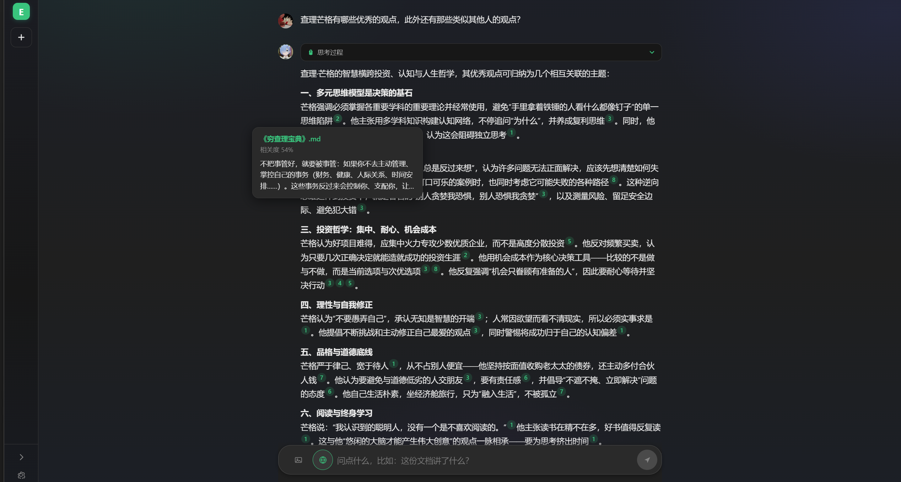
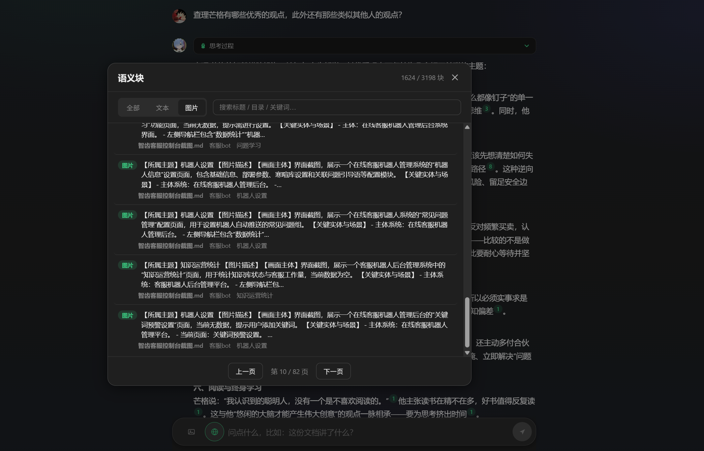
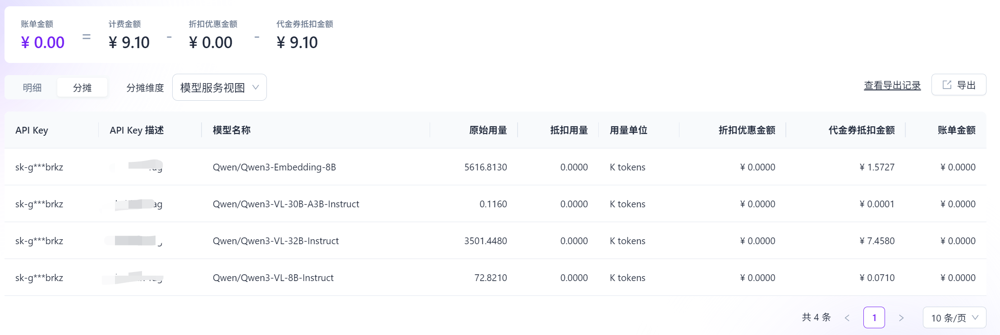
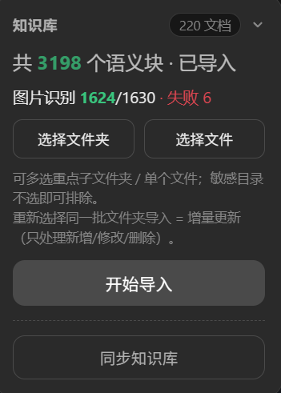

# Everything RAG — 个人知识第二大脑

**本地优先的 RAG（Retrieval-Augmented Generation）检索问答**：把本地 Markdown 文档（也可包含以 Markdown 导出的 AI 对话）统一切片和索引，用自然语言提问；有本地或联网依据时给出可追溯来源。知识文件与运行状态保存在本机，对话、嵌入、识图和联网搜索会按用户配置访问相应外部服务。


设计初衷是打造 RAG Agent， 支持 MCP, Skills, Web_Search 等常见功能，并对分块与召回有不错的效果，目前在一步步实现中 


## 功能特性

- **本地知识库管理**：导入本地 Markdown 目录/多级子目录，一键向量化，内容问答尽可能附来源引用。
- **增量同步**：通过指纹比对（mtime+size 快路径 + 内容哈希确认）区分 新增/更新/删除/未变，在未来修改源信息只需做增量同步，而不是全部重新分块导入。
- **视觉理解（图文入库）**：识图配置完整时，文档图片生成独立的检索摘要和详细证据。摘要与文件名、标题用于向量检索，表格行列、数值和流程关系保留在证据中，并参与关键词检索；同图跨文档复用识图缓存。
  - 图片使用更高分辨率识别，原图保存在本地缓存。涉及图片、表格或数值的问题，最多并行核对两张已召回图片，以本轮读图结果替换旧识别内容；失败会标明未核验。来源面板支持表格和“查看原图”。普通问题不额外调用识图模型。
  - v7 将图片摘要向量与证据分开保存。已有 v6 索引可在导入空闲时运行 `backend/.venv/Scripts/python scripts/migrate_image_index.py`：复用正文向量，仅重建图片向量；评测通过后加 `--promote` 更新索引清单。旧集合及状态备份保留。迁移复用历史描述，不会重新识别所有旧图片；旧原图在核对时按需缓存。重新识别和按需核对会产生配置供应商的识图调用费用。
- **面向 Markdown 的切块优化**：针对语雀/Obsidian 导出文档的常见问题专门打磨
- **混合检索 + 精准召回**：dense 向量 + BM25 词法（标题注入）+ RRF 融合 + 多级相关度门禁
- **联网搜索**：使用 Tailvy api 问答时可按需联网搜索
- **API配置灵活性**： 对话模型，嵌入模型，视图模型，联网搜索均可自定义配置

## 分块与检索优势

### Markdown 切块（针对不规范源文档）

| 手段 | 解决的问题 |
|---|---|
| 标题层级切块 + 短段合并 | 空行/截断导致的孤立碎句；步骤式文档跨图合并 |
| 表格语义化（表头→`字段：值`，rowspan 继承）| 合并单元格表格平铺成噪声 |
| 混合 HTML 清洗 + 代码保护 | 去掉 `<font>/<span>` 等展示标签和不可见脚本，同时保留代码围栏、行内代码、XML 与泛型 |
| `plain`/`text` 伪代码围栏按正文处理、缩进不误判代码 | 语雀导出把正文误判成代码 |
| 低信息噪声过滤（纯标签/URL/标点） | 减少 dense 噪声，同时保留定价、统计等数值表格 |
| 标题值保留 | URL、环境要求等只写在空子标题里的事实不再丢失 |
| 语义切块（相邻段 embedding 相似度骤降处切分）| 一标题塞多个话题的边界漂移 |
| 图片摘要索引 + 独立证据 + 按需原图核对 | 避免冗长 OCR 稀释语义，同时保留数字、表格与可追溯原图 |

### 检索召回

- **混合检索**：dense（Qwen3-Embedding-8B 云端嵌入）+ BM25 词法（bigram + 文件名/标题注入）+ RRF 融合。
- **多级相关度门禁**：基础门禁 0.60 + 词法救援 0.45（短缩写/标题命中）+ 纯 dense 加罚（无词法匹配的假阳性）+ 数值噪声加罚。
- **父子检索**：命中块展开到「同父节（上级标题）」上下文，并为真实父节补全保留一个上下文位置，替代整篇文档拖入。
- **实测精度（全新 v5 隔离索引）**：66 个严格块级正例（文件 basename + 完整标题 + 正文证据）中 **Hit@1 = 78.79%、Hit@5 = 96.97%、Hit@8 = 100%、MRR@8 = 85.85%**；10 个库外负例的上下文误放行率为 **0**。202/202 篇文档成功解析，2791/2791 个向量块通过 ANN 可达性检查。


##  实际效果







## 模型花费







api 费用账单如上所示，1630 张图片，使用 **Qwen/Qwen3-VL-32B-Instruct** 成本 7.46 元， 知识库约 **50 w** 字，chrunk 合计3198个，使用 **Qwen/Qwen3-Embedding-8B** 嵌入处理成本 1.5 元， 合计 9.1 元 人民币。 对话模型费用账单略


总之还是一个比较便宜的方案。


## 快速开始

### 1. 环境要求

| 依赖 | 版本 | 说明 |
|---|---|---|
| Python | 3.11+ | 后端 |
| Node | 18+ | 仅构建前端时需要 |

> 嵌入/识图均走云端 OpenAI 兼容 API，无需本地下载大模型。

### 2. 安装依赖

```bash
# 后端（Windows：backend\.venv\Scripts\python）
cd backend
python -m venv .venv
.venv/Scripts/pip install -e ".[dev]"

# 前端（可选，不构建也能启动——后端直接托管已有 dist/）
cd ../frontend
npm install
```

### 3. 配置模型（对话/嵌入必配，识图/搜索可选）

两种方式任选其一，推荐**设置页**（图形化，实时生效）：

- **方式 A（推荐）**：启动后在 Web 设置页填写「对话模型 / 嵌入模型 / 识图模型 / 联网搜索 / 回答偏好」。RAG 身份、grounding、防提示注入和引用规则由代码固定，页面不能覆盖。
- **方式 B（环境变量）**：复制模板 `backend/.env.example` → `backend/.env`，填写下表变量。

| 变量 | 必填 | 说明 |
|---|---|---|
| `EVERYTHING_RAG_CHAT_BASE_URL` / `_MODEL` / `_API_KEY` | ✅ | 对话模型（OpenAI 兼容端点） |
| `EVERYTHING_RAG_EMBED_BASE_URL` / `_MODEL` / `_API_KEY` | ✅ | 嵌入模型（OpenAI 兼容 `/embeddings`） |
| `EVERYTHING_RAG_SEARCH_API_KEY` | ✳ | 联网搜索（Tavily，可选） |
| `EVERYTHING_RAG_DATA_DIR` | ✳ | 数据目录，默认 `~/.everything-rag` |

。

### 4. 启动

```bash
# 回到仓库根目录
backend/.venv/Scripts/python scripts/run.py              # 固定 9999 端口 + 自动开浏览器
backend/.venv/Scripts/python scripts/run.py --no-browser # 自动化/CI 用（只打印端口）

# 或双击 EverythingRagStart.bat（Windows）
```

启动后：**设置页配好模型 → 导入 Markdown 目录 → 增量同步 → 开始问答**。

## 常用命令

```bash
# 命令行全量导入（与 UI 导入一致，含识图；图片描述后台补全）
backend/.venv/Scripts/python scripts/import_md.py --dir "<你的文档目录>"

# 后端测试（Windows）
cd backend && .venv/Scripts/python -m pytest

# 前端构建
cd frontend && npm run build

# E2E（Playwright 会启动隔离的前端测试服务）
cd frontend && npm test
```


## V1.2.0：Agent 编排与工作区隔离

V1.2.0 把问答链路从「单次检索 + 单次生成」升级为**受控的多 Agent 编排**，并把「数据不出本机、答案永远带来源」落到可验收的机制上。

- **工作区隔离**：每个工作区一份独立目录树（`documents/` / `chroma/` / `state.db` / `app.db` / `memory.json` / `checkpoints.db`），dense、BM25、章节补充、浏览、统计与图片/任务身份**只读本区**；跨区图片 hash 或任务 ID 一律 404。
- **Agent 编排（LangGraph）**：意图路由 → 计划（多任务）→ 并行研究 → 综合 → 核对 → 发布；研究子图有轮数与停滞上限，核对不通过时发布**带缺口的答案**而不是编造结论。
- **RunManager 与 SSE**：`POST /api/workspaces/{id}/runs` 建任务（**202**），`GET .../runs/{id}/events` 订阅 v2 事件（`schema_version=2`，20 类事件），支持 `after=` / `Last-Event-ID` 补读、取消与恢复；`POST /api/chat` 旧入口已下线（**410**，附替代路径）。
- **模型能力与工具协议**：按 `base_url + model` 解析能力（上下文/最大输出/工具/思考档），DeepSeek 官方 `deepseek-flash` 已入表；四档思考强度（关闭/轻度/深度/最高，**默认关闭思考**）映射到真实请求参数；多轮工具调用完整回传协议历史与 usage。
- **回答偏好**：设置页的回答偏好与自定义提示词（角色/语气/篇幅）**在 run 管线的每条写答案链路生效**（General Agent 通用回答 + 综合节点候选答案），进 `system` 职责提示；冲突时职责与不可变规则优先。
- **权限与批准**：三种权限模式（请求批准/自动批准/完全访问），联网工具执行前停顿并落批准卡片；重复批准幂等、参数或上下文变化后旧决定被拒（409）；非公开姓名在**真正出网前**脱敏。
- **工作区记忆**：`memory.json` 原子写入 + 乐观并发 + `operation_id` 幂等；快照在会话创建时冻结（会话 A 的快照不会因后续记忆更新而改变）；人工删除/纠正/关闭在下一次模型请求的上下文中生效；中文历史检索走 FTS5 + jieba。
- **前端工作流**：过程区域（折叠时间线 + 可展开研究任务）、批准卡片（允许本次/允许本轮同类/拒绝 + 编辑查询）、权限与思考菜单、记忆面板；断线/刷新按 `event_seq` 补读，答案片段先于完成事件。

验收与评测：`docs/tech/v1.2.0-acceptance-report.md`（A01–A32 逐条）、`v1.2.0-quality-report.md`（路由/答案质量）、`v1.2.0-migration-report.md`（迁移与保留/排除清单）。

**验证状态（2026-09-20 实测，只写数字）**

- 验收套件：`backend/tests/test_acceptance_v120.py`（A01–A32 + 检查点中断/恢复）+ `test_acceptance_t27_followups.py`（6 条端点级 + 3 条装配级）= **42 passed / 4 skipped(live) / 0 failed / 0 xfailed**。
- 回归：后端全量 `2 failed / 1719 passed / 86 skipped`（2 failed 恒为本机固定端口基线 `test_run_py.py`；86 skipped 全部是 live 闸：4 条 A 项 + 82 条真实索引召回门禁）；`ruff check app tests` 全绿；前端 `npm run build` 零错误 + Playwright **75 passed**。
- 路由评测 M1–M6 全达标（155 条 = 真实 87 + 构造 68，产物可复现）。
- **未达标/未执行（不粉饰）**：会话移动（A27）**后端端点级达标但真实前端路径未达标**（前端未发送 `confirm`/`expected_context_epoch`/`origin_run_id`，携带历史的会话在 UI 上会得到 409；另有拖拽用的旧移动入口绕过状态机）；live 四项（真实新闻、四档真实问答、真实多轮工具调用、真实数据迁移）与 PRD 16.4 答案质量/思考强度评测 **未执行**（等用户授权，见 `docs/tech/v1.2.0-live-eval-plan.md`）。启用方式：`EVERYTHING_RAG_LIVE_EVAL=1`（A 档）/ `EVERYTHING_RAG_RUN_LIVE_EVAL=1`（真实索引召回门禁）。

## 未来功能

* mcp ，skills 支持
* 支持多来源
* 更准确的分块策略
* ........
