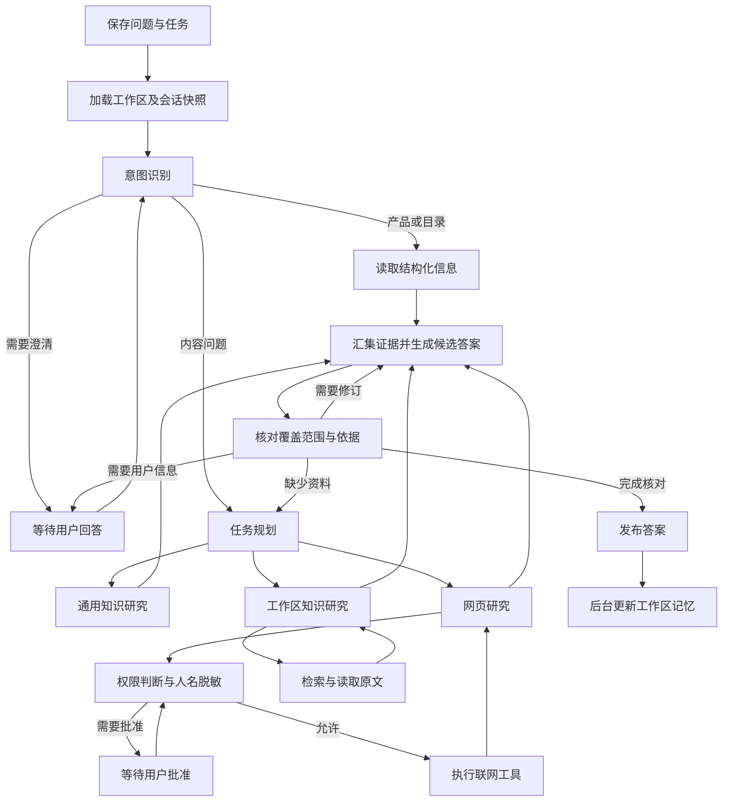
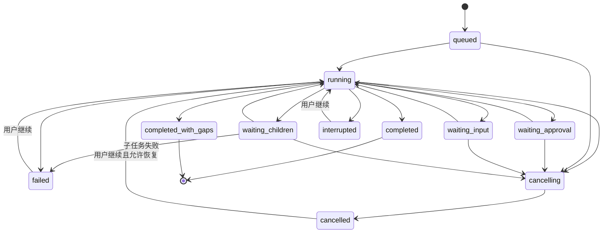

# Everything RAG V1.2.0 产品需求与技术实现方案

| 项目 | 内容 |
|---|---|
| 版本 | V1.2.0 |
| 需求状态 | 已完成需求访谈与用户确认 |
| 技术状态 | 已完成代码与官方资料调研，等待开发和真实环境验收 |
| 开发基础 | 当前 V1.1.0 开发工作区，包含已经添加的工作区功能 |
| 调研日期 | 2026-09-19 |
| 目标模型 | DeepSeek V4.1 Flash，当前配置为 `deepseek-flash`，端点为 `api.deepseek.com` |
| 交付形态 | 本地 Web 应用，Python / FastAPI 后端，React / TypeScript 前端 |

## 1. 产品目标与需求范围

### 1.1 用户需要完成的事情

用户能够在工作、生活等独立工作区中提问。系统理解当前问题及对话背景，选择通用回答、知识库、网页、历史讨论或项目统计作为资料来源。复杂问题由多个 Agent 分工查询，针对证据缺口继续调查，完成依据核对后输出答案。

回答质量是主要目标。系统允许长时间执行和多轮工具调用。用户能够查看处理进度、批准待执行操作、补充信息、停止任务，并在中断后继续。

### 1.2 需求编号

| 编号 | 功能要求 | 重要性 |
|---|---|---|
| R01 | 根据问题、必要上下文及工作区资料识别意图，选择一个或多个信息来源 | 必须 |
| R02 | 内部术语、内部方案和用户历史资料问题能够进入知识或记忆查询 | 必须 |
| R03 | 普通问答、最新新闻、产品帮助、知识概览具有对应处理路径 | 必须 |
| R04 | 对复杂问题生成子问题、依赖关系和完成条件，按需并行处理 | 必须 |
| R05 | 资料不足时调整查询、读取关联原文或进行联网补充 | 必须 |
| R06 | 检查问题覆盖、结论依据、数字单位、引用、版本和来源冲突 | 必须 |
| R07 | 工作区隔离知识库、记忆、历史搜索、统计、图片及内容缓存 | 必须 |
| R08 | 工作区持久记忆保存讨论主题、讨论进展和用户明确表达的回答要求 | 必须 |
| R09 | 会话开始固定记忆快照；自动更新供新会话使用；人工纠正立即生效 | 必须 |
| R10 | 提供请求批准、自动批准、完全访问权限，默认请求批准 | 必须 |
| R11 | 对联网内容中的非公开个人姓名脱敏，公开人物姓名保留 | 必须 |
| R12 | 提供关闭、轻度、深度、最高四个思考选项，默认深度思考 | 必须 |
| R13 | 处理过程可见，批准和澄清可恢复，正式答案通过核对后展示 | 必须 |
| R14 | 取消任务总时间限制；用户可停止；错误和资料不足具有准确状态 | 必须 |
| R15 | 会话移动携带已有历史，后续检索和记忆快照使用目标工作区 | 必须 |
| R16 | 影响答案的歧义无法通过资料消除时，向用户提出澄清问题 | 纳入本版，开发顺序位于核心查询之后 |

### 1.3 功能边界

本版 Agent 的动作包括知识查询、原文读取、网页搜索与读取、历史讨论查询、资料核对和记忆维护。记忆服务于问答，内容保持简短、可查看、可修改、可删除。

工作区之间独立管理资料。设置页面提供工作区选择和资料管理入口。会话使用所属工作区的知识范围。跨工作区携带内容通过用户明确执行的会话移动或资料导入完成。

模型服务配置、搜索服务凭证、主题和应用健康信息属于应用设置。权限与思考强度具有工作区默认值和会话保存值。

## 2. 使用场景与完成标准

| 场景 | 处理要求 | 用户看到的结果 |
|---|---|---|
| 今天 AI 圈有哪些重大新闻 | 识别时效要求，联网查询，核对事件日期和原始发布来源 | 按当前日期整理新闻，附来源和必要时间说明 |
| 我记得以前有一个这样的方案 | 结合上下文补全线索，查询当前工作区文档及相关历史讨论 | 找到对应方案并说明匹配依据，支持打开原文 |
| 我正在设计登录流程，有什么思路 | 查询已有内部方案；通用 Agent 研究设计原则；需要最新资料时联网 | 区分已有条件、通用建议和需要用户决定的事项 |
| 风控服务中 99 分位如何优化、有什么意义 | 必须查询工作区资料，识别指标定义与服务背景，必要时补充公开原理 | 内部实现具有原文依据，公开解释帮助理解 |
| Python 装饰器是什么 | 独立通用问题可直接回答；涉及笔记或项目时增加知识查询 | 清楚解释概念，引用与实际使用的来源一致 |
| 这是一个什么项目 | 读取产品能力说明 | 根据当前功能说明回答 |
| 当前知识库有哪些文档、多少篇 | 读取当前工作区的文档登记与索引统计 | 文件数量、主题和索引状态准确，区分文档与切片 |
| 用户输入多个相互关联的问题 | 建立子问题和依赖关系，分别收集材料后统一回答 | 用户提出的各项要求得到逐项处理 |
| 上次讨论到哪里了 | 读取本会话快照，需要详细信息时查询工作区历史 | 说明讨论主题、确认内容和待处理问题，并能回到来源会话 |
| 内部文档与网页结论不同 | 检查版本、适用条件和讨论对象，继续查询关键差异 | 说明差异及依据；无法确认的部分明确标记 |

单份资料出现相关关键词，只能证明它值得检查。结论是否得到支持，需要核对原文与用户问题的关系。

## 3. 当前代码基础

以下为调研日期的代码事实，用于确定开发入口。

| 现有能力 | 代码位置 | 本版接入位置 |
|---|---|---|
| 产品帮助、知识概览和内容问答分类 | [prompt_policy.py](../../backend/app/generation/prompt_policy.py) | 路由与产品说明节点 |
| dense、BM25、RRF、相关性过滤、章节内容补充 | [hybrid_retriever.py](../../backend/app/retrieval/hybrid_retriever.py) | `search_knowledge` 工具 |
| OpenAI 兼容模型流式调用及推理内容读取 | [providers.py](../../backend/app/generation/providers.py) | 模型能力适配和工具调用协议 |
| 问答执行与来源生成 | [chat_service.py](../../backend/app/generation/chat_service.py) | Agent 编排与答案发布 |
| Tavily 搜索 | [tavily.py](../../backend/app/search/tavily.py) | Web Agent 的搜索和网页读取 |
| 记忆模型、SQLite 存储、提炼器、独立召回接口 | [memory](../../backend/app/memory/) | 工作区记忆迁移及提炼规则参考 |
| 会话及工作区管理 | [conversation_store.py](../../backend/app/core/conversation_store.py)、[workspace_store.py](../../backend/app/core/workspace_store.py) | 会话状态、归属及默认设置 |
| SSE 前端和聊天界面 | [sse.ts](../../frontend/src/api/sse.ts)、[Chat.tsx](../../frontend/src/components/Chat.tsx) | 任务订阅、过程区域、批准卡片 |
| 真实语料检索和答案评测 | [eval_rag_quality.py](../../scripts/eval_rag_quality.py)、[run_answer_bench.py](../../benchmark/run_answer_bench.py) | 本版回归与端到端质量评测 |

当前正常问答入口尚未创建并传入 `memory_retriever`。历史消息最多取最近 12 条，分类和查询变体只读取本轮问题。当前 Provider 读取正文及 `reasoning_content`，尚未处理 `tool_calls` 和完整任务恢复。这些接入属于 R01、R04、R08、R13 的开发内容。

## 4. 技术选型与运行结构

### 4.1 采用的组件

| 职责 | 选择 | 使用方式 |
|---|---|---|
| Agent 节点与循环编排 | LangGraph `StateGraph` | 条件跳转、工具循环、批准暂停和执行恢复 |
| 执行位置持久化 | `AsyncSqliteSaver` | 每工作区独立 checkpoint 数据库，`durability="sync"` |
| 业务状态 | SQLite / `aiosqlite` | 会话、任务、批准、事件和最终答案的事务写入 |
| 结构化数据校验 | Pydantic | 路由、任务计划、工具参数、记忆与核对结果 |
| 模型访问 | 现有 `OpenAICompatChatModel` | 增加完整响应对象和 DeepSeek 能力适配，统一出网审计 |
| 知识检索 | 现有 Chroma + `HybridRetriever` | 每工作区独立存储和实例 |
| 网页资料 | 现有 Tavily Provider 扩展 Search / Extract | 保留 HTTP 和审计入口，提供结构化来源 |
| 工作区记忆 | 本地 `memory.json` | 标准 JSON、Pydantic 校验、版本控制及原子文件替换 |
| 历史检索 | SQLite FTS5 + `jieba` 中文分词 | 分词后建立倒排索引，原始消息独立保存 |
| 请求 token 计算 | 官方 `deepseek-recipe` 与匹配 tokenizer | 编码完整请求，服务端 usage 用于核对实际用量 |
| 浏览器进度订阅 | 原生 `EventSource` | GET SSE、事件编号和断线补读 |

LangGraph 的节点可调用现有模型客户端，并通过自定义事件报告进度。采用它处理持久执行和暂停恢复，现有检索与 Provider 保持独立模块。[LangGraph Streaming](https://docs.langchain.com/oss/python/langgraph/streaming)、[Persistence](https://docs.langchain.com/oss/python/langgraph/persistence)

调研确认的编排依赖基准为 `langgraph==1.2.11`、`langgraph-checkpoint-sqlite==3.1.1`、`aiosqlite==0.22.1`。LangGraph 会引入 `langchain-core` 等传递依赖。开发时使用依赖解析器生成锁文件并验证 Python 3.11 环境；其他新增依赖同步固定版本和许可信息。[LangGraph 包](https://pypi.org/project/langgraph/)、[SQLite checkpoint 包](https://pypi.org/project/langgraph-checkpoint-sqlite/)

### 4.2 Agent 职责

| Agent / 节点 | 输入 | 输出与完成条件 |
|---|---|---|
| Intent Agent | 问题、必要历史、工作区快照、目录和术语线索 | `RouteDecision`，明确来源需求及是否需要澄清 |
| Planner Agent | 已理解的问题与来源需求 | 子任务、依赖、覆盖的用户要求、完成标准 |
| General Agent | 需要解释的公开概念或设计问题 | 通用解释、建议、假设和需要外部核实的事实 |
| RAG Agent | 子问题、当前工作区、关联资料线索 | 原文证据、适用条件、未解决问题 |
| Web Agent | 查询目标、时间范围和批准状态 | 网页原文证据、来源日期、仍未解决的问题 |
| Synthesis Agent | 全部子任务结果及证据 | 候选答案、关键结论与证据映射 |
| Verifier Agent | 用户要求、候选答案、实际证据 | 通过、修订、继续查询或澄清建议 |
| Approval Reviewer | 已脱敏工具参数和本轮目标 | 自动批准结果或需要用户决定的原因 |
| Memory Extractor | 本产品已完成的对话及明确用户表达 | 简短记忆更新，附来源消息 |

各 Agent 是独立职责与上下文边界，默认使用同一个已配置模型。目录统计、工作区校验、批准写入和事件记录由程序完成。

### 4.3 问答流程

图中的研究分支按任务计划创建。每次继续查询必须指出尚未解决的问题、准备执行的动作和该动作能增加的证据。

## 5. 工作区知识隔离

### 5.1 身份与目录

保留已有工作区 ID。新增工作区使用稳定 UUID；显示名称可修改。每个工作区拥有服务端生成的 `storage_key`，文件路径由它构建。客户端只能提交工作区 ID，后端验证归属后解析目录。

| 路径 | 内容 |
|---|---|
| `data_dir/app.db` | 工作区、会话、消息、任务、批准、事件、历史检索和最终答案 |
| `data_dir/config.json` | 应用级 Provider 和界面配置 |
| `data_dir/workspaces/<storage_key>/documents/` | 本工作区上传资料 |
| `data_dir/workspaces/<storage_key>/state.db` | 文档登记、同步目录与指纹 |
| `data_dir/workspaces/<storage_key>/image_state.db` | 图片任务、识别结果与图片数据 |
| `data_dir/workspaces/<storage_key>/chroma/` | 本区全部嵌入模型与入库版本的 collection |
| `data_dir/workspaces/<storage_key>/memory.json` | 本区当前记忆及提炼进度 |
| `data_dir/workspaces/<storage_key>/checkpoints.db` | 本区 Agent 执行位置 |
| `data_dir/workspaces/<storage_key>/artifacts/` | 本区任务获得的网页正文及证据材料 |

### 5.2 `WorkspaceContext`

后端根据请求中的 `workspace_id` 创建不可变的 `WorkspaceContext`，包含身份、目录、当前知识版本、服务实例和工作区默认设置。模型工具参数中省略可自由指定的 `workspace_id`；工具执行器从已经绑定的上下文取得它。

`WorkspaceContext` 必须覆盖：上传、目录导入、同步、文档删除、向量召回、BM25、章节内容补充、目录统计、原图读取、图片任务、记忆、历史搜索、任务事件和引用读取。

每个后台任务保存创建时的 `workspace_id`。用户切换界面工作区后，已经运行的任务继续使用原来的上下文。

### 5.3 存储与缓存范围

1. 每工作区独立 Chroma `PersistentClient` 路径，collection 保留现有嵌入指纹和入库版本命名。
2. BM25 和章节索引只能从本区 collection 构建。
3. 向量句柄缓存键包含 `workspace_id`、Provider 配置摘要和 collection 身份。
4. BM25、目录与术语缓存键包含 `workspace_id`、`knowledge_revision`、索引指纹和生成器版本。
5. 图片缓存和历史 collection 扫描限定在本区数据目录；原图 API 同时验证工作区和图片身份。
6. 导入、同步、删除提交成功后增加本区 `knowledge_revision`。下一次工具调用使用更新后的版本；最终发布前重新检查已删除或被替换的证据。
7. 全局应用设置可以共享。内容缓存不能仅以问题文本、URL、文件名或图片 hash 作为全局键。

### 5.4 管理与移动

设置页面选择工作区后，展示本区文件、切片、图片、来源目录、同步状态和记忆。知识概览分别报告已登记文档数、已索引文档数、切片数及失败任务数。

移动会话需要展示会携带历史内容的说明。完成移动时：保留历史消息；读取目标工作区的记忆快照；增加 `context_epoch`；后续检索使用目标工作区；历史引用继续保存原来的来源工作区。历史引用允许展示已经保存在消息中的片段，Agent 新的原文读取只访问目标工作区。

运行中会话的移动在用户确认后停止主任务及其子任务，等待活动请求退出，将原 run 标记为 `cancelled`，保存 `stop_reason=conversation_moved`、`resumable=false`，原批准与澄清请求转为 `superseded`。原 run 的工作区归属保持不变，只提供历史查看。目标工作区继续当前问题时创建新的 run、thread 和 checkpoint，保存 `origin_run_id`，重新绑定权限、目标区快照和资料范围；原区未发布的研究结果不进入新执行。后台记忆更新提交前再次核对会话归属和 `context_epoch`。

删除工作区采用可恢复的归档处理：停止本区运行任务，归档会话，停用知识与记忆，保留归属信息。默认工作区保留。清空知识操作只清除选中工作区的知识数据，并保留对话中已有的引用片段及失效标识。

## 6. 意图识别与任务规划

### 6.1 路由输入

Intent Agent 接收当前问题、当前日期及用户时区、必要的最近历史、本会话固定记忆快照、当前工作区主题概览，以及通过目录查询得到的相关术语和文件线索。

知识目录在导入、同步、删除后更新，包含全部文档的标题、标题层级、主题、术语及来源 ID。查询接口支持精确词、别名和全文检索。提示中只加入与本轮相关的目录结果，完整目录保存在本地。

内部术语条目必须附实际文档位置。缺少明确解释的术语标记为 `definition_unknown`。可用模型提取文档中的术语与别名，程序检查其引用片段确实存在；目录信息只用于寻找原文。

### 6.2 `RouteDecision`

| 字段 | 类型 | 含义 |
|---|---|---|
| `question` | string | 保留原问题 |
| `resolved_question` | string | 根据历史补全指代后的问题 |
| `intent` | enum | `general` / `research` / `product` / `catalog` / `memory` / `clarification` |
| `needs_knowledge` | boolean | 是否需要本工作区资料 |
| `needs_web` | boolean | 是否需要公开且可核实的信息 |
| `needs_history` | boolean | 是否需要历史讨论 |
| `needs_general` | boolean | 是否需要通用解释或设计建议 |
| `freshness` | enum | `none` / `current` / `date_range` |
| `entities` | array | 关键对象、术语、版本和时间表达 |
| `scope_evidence_ids` | array | 支持内部归属判断的目录或原文 ID |
| `unresolved_terms` | array | 需要补充确认的术语 |
| `reason_summary` | string | 用户可以理解的简短路径说明 |

`needs_knowledge` 和 `needs_web` 可以同时为真。模型自报置信度只用于诊断，路由验收依据人工标注的真实问题。

### 6.3 决策规则

| 条件 | 处理要求 |
|---|---|
| 用户明确引用笔记、内部文档、既有方案或当前项目 | 查询知识库 |
| 对话已围绕某内部资料展开，用户继续追问 | 使用历史补全对象并继续知识查询 |
| 内部术语目录命中，且问题涉及其在本系统中的定义或实现 | 查询对应原文 |
| 术语含义不明确，可能指内部对象 | 进行范围检查，确认目录和候选原文后决定路径 |
| 用户明确要求今天、最新、当前版本等信息 | 联网查询并检查时间 |
| 通用解释同时涉及已有内部方案 | General Agent 与 RAG Agent 分工，统一整理 |
| 仅询问产品功能或文档数量 | 使用产品说明或结构化统计 |
| 用户回忆以前的讨论 | 查询工作区记忆和历史记录，必要时关联文档 |
| 知识库为空 | 通用和网页问题仍可处理；内部资料问题说明当前资料情况 |

路由结果可在研究过程中调整。发现新的内部术语、版本约束或时效要求后，Planner 更新来源需求。工具始终遵守工作区范围和权限。

### 6.4 复杂问题计划

每个 `ResearchTask` 保存 `task_id`、`parent_task_id`、`question`、`requirement_ids`、`agent_kind`、`depends_on`、`expected_evidence`、`status` 和 `result_ref`。

是否创建多个任务根据问题中的独立目标、证据来源和依赖判断。输入长度用于提示检查完整性。较长输入必须提取全部用户要求，保留原文，并将每项要求映射到至少一个任务。

相互独立的查询并行执行。有依赖的查询在前置结果完成后启动。相同工作区、相同知识版本、相同查询目标的重复任务复用已有结果。依赖环、缺失任务 ID 和无来源的完成声明由 Pydantic 与程序检查拒绝。

默认每个任务同时运行最多 3 个研究 Agent，应用同时执行最多 4 个模型请求，均可配置。这些参数管理并发资源，任务总时长和总查询次数根据完成情况决定。

## 7. 工具与研究循环

### 7.1 工具定义

| 工具 | 主要参数 | 返回内容 |
|---|---|---|
| `lookup_catalog` | `query`、`cursor` | 本工作区文档、术语、标题及来源位置 |
| `get_workspace_overview` | 统计类别 | 已登记、已索引文档数、主题、图片和任务状态 |
| `search_knowledge` | `query`、可选文档范围、候选数量 | 相关片段、分数、来源 ID、知识版本 |
| `read_document` | `document_id`、章节或内容位置 | 指定原文、上下文、文档版本及可继续读取的位置 |
| `search_history` | `query`、时间范围、`cursor` | 本工作区实际会话消息及来源 |
| `read_history` | `conversation_id`、消息位置 | 命中位置前后的历史消息 |
| `web_search` | `query`、日期范围、来源范围 | 网页线索、摘要、URL、日期、搜索请求 ID |
| `read_web_page` | URL 列表 | 网页正文或逐项读取错误、来源和内容 hash |
| `verify_image` | 本区图片 ID、具体问题 | 原图核对结果和来源 |
| `ask_user` | 问题、必要选项和原因 | 用户提交的结构化回答 |

内部工具由 `ToolRegistry` 注册，记录 Pydantic 参数类型、处理函数、是否联网和允许使用的 Agent。使用标准 JSON 解析工具参数，校验完成后执行。工具说明明确参数含义、返回状态和来源范围。

权限由执行器校验。完整访问权限仍然使用已经注册的工具和当前工作区。网页正文及知识原文作为参考数据进入模型上下文，其中的文字不能修改工具权限或系统规则。

### 7.2 RAG Agent 循环

1. 根据子问题和历史指代生成检索查询，同时保留原问题和内部术语。
2. 调用现有混合检索，按当前查询评价片段相关性。
3. 对定义、数值、边界条件和方案结论读取对应章节或关联原文。
4. 记录证据能够回答的子问题及仍缺少的内容。
5. 缺少内部定义时继续本地查询；需要公开原理、最新版本或外部方法时向 Planner 提出 Web 子任务。
6. 返回证据、结论、限制条件和未解决问题。

检索默认使用现有线上相关性配置和 `context_top_k=8` 作为每次查询的起点。后续查询、章节读取及证据合并由 Agent 完成。查询结果为空、资料无关、服务错误分别返回准确状态。

### 7.3 Web Agent 与网页原文

Tavily Search 使用 `topic`、`start_date/end_date`、`include_published_date` 等参数表达搜索需求。复杂技术查询和新闻调查默认 `search_depth=advanced`、`include_answer=false`。原文读取使用 Extract，`format=markdown`、`extract_depth=advanced`；需要整页内容时省略 `query`，保留实际返回正文。Search 与 Extract 使用现有 `httpx` 和出网审计，不要求经过框架提供的网络客户端。[Tavily Search](https://docs.tavily.com/documentation/api-reference/endpoint/search)、[Tavily Extract](https://docs.tavily.com/documentation/api-reference/endpoint/extract)

应用自行管理批准和人名脱敏。批准绑定实际查询、URL、日期和域名参数。Extract 结果按 URL 关联，检查 `results` 与 `failed_results`。HTTP 成功不能替代逐项内容检查。

网页证据保存 `url`、`final_url`（服务提供时）、`title`、`published_at`、`retrieved_at`、`content_hash`、`artifact_id` 和读取范围。缺失的来源字段保存为空，日期含义由原文确认。

“今天新闻”按用户时区计算本地日期范围，搜索后检查原始发布内容和事件发生时间。网页更新时间不能直接充当事件时间。报道转述同一新闻时合并来源关系，独立来源数量按实际原始发布者计算。

网页过长时将完整提取结果保存为任务资料，Agent 分批读取并记录位置。提供商返回部分内容时标记 `content_complete=false`，核对环节据此判断可支持的结论范围。

### 7.4 循环完成条件

每次研究更新 `requirement_coverage`、`evidence_ids`、`open_questions`、`conflicts`、`next_action` 和 `expected_gain`。

满足以下条件可以进入最终核对：用户要求已得到覆盖；关键事实具有来源或已明确标记资料缺口；版本和数字等重要差异已经处理；没有需要继续确认的关键歧义。

同一问题、同一参数、同一资料版本的查询复用已保存结果。新查询需要说明新的对象、资料范围或待验证假设。持续获得相同资料且没有可执行的新线索时，以资料不足结束并说明未解决部分。

本版不设置任务总时长和业务搜索轮数上限。网络请求保留连接与读取超时，模型请求遵守服务商上下文及输出上限。工具错误在发生位置抛出，由任务管理层记录失败和可继续位置。SDK 隐式重试关闭；用户选择继续后才重试失败操作。

LangGraph 自身存在 `recursion_limit`，当前默认值为 1000 个 super-step。它属于运行保护，触发时任务保存为可继续的错误状态，不能视为研究完成。工作流不把该值解释成搜索轮数。[LangGraph Graph API](https://docs.langchain.com/oss/python/langgraph/graph-api)

## 8. 答案组织与依据核对

### 8.1 证据对象

`Evidence` 至少包含：`evidence_id`、`workspace_id`、`run_id`、`task_id`、`source_type`、`source_ref`、`content`、`content_hash`、`document_revision`、`retrieved_at`、`supported_requirements` 和 `limitations`。

来源类型为 `knowledge`、`web`、`memory`、`history`、`catalog`、`product`。General Agent 返回的解释或建议标记为 `general_knowledge` 或 `proposal`，不能生成文档引用编号。

网页和知识证据根据来源身份、版本和内容 hash 去重。原文作为权威材料保留；子 Agent 摘要同时携带证据 ID，整理和核对节点可以读取原文。

### 8.2 核对内容

| 检查 | 判定依据 | 处理 |
|---|---|---|
| 问题覆盖 | 每项用户要求对应回答内容或明确资料缺口 | 补充研究或修订 |
| 事实支持 | 关键陈述能够由引用原文支持 | 查询原文、删除无依据陈述或说明不确定性 |
| 数字与单位 | 数值、单位、分母、时间范围和测试条件一致 | 修订并重新核对 |
| 版本与范围 | 资料版本、服务对象和适用环境对应用户问题 | 阅读关联资料或并列说明差异 |
| 来源冲突 | 比较原始来源、时间和适用条件 | 继续查询，保留无法确定的冲突 |
| 内部事实 | 公司定义、现有实现、既定方案具有本区资料依据 | 公共建议单独表述 |
| 引用有效性 | 来源 ID 存在且片段支持引用位置的陈述 | 修订引用或答案 |
| 资料状态 | 发布前知识与记忆仍可使用 | 撤销失效证据并重新核对 |

Verifier 返回 `verdict=pass/revise/research/clarify/insufficient`，同时返回具体 `issues`，每项含受影响的用户要求、陈述位置、证据 ID 和建议动作。程序检查引用身份、字段、数字格式及要求覆盖；模型判断语义支持。模型评分以真实样例和人工审阅校验。

### 8.3 发布规则

核对通过的候选答案保存为 `AnswerArtifact`，包含正文、来源映射、核对记录和版本。正式正文从该对象直接发送到前端；发布阶段逐段展示已经核实的文本。

正文引用使用稳定的 `[S1]`、`[W1]`、`[M1]`、`[H1]`，分别对应知识、网页、记忆和历史。编号在最终候选答案形成时分配，重用同一来源不会重新编号。

`answer_basis` 扩展为 `knowledge/web/general/product/catalog/memory/history/mixed/insufficient`；同时保存 `basis_components`，准确表达多种来源。历史消息中的现有取值继续正常展示。

资料不足的回答使用 `completed_with_gaps`，展示已核实内容、缺少的依据和对结论的影响。模型或工具运行错误使用 `failed`，保留已经完成的研究记录，提供继续入口。

## 9. 思考强度与模型接入

### 9.1 档位

| `reasoning_level` | 界面名称 | DeepSeek 请求 | 调查要求 |
|---|---|---|---|
| `off` | 关闭思考 | `thinking.type=disabled`，省略 `reasoning_effort` | 按问题需要使用工具，保持依据检查 |
| `low` | 轻度思考 | `thinking.type=enabled`，`reasoning_effort=low` | 集中处理主要证据缺口 |
| `high` | 深度思考 | `thinking.type=enabled`，`reasoning_effort=high` | 检查子问题、条件和来源差异 |
| `max` | 最高强度 | `thinking.type=enabled`，`reasoning_effort=max` | 对关键争议寻找独立依据，深入核对限制条件 |

默认 `high`。会话保存选择，新会话继承工作区默认值。用户修改强度后从下一次模型请求起生效；已经开始的请求保留原参数，过程记录展示实际强度。全部职责默认继承用户选择，程序化统计和校验没有模型推理参数。

DeepSeek 官方 API 支持 `low/high/max` 三个实际强度，思考默认开启。兼容名称存在合并映射，因此使用原生档位。OpenAI SDK 中 `thinking` 放入 `extra_body`。档位控制推理投入，实际推理 token 数量由模型和问题共同决定。[DeepSeek 思考模式](https://api-docs.deepseek.com/guides/thinking_mode/)

最高强度也在证据足够时结束。各档位的质量要求一致，调查策略决定投入程度；没有为了满足次数要求而重复搜索的行为。

### 9.2 Provider 能力

新增 `ModelCapabilities`，记录 `supports_tools`、`supports_thinking_toggle`、`reasoning_levels`、`supports_image_input`、`context_limit`、`max_output_tokens` 和 `history_protocol`。

当前官方 `deepseek-flash` 使用 DeepSeek 专用适配参数。其他 OpenAI 兼容端点需要声明并验证能力，界面只显示可用选项。Provider 不支持所选功能时返回明确配置错误。

完整模型响应保存 `content`、`reasoning_content`、`tool_calls`、`finish_reason`、`usage` 和提供商请求 ID。流式工具参数按调用 `index` 汇集，完整 JSON 到达并通过校验后执行。

带 `tools` 的 DeepSeek 会话需要保留并回传此前 assistant 消息中的完整 `reasoning_content`，包括没有调用工具的轮次。每个工具结果使用对应的 `tool_call_id`。独立子 Agent 建立自己的模型上下文；传入历史摘要时将其作为参考数据，不制造未发生的 assistant 工具调用。[DeepSeek Tool Calls](https://api-docs.deepseek.com/guides/tool_calls/)

模型返回 `tool_calls` 时继续执行工具；返回正常结束时进入答案或子任务结果处理。`length`、`aborted` 等结束原因保存准确状态，未完整生成的内容不能直接标记为成功答案。[Chat Completions](https://api-docs.deepseek.com/zh-cn/api/create-chat-completion/)

### 9.3 上下文与缓存

每个 Agent 的输入顺序为稳定职责提示、稳定工具定义、工作区与会话固定快照、当前上下文段的历史、最新问题或工具结果。动态时间、知识检索结果和批准结果追加在动态部分。

复用模型上下文时完整保留工具调用和结果组。需要压缩时，等待本组工具结果完整返回，再增加该 Agent 的 `agent_context_epoch`，携带用户目标、已核实结论、关键证据位置、未解决问题和当前权限。完整历史与原文保存在本地，Agent 可以按需读取。工作区记忆快照继续使用当前会话版本，人工失效操作除外。单个 Agent 的压缩不改变会话级 `context_epoch`，其他 Agent 继续使用各自有效上下文。

当前模型的本地请求计数采用官方 `deepseek-recipe`，固定软件版本、tokenizer 版本和文件 SHA-256。将完整 Chat Completions 请求转换为官方消息格式后计算 token ID 数量，包含 `tools` 和要求保留的推理内容。服务端 `usage.prompt_tokens` 是实际用量，本地编码结果需要通过真实请求核验。[DeepSeek 官方 tokenizer 说明](https://github.com/deepseek-ai/deepseek-recipe/blob/main/docs/tokenizer.md)

请求提交条件为 `local_prompt_tokens + reserved_output_tokens + protocol_margin <= provider_context_limit`。默认在可用输入空间达到 80% 时安排上下文整理，剩余空间保留给完整工具结果和输出。超长原文按可追溯位置分批读取。输出空间包括推理和最终正文，按模型实际能力配置。

记录每次调用的输入、输出、推理 token，以及 `prompt_cache_hit_tokens`、`prompt_cache_miss_tokens`。固定快照保证对应文本稳定；服务端缓存具有创建和过期规则，验收分别检查文本稳定性与实际命中。[DeepSeek Context Caching](https://api-docs.deepseek.com/guides/kv_cache/)

## 10. 权限、批准与人名脱敏

### 10.1 权限模式

| `permission_mode` | 名称 | 行为 |
|---|---|---|
| `ask` | 请求批准 | 联网搜索及网页读取执行前暂停，等待用户批准 |
| `auto` | 自动批准 | 审核节点确认操作符合当前问题时批准；无法确定时请求用户决定 |
| `full` | 完全访问权限 | 自动执行已配置问答工具，省去逐次批准审核 |

所有模式执行人名脱敏并遵守工作区范围。本地查询及已经开启的记忆维护自动执行。现有模型和嵌入服务使用已配置连接；此按钮管理 Agent 的联网工具动作。

默认 `ask`。会话保存权限，工作区设置用于新会话默认值。运行期间修改权限后，在下一次工具执行前重新检查；待批准操作根据新权限重新评价，结果作为事件保存。

### 10.2 批准卡片

卡片展示操作目的、工具名称、将发送的查询或 URL、日期范围、所属子任务及人名脱敏提示。按钮为“允许本次”“允许本轮同类操作”“拒绝”，并提供编辑查询内容的入口。

“本轮同类操作”明确限定当前 `run_id`、工具类别、用户问题范围和批准时的规则版本。它不自动改变会话默认权限。修改后的参数经过校验和脱敏，再保存为批准对象。

`ApprovalRequest` 保存 `approval_id`、`run_id`、`task_id`、`interrupt_id`、`operation_id`、`args_hash`、`context_epoch`、规则版本、显示内容、状态和用户决定。状态为 `pending/approved/denied/superseded`。

批准提交使用事务从 `pending` 转为目标状态。重复提交相同决定返回现有结果；冲突决定返回 409。执行前再次比较参数 hash、工作区、上下文版本和授权范围。用户拒绝后继续处理允许的资料，拒绝记录随任务保留。

### 10.3 暂停与恢复

批准请求在前置节点保存，独立批准节点调用 `interrupt()`。该节点只读取已保存的请求并等待选择。用户提交后使用原图身份和 `Command(resume=...)` 恢复。

LangGraph 恢复时会重新执行发生 interrupt 的节点，因此模型调用和外部工具操作必须放在各自独立节点。稳定的 `operation_id` 和结果记录用于复用已经成功的操作。[LangGraph Interrupts](https://docs.langchain.com/oss/python/langgraph/interrupts)

等待用户期间停止对应 Agent 的模型调用，页面保持批准卡片和状态订阅。其他独立子任务可以继续处理。用户批准、拒绝或修改方案后，任务从对应位置继续。

### 10.4 人名脱敏

脱敏对象是联网查询、发送给网页服务的内容及相关 URL 参数中的非公开个人姓名，包括用户、同事和内部资料中的姓名。公开人物保留姓名。内部技术名词、公司名称和方案内容按用户确认的权限规则使用。

脱敏节点使用结构化实体提取，将姓名、别名、原文位置和是否为公开人物返回给程序。程序验证原文位置后替换为稳定称谓，例如“人员 A”，保留角色和关系。公开人物依据用户明确查询对象、公开来源或可确认的公共身份识别；无法确定时按非公开姓名处理。

应用保存原始查询与实际联网查询的对应关系，实际发送内容通过姓名检查。URL 路径中包含非公开姓名且无法保持有效地址时，改用已经脱敏的搜索目标寻找公开来源，并记录未执行该 URL 的原因。

人名脱敏在本地资料保存与展示之外执行。用户自己的原文、聊天和原始知识索引保持原内容。发送给已经配置的模型服务仍遵守原有连接配置。

## 11. 工作区记忆

### 11.1 内容与来源

| `kind` | 内容 | 保存依据 |
|---|---|---|
| `response_preference` | 用户明确表达的语言、长度、举例等要求 | 用户原话 |
| `topic` | 最近讨论的主题、相关对象和时间 | 本产品真实问题 |
| `progress` | 已讨论内容、当前进度及待处理问题 | 可追溯的会话消息 |
| `confirmed_conclusion` | 用户明确认可的结论或决定 | 用户确认消息及对应内容 |

自动提炼不把一次提问变成用户个人观点。助手提出的建议在用户确认前保留为讨论内容。记忆引用指向来源会话和消息，回答中能区分讨论记录、已确认结论和文档事实。

### 11.2 文件结构

`memory.json` 使用标准 JSON 保存 `schema_version`、`enabled`、`revision`、`invalidation_revision`、`updated_at`、`entries`、`invalidations`、`processed_cursors` 和 `applied_operations`。

每条记忆保存 `id`、`kind`、`text`、`source_conversation_id`、`source_message_ids`、`created_at`、`updated_at`、`user_pinned`、`status`、`superseded_by` 和 `operation_id`。状态为 `active/forgotten/superseded/orphaned`。

单条记忆默认最多 300 字符，自动构建的会话快照默认最多 8000 字符。快照按用户主动保存内容、仍未完成的讨论、最近主题排序。记录超过快照容量时可通过历史查询访问；用户主动保存内容超出容量时显示完整管理入口并请求整理。

记忆维护先取得会话锁，再取得工作区写入锁。读取当前完整版本、应用经校验的更新、增加 revision，并将记忆、提炼游标和已应用操作 ID 一起原子替换。`operation_id` 去重，禁止重复后台任务产生重复条目。自动流程不得恢复已遗忘条目。会话移动使用相同会话锁；涉及两个工作区时按 storage_key 顺序取得工作区锁。后端使用单进程任务管理器和应用排他文件锁，重复启动写入进程返回明确错误。

### 11.3 固定会话快照

新会话发送第一条消息时读取工作区记忆，保存 `memory_revision`、`memory_invalidation_revision`、`memory_snapshot_text`、`memory_snapshot_hash` 和 `memory_snapshot_at`。恢复同一会话使用已保存正文。

自动记忆更新立即持久保存，当前会话快照保持不变，新会话读取新版本。当前会话仍可使用自身新产生的消息。需要详细历史时，工具结果追加到动态消息中。[Hermes Persistent Memory](https://hermes-agent.nousresearch.com/docs/user-guide/features/memory)

同一工作区并行创建会话和写入记忆时，快照必须对应某一个完整版本。恢复会话、页面刷新和应用重启不能自动替换快照。

### 11.4 人工修改与即时生效

人工纠正、删除或关闭记忆时增加 `invalidation_revision`，并增加受影响会话的 `context_epoch`。后续模型请求和答案发布前检查这些版本。受影响的运行停止当前模型请求并保存恢复位置；关联子任务的模型消息、研究结果、候选答案和待批准操作按照来源关系失效。重建上下文后更新对应 `agent_context_epoch`，仅重新执行受影响步骤，同步更新快照 hash，允许前缀缓存变化。已经失效的批准转为 `superseded`，重新生成操作必须重新经过当前权限检查。

保留原始聊天供用户查看。重建时不能再次把已删除或已纠正的记忆片段作为有效记忆传入；关联的工具结果和上下文摘要也要失效。用户要求删除的是记忆条目时，历史讨论仍可通过明确的历史查询访问，但不能自动恢复被删除的记忆。

`MemoryInvalidation` 保存记忆 ID、来源消息 ID、原文位置、撤销类型及替代内容。界面读取原始历史，模型读取经过失效规则处理的历史视图：撤销的要求从自动携带的有效指令中移除，其他消息内容保留。明确查询历史时可以展示原话，同时注明已经撤销或纠正。新上下文段应用相同规则，不能通过摘要恢复旧要求。

关闭记忆将 `enabled=false` 与失效版本同时提交，受影响会话的记忆快照置空，自动提炼及记忆写入停止。排队任务提交前检查开关。原始聊天继续保存，用户明确发起的历史查询继续可用。重新开启后，现有会话重新构建有效快照，新会话按正常规则读取。

已经发送到服务商的请求无法撤回；它返回的受影响候选答案停止发布。用户修改之后开始的请求必须使用更新后的上下文。

### 11.5 更新与历史搜索

正式答案和后台提炼任务在 `app.db` 同一事务中保存。提炼从 `processed_cursors` 对应位置继续，在会话锁内检查工作区、会话归属、开关和 `context_epoch`，然后提交记忆文件。文件提交成功后更新任务完成状态；中断恢复时通过 `applied_operations` 确认已应用操作，完成对应任务登记。提炼失败单独显示记忆维护状态，已完成答案继续保留。

历史搜索在 SQLite FTS5 中保存分词后的索引字段，原始消息单独保存；查询结果返回原文。中文采用 `jieba` 分词并加入当前工作区内部术语，英文 identifier 保留原名。分词器版本或术语变化后只重建相应文本索引。

每工作区创建独立 `jieba.Tokenizer()`，在初始化前将 `tmp_dir` 指向本区 `cache/jieba/`，`cache_file` 包含词典版本。通过实例加载 UTF-8 术语词典，导入与查询使用相同的 `cut_for_search()` 配置，分词结果交给 FTS5 `unicode61`。查询词项使用标准 FTS5 引号规则并通过 SQL 参数提交。[jieba 官方说明](https://raw.githubusercontent.com/fxsjy/jieba/master/README.md)

会话删除后，有效派生记忆转为 `orphaned`，不再作为有效记忆使用；`forgotten`、`superseded` 及人工失效记录保留原状态，对应快照触发失效。删除事务登记持久后台任务，按来源会话 ID 更新所有包含该来源的工作区记忆，并记录各区处理状态；任务完成前通过来源删除标记阻止相关记忆注入。会话归档保留历史搜索能力。新建分支会话读取当前工作区最新记忆快照，并保留被复制的历史来源。

## 12. 持久任务、暂停与恢复

### 12.1 运行身份

| 标识 | 范围 | 规则 |
|---|---|---|
| `conversation_id` | 用户可见会话 | 保存历史、工作区和默认选择 |
| `run_id` | 一次用户问题 | 批准、澄清、失败后继续均沿用 |
| `task_id` | 一个研究子任务 | 所属 run 和依赖关系固定 |
| `thread_id` | 一个 LangGraph 执行上下文 | 主图为 `run:<run_id>:main`，子图为 `run:<run_id>:task:<task_id>` |
| `execution_id` | 一次实际启动或恢复 | 每次重新驱动执行时创建 |
| `operation_id` | 一个模型或工具操作 | 在调用前创建并保存，重放时复用 |
| `context_epoch` | 会话有效上下文版本 | 人工记忆失效或跨工作区移动时增加，所有任务校验 |
| `agent_context_epoch` | 单个 Agent 的模型上下文版本 | 该 Agent 压缩或重建上下文时增加 |
| `event_seq` | 一个 run 的事件顺序 | 单调递增，唯一约束为 `(run_id, event_seq)` |

`thread_id` 与产品会话分别管理，便于一个会话保留多轮运行记录。Provider 的会话消息另行持久保存；恢复同一个 Agent 时使用完整的协议消息。

### 12.2 RunManager

FastAPI lifespan 创建 RunManager、数据库连接和各工作区的 `AsyncSqliteSaver`。应用退出时关闭资源。每个产品会话同一时刻只允许一个活动主任务，多个工作区可以各自执行。

主图保存计划后，由 RunManager 为独立子任务创建独立 `thread_id`，分别执行研究图。某个子任务等待批准时，其他子任务继续运行。父任务等待子任务结果期间停止模型调用。

创建子任务使用稳定 ID 和唯一约束；重新执行分配节点时复用已存在任务。父图等待采用持久的结果条件和中断状态。子任务完成事件写入事务队列，调度器重新检查等待条件，避免结果先到达而父图仍然等待。

子任务失败同样写入事务队列，父 run 转为 `failed` 并保存失败 task ID。其他活动子任务停止并保存执行位置，已经完成的有效结果继续保留。用户继续父 run 时，RunManager 恢复失败及被中断的独立 thread，重新检查任务依赖和结果版本；有效的成功子任务无需重复执行。全部必要任务完成后恢复父图。子任务失败不能让父图永久停留在 `waiting_children`。

主图和研究图均使用同步 checkpoint 持久模式。批准节点、模型节点、工具节点和结果写入节点分别处理自己的操作。LangGraph checkpoint 保存执行位置；应用任务表、事件表和 Provider 消息保存业务状态与用户可见记录。[AsyncSqliteSaver 源码](https://raw.githubusercontent.com/langchain-ai/langgraph/main/libs/checkpoint-sqlite/langgraph/checkpoint/sqlite/aio.py)

### 12.3 任务状态

| 状态 | 含义 | 允许的后续操作 |
|---|---|---|
| `queued` | 等待执行资源 | 开始、取消 |
| `running` | 正在处理 | 等待、完成、失败、停止 |
| `waiting_children` | 等待独立研究任务 | 子任务完成后继续，子任务失败时进入 failed |
| `waiting_approval` | 等待用户批准 | 允许、拒绝、修改参数、停止 |
| `waiting_input` | 等待用户澄清 | 提交回答、停止 |
| `interrupted` | 进程退出或上下文变更导致执行中断 | 从记录的位置继续 |
| `failed` | 模型、工具或运行系统明确失败 | 查看错误、继续 |
| `cancelling` | 正在取消活动请求和子任务 | 进入 cancelled |
| `cancelled` | 用户停止或会话移动终止原执行 | 查看已有过程；仅 resumable=true 时允许继续 |
| `completed` | 答案通过核对并保存 | 查看答案、新一轮提问 |
| `completed_with_gaps` | 已说明无法取得的关键资料 | 查看答案、补充资料或新一轮提问 |

### 12.4 断线、重启与取消

关闭页面或 SSE 断开只取消订阅，后台任务继续执行。用户点击停止通过取消 API 终止主任务及其活动子任务。取消等待模型请求退出后才记录完成状态；之后到达的迟到结果不能更新正式答案。

应用重启时读取未完成任务和 checkpoint。待批准、待澄清任务恢复原卡片；此前正在执行的任务显示 `interrupted`，用户选择继续后恢复。已经完成的步骤复用保存结果。未完成的外部请求重新执行时显示新的 `execution_id`。

外部服务处理请求与本地保存结果之间存在进程中断窗口。应用记录每次尝试，不能承诺服务端只收到一次请求。本地消息、批准决定、工具结果登记和记忆操作通过唯一 ID 保证重复恢复的一致性。

### 12.5 错误与观察信息

错误对象含 `error_code`、用户说明、失败节点、操作 ID、可否继续及所需操作。API 密钥、认证头和服务商完整错误响应不进入界面或诊断日志。

过程正文、用户问题和证据保存于本地业务数据库或资料文件。普通诊断日志只记录 ID、状态、数量和耗时。任何节点返回的结构化内容不合法时就地失败，不能用空对象或通用回答替代。

## 13. 数据模型与 API

### 13.1 业务数据库

使用 `app.db` 统一保存需要事务关联的会话和运行数据，启用外键和 WAL。迁移后它是工作区与会话的权威数据源。

| 表 | 关键字段与约束 |
|---|---|
| `workspaces` | `id`、唯一 `storage_key`、`name`、`status`、`default_permission_mode`、`default_reasoning_level`、`knowledge_revision` |
| `conversations` | `id`、`workspace_id`、标题、归档和分支信息、会话权限与强度、快照正文及版本、`context_epoch` |
| `messages` | `id`、`conversation_id`、`sequence`、角色、原文、来源快照、创建时间；会话内 sequence 唯一 |
| `runs` | `id`、`conversation_id`、创建时 `workspace_id`、`origin_run_id`、`client_request_id`、输入消息 ID、状态、实际配置、`context_epoch`、`stop_reason`、`resumable`、答案 ID |
| `agent_tasks` | `id`、`run_id`、父任务、Agent 职责、子问题、依赖、状态、`thread_id`、`agent_context_epoch`、结果 ID |
| `provider_messages` | 模型上下文 ID、`context_epoch`、`agent_context_epoch`、消息顺序、完整协议 JSON、模型与参数、`execution_id` |
| `operations` | 唯一 `operation_id`、任务、工具、参数 hash、状态、尝试记录、结果引用 |
| `approvals` | 批准 ID、run、task、interrupt、operation、参数与版本、状态、用户决定 |
| `input_requests` | 澄清 ID、run、问题、状态、回答、版本 |
| `run_events` | run、单调事件编号、事件类型、对象 ID、版本、结构化负载 |
| `answer_artifacts` | 答案 ID、run、正文、来源映射、核对结果、内容 hash |
| `background_jobs` | 记忆提炼等任务、来源消息范围、操作 ID、状态、结果 |
| `history_fts` | 消息 ID、分词内容、工作区关联；查询必须过滤当前归属 |
| `migration_jobs` | 迁移版本、阶段、来源指纹、目标、校验结果 |

JSON 列通过标准库及 Pydantic 读取。资料正文可存文件，数据库保存内容 hash 和路径引用。最终答案、助手消息、答案展示事件、完成事件和记忆提炼任务在同一 SQLite 事务中提交。该事务按顺序分配 `answer.meta → answer.delta* → run.completed` 的事件编号，最后一个事件记录明确的 `completed` 或 `completed_with_gaps` 状态。

### 13.2 核心端点

以下路径中的 `w` 为工作区 ID，`r` 为 run ID。创建、恢复及其他执行操作验证路径、当前会话和任务的工作区一致。历史 run 的只读查询与事件补读按 run 创建时的工作区校验，会话历史返回对应原工作区路径；即使会话已移动，也可以读取其已有记录。这个只读入口不执行工具，也不开放原工作区其他资料。因移动终止的 run 拒绝恢复及提交批准、澄清。

| 方法与路径 | 请求 / 返回 | 语义 |
|---|---|---|
| `POST /api/workspaces/{w}/runs` | 问题、会话 ID、客户端请求 ID、图片引用、可选权限和强度；返回 202 与 run ID | 保存用户消息并创建任务 |
| `GET /api/workspaces/{w}/runs/{r}` | 任务状态、子任务、待输入、最终答案及最后事件编号 | 刷新和恢复界面 |
| `GET /api/workspaces/{w}/runs/{r}/events?after=...` | SSE | 订阅及补读进度 |
| `POST /api/workspaces/{w}/runs/{r}/approvals/{id}` | 决定、批准范围、参数版本、可选修改内容 | 提交批准 |
| `POST /api/workspaces/{w}/runs/{r}/inputs/{id}` | 澄清回答与问题版本 | 继续需要澄清的任务 |
| `POST /api/workspaces/{w}/runs/{r}/cancel` | 取消原因 | 显式停止 |
| `POST /api/workspaces/{w}/runs/{r}/resume` | 恢复原因与预期状态版本 | 继续失败、中断或停止的任务 |
| `GET /api/workspaces/{w}/knowledge/overview` | 本区统计 | 文档、主题、索引与图片状态 |
| `GET /api/workspaces/{w}/knowledge/documents` | 分页、过滤 | 文档列表 |
| `GET /api/workspaces/{w}/blocks` | 文档范围、分页、查询 | 切片查看 |
| `GET /api/workspaces/{w}/knowledge/images/{hash}` | 原图 | 验证图片归属 |
| `POST /api/workspaces/{w}/import` | 来源目录和导入选项 | 导入本区资料 |
| `POST /api/workspaces/{w}/import/upload` | 文件 | 上传并导入本区 |
| `POST /api/workspaces/{w}/sync` | 来源范围 | 同步本区目录 |
| `GET /api/workspaces/{w}/import/status/{id}` | 导入状态 | 验证任务归属 |
| `DELETE /api/workspaces/{w}/knowledge/documents/{id}` | 预期文档版本 | 删除本区文档索引和登记 |
| `DELETE /api/workspaces/{w}/knowledge` | 明确确认及预期知识版本 | 清空本区知识 |
| `GET /api/workspaces/{w}/memory` | 当前条目、revision、开关 | 记忆管理 |
| `PATCH /api/workspaces/{w}/memory` | 开关及预期 revision | 开启或关闭 |
| `PATCH /api/workspaces/{w}/memory/{id}` | 修改内容及预期 revision | 人工纠正并使快照失效 |
| `DELETE /api/workspaces/{w}/memory/{id}` | 预期 revision | 遗忘并使快照失效 |
| `POST /api/workspaces/{w}/memory` | 用户明确要求保存的内容 | 主动记忆 |
| `GET /api/workspaces/{w}/history` | 查询、日期、分页 | 本区历史搜索 |

会话列表、归档、改名和分支继续保留现有交互。会话创建接收 `workspace_id`；移动接口增加确认标识和预期 `context_epoch`。工作区设置接口增加权限、强度和记忆开关。

输入消息长度扩展至 32000 字符，附件使用已有文件引用，执行前还需通过完整模型上下文预算校验。`client_request_id` 在会话内唯一，同一请求重复提交返回同一个 run。

前后端作为同一版本发布。应用发送问题使用新的 run API；原 `/api/chat` 入口返回明确的客户端版本提示及 410，提示刷新页面。已有消息通过数据迁移正常读取。

### 13.3 SSE 事件

SSE 使用标准 `id` 和 JSON `data`。统一事件对象包含 `schema_version=2`、`run_id`、`event_seq`、`execution_id`、可选 `task_id`、`type`、`created_at` 和 `payload`。

| `type` | 内容 |
|---|---|
| `run.status` | 任务状态和当前处理阶段 |
| `route.decided` | 来源选择和简短原因 |
| `plan.updated` | 子问题、依赖和完成情况 |
| `agent.started` / `agent.completed` | Agent 职责与结果摘要 |
| `tool.started` / `tool.completed` | 工具动作、参数摘要、来源及结果数量 |
| `approval.requested` / `approval.resolved` | 批准卡片和决定 |
| `input.requested` / `input.resolved` | 澄清问题及回答 |
| `evidence.added` | 可查看的资料及来源 |
| `verification.updated` | 核对项目、完成状态和待补充内容 |
| `answer.meta` / `answer.delta` | 已核对答案的来源和正文片段 |
| `run.completed` | 最终答案 ID、完整性和用量 |
| `run.failed` / `run.cancelled` | 错误或停止状态 |
| `memory.updated` / `memory.failed` | 后台记忆维护结果 |

事件先保存后推送，原生 EventSource 自动解析帧。客户端通过事件编号去重并使用 `Last-Event-ID` 补读；刷新后从任务快照取得最后事件位置。未知事件版本或负载校验失败显示协议错误。

正式答案全文已经持久保存，`answer.delta` 是其展示片段。客户端根据答案 ID 与片段位置更新，重复事件不会重复追加文字。收到 `run.completed` 后核验最终片段和答案 hash，缺失时通过任务快照取得全文，完成展示后关闭该次订阅；失败和取消事件同样结束该次订阅，用户继续时从已保存编号重新订阅。后台记忆维护使用独立任务状态，答案订阅关闭后仍可在会话状态中查询。

## 14. 界面与交互

### 14.1 输入区域

输入框旁显示权限按钮和思考强度按钮。权限菜单使用请求批准、自动批准、完全访问权限三项；默认请求批准。思考菜单使用关闭思考、轻度思考、深度思考、最高强度四项。

按钮展示当前会话实际设置。工作区设置页提供默认值。权限变化在下一次工具执行前检查，强度变化在下一次模型调用前生效，过程区域记录实际使用值。

### 14.2 过程区域

按时间顺序显示计划、Agent、工具、资料、批准、澄清和核对条目。研究任务可以展开查看子问题、读取过的来源和结果摘要。并行任务分别显示状态，父任务展示整体完成情况。

条目使用实际事件生成，包含“正在查询风控指标定义”“正在读取对应章节”“发现版本差异，继续查阅发布说明”等行动说明。页面展示简短进度说明和证据核对结果。Provider 要求保留的原始推理内容保存在本地执行记录中，用户界面的过程说明按实际动作生成。

普通回答也显示所选处理路径。正文在核对完成后展示。资料不足和请求失败分别显示自己的说明；失败位置可以继续，已经完成的资料仍可查看。

### 14.3 批准、澄清和停止

批准与澄清卡片直接位于对话中，待处理时保持可见。切换工作区后侧边栏显示相应会话需要处理，重新进入会话恢复卡片。

停止按钮触发取消 API，显示正在停止，收到确认后显示已停止。刷新页面通过 run ID 恢复状态。输入新问题时如果同一会话仍有活动任务，界面提示处理当前任务或停止后继续，后端以 409 保证执行顺序。

### 14.4 资料、记忆与引用

资料管理页的工作区选择影响文档、切片、图片和统计。记忆页显示简短条目、类别、来源与更新时间，支持修改、删除、开关和主动保存。

引用卡片显示资料类型和来源位置；移动会话携带的历史引用显示原工作区名称。知识已删除或原工作区已归档时，保留已保存片段并标记来源状态。新的 Agent 查询继续使用当前工作区。

## 15. 数据迁移与版本发布

### 15.1 迁移范围

全局知识数据归入 `default` 工作区，其他已有工作区保留会话归属，知识库初始为空。已有上传文件、外部来源目录、向量、图片结果、历史引用和会话都需要保留。

迁移仅处理本地数据。目录变化本身不触发嵌入或识图服务调用。现有切片及嵌入表示保持一致时，保留原入库 schema 和 embedding fingerprint。

### 15.2 迁移步骤

1. 取得应用排他锁，停止并等待全部写入任务退出，创建迁移记录和一致的本地备份。
2. 将 `workspaces.json`、`conversations.json` 导入 `app.db`，保留现有 ID、归档、排序、分支和工作区归属；为消息生成稳定 ID 和 sequence，并保存旧消息下标到新 ID 的映射。会话引用的工作区记录缺失时，创建具有原 ID 的 archived 工作区记录，名称标明已归档，保留原归属。
3. 为工作区创建 `storage_key` 和数据目录，设置默认 `permission_mode=ask`、`reasoning_level=high`、记忆开启。
4. 使用 SQLite 官方备份接口复制现有文档和图片数据库，保留指纹、已完成结果和待处理任务。
5. 复制上传文件至默认工作区目录，保留字节内容与 mtime，建立旧路径到新路径映射。外部来源目录保留原地址。
6. 使用 Chroma 公共 API 分批读取原 collection 的 `ids/documents/embeddings/metadatas`，传入已有 embeddings 写入目标目录。保留全部历史 collection 身份、块 ID、维度和向量值。
7. 更新上传资料相关的来源路径、同步根路径和图片引用。原有文档、图片和会话引用增加来源工作区 `default`；迁移前已明确具有归属的数据保留原归属。
8. 如存在记忆数据库，根据来源会话归属导入对应工作区，按照下述类别、状态及来源规则转换。缺少可确认来源的条目进入迁移审阅记录，由用户选择归属并确认内容后启用。
9. 创建本地目录、术语基础索引及历史全文索引。需要模型才能生成的扩展目录信息在迁移完成后作为独立任务运行，并显示状态。
10. 校验文件数量、内容 hash、全部向量维度与数值、图片、来源登记、会话和引用。通过后提交 `storage_schema_version`，应用统一使用目标数据。

迁移过程记录阶段和内容指纹，重复执行具有幂等性。中断后继续当前迁移阶段。应用在迁移完成之前禁止新旧数据同时写入，失败时保留备份及迁移记录。

旧记忆保留 ID、时间、原文、用户主动保存标识与替代关系，`source_message_index` 通过消息映射转换为 `source_message_ids`。来源必须存在，引用原话必须能够核验。类别按以下规则转换：

| 旧类别 | 新类别与条件 |
|---|---|
| `preference` / `constraint` | 明确的回答要求转为 `response_preference`；具体方案条件转为 `progress`，保留适用主题与范围 |
| `decision` / `conclusion` | 有用户确认依据时转为 `confirmed_conclusion`；只有讨论依据时转为 `progress`，明确保存讨论状态 |
| `identity` | 与工作区主题或项目有关的内容转为 `topic`；其他身份内容进入迁移审阅记录 |

只有旧 `active` 且通过来源与类别校验的条目成为新 `active`。旧 `forgotten/superseded/orphaned` 保持状态；类别暂不能转换时保留完整迁移记录及对应失效标记，阻止自动提炼重新启用。旧 `pending` 保留在迁移审阅记录中，用户确认前不进入快照。引用无法核验的条目同样进入审阅记录，不能自动取得有效状态。

新版由来源路由统一管理通用知识、内部资料和网页查询。旧 `knowledge_only` 设置保存于迁移记录，设置页面移除该开关，运行不再读取该字段；用户在具体问题中提出的资料范围要求由 Intent Agent 记录并由工具范围检查执行。

现有 `ChromaVectorStore.upsert()` 会访问惰性初始化的 `embedder.dim`，迁移应使用 Chroma 显式 embeddings 接口，防止维度初始化触发远程调用。上传目录变化后必须验证无修改同步和重新上传同一文件的去重行为。

### 15.3 数据一致性校验

| 检查 | 要求 |
|---|---|
| 会话和消息 | 内容、顺序、归属、分支、归档及引用一致 |
| 文件 | 字节 SHA-256 一致，mtime 保留 |
| 向量 | 每个 block ID 的维度和值一致，collection 数量及记录数量一致 |
| 图片 | 已完成识别内容和原图一致，未完成任务可继续 |
| 默认工作区 | 原全局知识可检索、可浏览、可引用 |
| 其他工作区 | 原会话保留，知识统计准确 |
| 无修改同步 | 不新增 embedding 或识图调用 |
| 迁移恢复 | 各阶段中断后恢复得到同样结果 |

迁移验证完成后，原数据备份由用户通过数据管理入口处理。版本发布同步更新 README、项目开发说明、设置说明和 API 类型。

## 16. 验收与真实质量评测

### 16.1 验证原则

所有验收使用真实文档、真实历史、实际数据库与实际 Provider。用于问答效果评测的问题来自用户真实场景和现有语料，人工确认答案依据。开发和验收不使用 mock、替代响应或伪造工具结果。

数据库与生命周期测试直接运行本地组件。模型语义、思考强度及工具循环通过真实模型调用验证。浏览器交互使用实际后端和 DOM 断言，检查按钮、状态和请求；不以截图识别代替状态验证。

调研阶段未执行本版功能评测。下列数值是发布要求，结果由实现后的报告填写。

### 16.2 功能验收用例

| ID | 场景 | 必须满足 |
|---|---|---|
| A01 | 今天 AI 新闻 | 使用 Web 路径，核对实际日期；本地知识正文检索次数为 0 |
| A02 | 内部风控 P99 方案 | 必须查询当前区资料，内部陈述具有原文依据 |
| A03 | 通用解释与内部方案综合 | 独立研究并正确合并，通用建议具有明确表述 |
| A04 | 产品帮助与工作区统计 | 来源为产品信息或真实统计，文档数与切片数准确 |
| A05 | 多轮指代 | “这个方案”“第二种方式”等恢复到正确对象后查询 |
| A06 | 两个工作区含同名真实文档 | dense、BM25、章节补充、浏览和统计分别只读取本区 |
| A07 | 原图和任务身份检查 | 使用其他工作区图片 hash 或任务 ID 得到 404 |
| A08 | 导入时切换工作区 | 任务仍写入创建时的工作区 |
| A09 | 复杂长问题 | 每项要求有任务或澄清记录，依赖执行顺序正确 |
| A10 | 第一次资料不足 | 调整查询或读取原文，后续动作对应明确缺口 |
| A11 | 真实文档版本冲突 | 核对版本和适用条件，不能合并成无依据结论 |
| A12 | 引用支持检查 | 所有引用 ID 有效，关键陈述可由对应原文支持 |
| A13 | 请求批准 | 批准前工具调用数为 0，批准后执行对应参数 |
| A14 | 拒绝和编辑查询 | 拒绝后保持决定；修改内容重新校验并按批准值执行 |
| A15 | 重复批准、过期批准 | 相同决定幂等；参数或上下文已变化时拒绝过期决定 |
| A16 | 并行任务等待批准 | 被暂停的任务不调用模型，其他独立任务继续 |
| A17 | 人名脱敏 | 非公开姓名不进入实际联网负载；公开人物查询可用 |
| A18 | 四档思考选项 | 实际请求参数对应界面值，各档位可完成真实问答 |
| A19 | 多轮 DeepSeek 工具调用 | 完整回传协议历史，工具参数和结果对应准确 |
| A20 | 自动记忆更新 | 会话 A 快照 hash 不变，新会话 B 读取更新版本 |
| A21 | 记忆人工删除、纠正、关闭 | 下一次实际模型请求的完整上下文体现变更 |
| A22 | 中文历史搜索 | 实际历史主题和内部术语能够命中正确消息 |
| A23 | 页面断线和刷新 | 后台继续，事件补读，无重复正文和重复批准；答案片段先于完成事件，最终正文 hash 一致 |
| A24 | 应用重启 | 恢复原快照和待批准卡片，运行中任务可继续 |
| A25 | 用户停止 | 活动任务和子任务退出，迟到结果不发布答案 |
| A26 | 迁移 | 停止全部写入后备份，保留向量、文件、图片和会话，远程模型调用数为 0；缺失工作区记录和旧记忆状态按规则转换 |
| A27 | 会话移动 | 历史和旧 run 只读记录可访问；原 run、批准和澄清停止使用；目标区新 run 采用目标快照与检索范围 |
| A28 | 并发记忆写入与会话移动 | 更新不丢失，不向错误工作区提交记忆 |
| A29 | 服务错误 | 准确记录 failed 和失败节点；子任务失败通知父任务，继续时恢复对应 thread 并复用有效成功结果 |
| A30 | 记忆文件提交后进程中断 | 恢复确认已应用操作，条目和游标没有重复 |
| A31 | 上下文压缩 | 完整工具组保留，目标、来源和未解决问题可恢复；单个 Agent 压缩只增加自己的上下文版本 |
| A32 | 生成后资料删除 | 发布前检测失效资料，重新核对受影响陈述 |

### 16.3 路由评测

建立至少 120 个独立真实问题：30 个内部问题、30 个通用问题、20 个时效问题、10 个产品或概览问题、15 个多来源问题、15 个多轮追问。每条同时标注所需来源、可接受路径和禁止误述的内部事实。

评测集区分开发集和保留集，同一问题的改写归于同一集合。保留集在规则冻结后执行。至少记录实际 RouteDecision、范围检查、执行过的工具和进入模型的证据。

| 指标 | 发布要求 |
|---|---|
| 用户确认的关键内部问题 | 全部进入知识路径 |
| 内部问题来源召回率 | 保留集达到 100% |
| 普通问题无无关知识注入比例 | 至少 95% |
| 最新信息问题正确选择 Web 或请求批准 | 100% |
| 产品和统计问题选择正确来源 | 100% |
| 多来源与多轮问题完成来源要求 | 至少 95% |
| 跨工作区内容误用 | 0 次 |

范围检查单独计数，不等同于向最终答案加入知识证据。上述比例只说明评测集表现，报告同时提供样本数和实际失败用例。

### 16.4 答案质量评测

选择至少 40 个真实问题，覆盖内部方案、数值条件、多个子问题、历史讨论、新闻和来源冲突。固定语料、模型、问题、搜索时间与评审标准，对当前基础版本和 V1.2.0 分别运行。

每个答案评价正确性、要求覆盖、证据支持、来源时效和建议适用性。程序校验引用与结构；模型评价语义；人工复核全部严重问题和具有分歧的结果。

发布要求：关键内部事实无编造；有效引用比例 100%；关键陈述支持率至少 95%；要求覆盖率至少 95%；综合质量相对同条件基础版本提高；既有真实检索用例通过原门槛。证据无法取得的情况单独统计，不能通过大量拒绝回答获得高准确率。

思考强度使用同一组至少 20 个问题分别运行 `off/low/high/max`，每题每档至少 3 次，报告质量分布、工具次数、推理 token、缓存和耗时。高档位效果根据评测判断，不要求每个问题都输出更多推理 token 或调用更多工具。

### 16.5 恢复和一致性测试

在真实操作的不同位置终止进程：批准保存前后、工具返回前后、checkpoint 写入前后、答案事务提交前后、记忆文件替换前后。恢复后检查状态、操作 ID、正文、来源、事件和后台任务。

对重复提交、客户端断开、两个浏览器页面同时批准、会话移动与提炼并发、知识删除与答案发布并发执行实际接口测试。检查 app.db 外键、唯一约束、文件 revision 和快照 hash。

### 16.6 评测产物

每次报告包含代码版本、未提交改动指纹、数据集 hash、语料 hash、工作区、索引与模型指纹、Provider 能力、权限与强度、提示版本、工具版本和执行日期。

保存路由结果、子任务覆盖、证据映射、核对结果、事件序列、token 用量和失败原因。含用户原文的材料保存在本地受管理的数据目录；可公开报告使用人工检查后的脱敏内容。

## 17. 开发任务与交付顺序

以下顺序表达依赖关系，全部功能属于 V1.2.0 的交付范围。

| 工作项 | 涉及模块 | 完成条件 |
|---|---|---|
| T01 工作区数据与迁移 | `core`、`api/deps.py`、`ingestion`、`vectorstore` | 隔离、迁移及真实资料回归通过 |
| T02 业务数据库与任务管理 | `core/app_store.py`、`agent/runtime.py` | run 生命周期、消息幂等、事件补读可用 |
| T03 模型能力与工具协议 | `generation/base.py`、`providers.py` | 四档参数、真实多轮工具调用、usage 和完整历史可用 |
| T04 工具与联网原文 | `agent/tools.py`、`search` | 原文读取、来源对象、错误状态和审计准确 |
| T05 权限和澄清 | `agent/approval.py`、API、前端卡片 | 三种模式、暂停恢复、人名脱敏通过 |
| T06 目录与意图识别 | `agent/routing.py`、`knowledge_catalog.py` | 路由评测通过，内部术语可核验 |
| T07 多任务研究与核对 | `agent/planner.py`、`research.py`、`verification.py` | 复杂任务、补充查询、依据检查和正式发布通过 |
| T08 工作区记忆 | `memory`、会话上下文、历史搜索 | 固定快照、人工失效、并发和中文检索通过 |
| T09 前端工作流展示 | `Chat.tsx`、`types.ts`、run API、设置和引用组件 | 过程、批准、断线、恢复和正式答案完整可用 |
| T10 联合验收与文档 | 测试、benchmark、README、开发说明 | 全部功能验收、真实质量报告和数据迁移报告完成 |

建议新增 `backend/app/agent/` 保存 `models.py`、`graph.py`、`runtime.py`、`routing.py`、`planner.py`、`research.py`、`tools.py`、`approval.py`、`verification.py`、`context.py`、`events.py`。各模块负责单一明确职责，现有检索和 Provider 接口通过适配接入。

前端新增任务 API 客户端、过程列表、批准卡片、澄清卡片、权限菜单和思考菜单。类型定义与后端 schema 同步，正文发布沿用现有 Markdown 与引用组件。

所有需要网络请求的模块使用统一审计入口。模型节点和工具节点失败直接终止对应执行，由 RunManager 保存错误状态。测试完成之后才能将相应任务标记为完成。

## 18. 参数基准与待测项目

### 18.1 工程默认值

| 参数 | 默认值 | 说明 |
|---|---|---|
| 会话权限 | `ask` | 新会话继承工作区设置 |
| 思考强度 | `high` | 对应深度思考 |
| 工作区记忆 | 开启 | 用户可以查看、修改和关闭 |
| 研究 Agent 并发 | 3 | 限制同时执行数量 |
| 应用模型请求并发 | 4 | 避免本地资源和服务连接过度竞争 |
| 每次知识检索上下文候选 | 8 | 复用当前线上起点，研究可继续读取 |
| 单条记忆长度 | 300 字符 | 保持记忆内容简短 |
| 快照正文长度 | 8000 字符 | 详细历史通过工具读取 |
| 用户单条输入长度 | 32000 字符 | 同时执行完整上下文预算检查 |
| 上下文整理阈值 | 可用输入空间的 80% | 在完整工具组结束后处理 |
| 任务总时间 | 无业务上限 | 完成、用户操作或明确错误决定状态 |
| 总搜索轮数 | 无业务上限 | 每次继续需要明确证据目标 |

### 18.2 实施时必须验证的技术事项

1. 固定依赖版本在 Python 3.11 和现有 FastAPI、Chroma、OpenAI SDK 环境中的兼容性，生成实际锁文件。
2. DeepSeek 官方编码器、tokenizer 版本与线上服务 usage 的差异；参数校验及工具历史回传通过真实调用验证。
3. 路由对内部术语、未明确指代、公开同名词和空知识库的实际表现。
4. 当前服务商返回的网页正文完整度、日期字段和错误格式。
5. 目录、FTS5 和 BM25 在工作区资料规模下的查询与更新性能。
6. 长任务执行记录和 checkpoint 的数据库大小，明确用户可管理的清理入口。
7. 人名识别在实际资料中的准确率以及公开人物例外。

这些项目属于开发验证内容。实现报告需写出测量结果、未满足的要求和影响，不能把文档中的默认值当作已经取得的性能结果。

## 19. 需求与验收对应关系

| 需求 | 设计章节 | 验收 |
|---|---|---|
| R01 意图识别 | 6 | A01–A05、路由评测 |
| R02 内部资料识别 | 6.2、6.3、7.2 | A02、A05、关键内部问题集 |
| R03 多类问答路径 | 2、6.3 | A01、A03、A04 |
| R04 多任务研究 | 6.4、12.2 | A09、A16 |
| R05 补充查询 | 7 | A10、A11 |
| R06 答案核对 | 8 | A11、A12、A32、答案质量评测 |
| R07 工作区隔离 | 5、15 | A06–A08、A26 |
| R08 简单持久记忆 | 11 | A20、A22、A28、A30 |
| R09 固定快照与人工失效 | 9.3、11.3、11.4 | A20、A21、A24、A31 |
| R10 三种权限 | 10.1–10.3 | A13–A16 |
| R11 人名脱敏 | 10.4 | A17 |
| R12 思考强度 | 9 | A18、A19、四档真实评测 |
| R13 过程与恢复 | 12–14 | A13–A16、A23–A25 |
| R14 长任务与停止 | 7.4、12.3、12.4 | A25、A29、恢复测试 |
| R15 会话移动 | 5.4、11.4 | A27、A28 |
| R16 主动澄清 | 6、10.3、13、14.3 | 歧义问题的等待、提交、刷新和恢复测试 |
