# Everything RAG V1.2.0 图文检索与回答质量需求文档

| 项目 | 内容 |
|---|---|
| 文档编号 | RAG-MQ-001 |
| 文档版本 | 1.0 |
| 所属版本 | V1.2.0 |
| 日期 | 2026-09-19 |
| 状态 | 需求已编写；待开发与真实环境验收 |
| 产品目标 | 提高技术资料检索准确性、图片信息读取能力和答案证据质量 |
| Embedding 决策 | 文字与视觉索引分别使用 2,048 维，分别管理向量空间 |
| 开发基础 | V1.1.0 已有 RAG 能力及当前工作目录中的 V1.2.0 开发内容 |

关联材料：[V1.2.0 主 PRD](C:/Users/22331/Desktop/everything-rag/docs/PRD/v1.2.0-PRD.md)、[检索相关性 PRD](C:/Users/22331/Desktop/everything-rag/docs/PRD/RAG-relevance-PRD.md)、[技术调研](C:/Users/22331/Desktop/everything-rag/docs/tech/v1.2.0-quality-extension-research.md)。

本专题定义图片证据、视觉检索、embedding 维度迁移和质量验收要求。路由、工作区、权限、会话记忆及任务恢复复用主 PRD；各模块的接口需要遵守本文的证据版本、维度和作用范围要求。

## 1. 项目背景

Everything RAG 用于个人工作和生活资料问答。用户通过工作区管理 Markdown 文档及其引用的图片，希望系统能够查找具体方案、解释技术概念、还原历史讨论，并结合多个来源回答复杂问题。

已有系统完成文档解析、分块、向量化、混合召回和回答生成。V1.2.0 增加意图路由、子问题规划、研究循环、记忆及过程展示之后，资料本身能否被正确读取、召回结果能否支持结论，将直接决定最终回答质量。

用户计划继续导入约 400 份 Markdown 文档，总计约 60–80 万字。技术资料中的表格截图、流程图、架构图和实验图承载重要信息，单独保留一份图片文字描述，难以覆盖用户之后提出的全部问题。

本版本需要让系统能够找到相关图片，读取与问题有关的区域，恢复图文关系，核对数值与条件，并让用户从答案引用检查原始依据。

## 2. 要解决的痛点

| 编号 | 用户遇到的问题 | 对回答的影响 | 本版要求 |
|---|---|---|---|
| P01 | 图片描述没有记录用户后来询问的内容 | 图片没有进入候选，或回答缺少关键资料 | 原图参与视觉检索，支持按问题继续读取区域 |
| P02 | 表格中的数字与业务、日期或单位对应错误 | 数字看似有出处，结论仍然错误 | 保存单元格身份和完整数值条件 |
| P03 | 长图、密集表格、复杂流程一次整图识别不完整 | 局部文字、箭头和条件遗漏 | 根据布局读取区域，保存覆盖范围和未确认内容 |
| P04 | 找到了图，缺少正文中的实验条件和原因说明 | 将趋势误当原因，或忽略适用条件 | 建立图片、图注、章节正文与关联资料的关系 |
| P05 | 图片来源更新，缓存继续使用历史描述 | 使用了错误版本的方案或数据 | 分别管理原图、识别产物、检索表示和向量版本 |
| P06 | 多个相似分块进入上下文 | 无关内容干扰回答，必要资料被挤出 | 统一候选筛选，检查必要证据覆盖和重复内容 |
| P07 | 内部术语、旧名称、模糊指代难以识别 | 内部问题进入通用回答，或检索对象错误 | 工作区术语与有来源的指代解析 |
| P08 | 多份方案处于不同阶段或适用不同环境 | 组合出资料中不存在的确定方案 | 保存方案状态、时间及适用范围 |
| P09 | 用户无法快速核查答案引用 | 难以发现识别、计算或引用错误 | 引用定位到原文范围、图片区域和计算输入 |
| P10 | 调整模型和索引后缺少稳定质量依据 | 无法判断改动是否提高了质量 | 建立真实问题评测和维度切换验收 |

## 3. 项目现状

### 3.1 已有能力与当前边界

| 模块 | 当前代码中可确认的能力 | 本专题需要增加的内容 |
|---|---|---|
| 文档解析 | 使用 markdown-it-py，保留标题、正文、表格、代码和图片引用 | 图片出现位置、原文范围与关联关系 |
| 分块 | 按标题组织，区分正文、表格、代码和图片 | 更准确的证据定位及互补内容关联 |
| 检索 | dense、BM25、RRF、查询规范化、标题和章节补充 | 独立视觉候选、图文重排与证据覆盖检查 |
| 图片表示 | 检索摘要参与向量化；完整识别文字参与 BM25 和回答 | 区域、表格单元格、流程关系和视觉向量 |
| 图片存储 | 图片任务、描述缓存、来源缓存、原图缓存 | 明确的内容版本、提取版本、来源更新与状态展示 |
| 图片读取 | 已有按用户问题读取原图的能力 | 指定区域读取、多图查证和结构化核对结果 |
| Agent | 工作目录已有规划、研究、工具、核验和持久任务模块；`runs`、`approvals` 已在 `main.py` 注册 | 将本专题工具与证据对象接入并完成端到端验收 |
| 答案核验 | 已有引用与数字单位检查，并提供模型语义核验接口 | 行列归属、实验条件、图像区域和计算事实检查 |
| Embedding | 当前保存配置使用硅基流动 `Qwen/Qwen3-Embedding-8B`；历史 collection 为 4,096 维 | 显式维度配置、请求参数、空间指纹和新索引迁移 |

开发目录持续变化，上表属于编写时的代码检查结果。模块与路由存在不能代替运行验收。

代码依据：[image_document.py](C:/Users/22331/Desktop/everything-rag/backend/app/ingestion/image_document.py)、[pipeline.py](C:/Users/22331/Desktop/everything-rag/backend/app/ingestion/pipeline.py)、[image_state_store.py](C:/Users/22331/Desktop/everything-rag/backend/app/ingestion/image_state_store.py)、[hybrid_retriever.py](C:/Users/22331/Desktop/everything-rag/backend/app/retrieval/hybrid_retriever.py)、[verification.py](C:/Users/22331/Desktop/everything-rag/backend/app/agent/verification.py)、[main.py](C:/Users/22331/Desktop/everything-rag/backend/app/main.py)。

### 3.2 已检查的数据状态

2026-09-19 的只读检查覆盖本机默认数据目录及其中的历史缓存：

- 不同图片描述 1,631 份，原图缓存 68 张。
- 包含新版“检索摘要／原始证据”两个标记的描述 66 份。
- 一个 collection 中的 1,692 条图片记录均标记 `image_representation_version=1`。
- 四个 collection 均为 4,096 维，记录数量分别为 4,719、4,269、3,198、4,616；不同 collection 可能包含相同资料，不能合计为当前有效知识规模。

`image_representation_version` 表示检索表示的版本。代码允许复用旧描述生成新表示，因此它不能证明图片已经重新识别。没有缓存原图也不能证明原始来源已经不可用。

上述 68 张缓存原图均未触发当前文档识图的尺寸缩小条件。长图与密集图片需要纳入测试，当前统计没有证明这些样本存在缩放导致的识别错误。

### 3.3 维度配置尚需增加的能力

当前 `EmbedModelConfig` 没有维度字段；`CloudEmbedder` 的请求仅传递 `model` 和 `input`。构造函数中的 `dim` 用于校验预期响应长度，没有发送给服务端。当前向量空间指纹包含模型和端点摘要，尚未包含输出维度。

因此，改为 2,048 维需要同时修改设置、Provider 请求、响应校验、空间指纹及索引创建逻辑。

依据：[settings_store.py](C:/Users/22331/Desktop/everything-rag/backend/app/core/settings_store.py:41)、[embedder.py](C:/Users/22331/Desktop/everything-rag/backend/app/vectorstore/embedder.py:62)。

## 4. 产品目标与功能范围

### 4.1 产品目标

1. 内部资料问题能够找到必要的正文和图片证据。
2. 表格、图表和流程中的信息能够对应到明确区域与适用条件。
3. 复杂问题能够按证据缺口继续查询，保留互补内容和冲突信息。
4. 用户能够查看原文、图片区域、资料版本和计算依据。
5. 索引调整有真实评测依据，迁移过程中资料和历史引用保持可追溯。

### 4.2 需求清单

| 需求 ID | 实现内容 | 完成标准 |
|---|---|---|
| MQ01 | 原图资产与出现位置管理 | 每张图具有内容身份，每次引用具有独立文档语境 |
| MQ02 | 区域识别与结构提取 | 输出可定位的文字、表格、图表与流程区域 |
| MQ03 | 按问题核对原图 | 根据答案证据需求读取区域，返回事实和未确认字段 |
| MQ04 | 2,048 维文字和视觉索引 | 请求、响应、指纹、collection 与查询维度一致 |
| MQ05 | 图文候选召回与重排 | 视觉信息能够独立产生候选，并经过相应相关性检查 |
| MQ06 | 图文关系与原文继续读取 | 从图片能够读取相关正文、脚注和被引用资料 |
| MQ07 | 数值事实与计算工具 | 计算输入具有主体、单位、时间、条件和来源 |
| MQ08 | 子问题覆盖和冲突检查 | 每个必要子问题有证据或明确缺口 |
| MQ09 | 工作区术语和指代解析 | 查询对象可追溯，歧义影响结论时发起澄清 |
| MQ10 | 资料阶段和时间范围 | 当前方案、历史方案与未知状态分别表达 |
| MQ11 | 区域引用与处理状态展示 | 答案依据能够定位，处理失败和未完成状态可见 |
| MQ12 | 缓存失效与索引迁移 | 资料更新后产物一致，历史答案保留原有依据 |
| MQ13 | 人工纠正与问题回放 | 纠正更新相关产物，并形成可复现的质量案例 |
| MQ14 | 真实质量评测 | 分别验证识别、召回、筛选、回答与引用 |

MQ01–MQ14 均纳入本专题交付。开发依赖按照数据身份、识别与索引、查询与核验、界面及完整验收组织。

## 5. Embedding 模型与维度决策

### 5.1 选定配置

| 通道 | 模型与服务 | 输出维度 | 参数 | 存储范围 |
|---|---|---:|---|---|
| 文字 | 保留硅基流动 `Qwen/Qwen3-Embedding-8B` | 2,048 | OpenAI 兼容请求顶层 `dimensions=2048` | 工作区内独立文字 collection |
| 视觉 | 阿里云 `qwen3-vl-embedding` | 2,048 | HTTP 请求 `parameters.dimension=2048` | 工作区内独立视觉 collection |

硅基流动官方接口明确列出当前文字模型支持 2,048 维；Qwen 模型支持可变维度表示。阿里云视觉模型的默认维度为 2,560，支持指定 2,048。[硅基流动接口](https://docs.siliconflow.cn/docs/api/embeddings-post)、[Qwen 模型说明](https://huggingface.co/Qwen/Qwen3-Embedding-8B/raw/main/README.md)、[阿里云视觉接口](https://www.alibabacloud.com/help/en/model-studio/multimodal-embedding-api-reference)

两个通道即使维度相同，也具有不同向量空间。用户问题分别经过文字模型和视觉模型编码，再查询对应 collection；结果按照排名与证据身份融合。重排模型不设置 embedding 维度。

### 5.2 选择 2,048 维的理由

2,048 维是本版本的产品配置选择，依据包括：现有文字模型直接支持、视觉模型也支持、用户要求优先保持回答质量，以及图片区域会增加向量记录数量。保留同一个文字模型可以减少模型变更对评测的干扰。

4,096 维在当前数千条记录的 collection 中尚不足以构成明确的容量问题。选择 2,048 维能够减少向量本身的存储与计算量，但不能据此承诺模型调用费用、端到端等待时间或总磁盘使用量减半。

以下按每条向量采用 float32、每个维度四字节计算。只包含向量数值，不包含 HNSW、数据库、正文、图片、日志和多份索引。

| 向量维度 | 每条向量 | 10,000 条 | 100,000 条 |
|---|---:|---:|---:|
| 1,024 | 4 KiB | 39.06 MiB | 390.63 MiB |
| **2,048** | **8 KiB** | **78.13 MiB** | **781.25 MiB** |
| 2,560 | 10 KiB | 97.66 MiB | 976.56 MiB |
| 4,096 | 16 KiB | 156.25 MiB | 1,562.50 MiB |

同样记录数量下，2,048 维向量数值大小为 4,096 维的一半，为 2,560 维的 80%。区域数量、原图大小、保留的索引版本和数据库附加数据同样影响实际空间。

本项目尚无 2,048 与 4,096 维的真实对照成绩，因此不能宣称两者准确率相同。2,048 维索引必须通过第 12 节的切换验收；验收未通过时不激活该索引，并明确记录失败项目。

### 5.3 配置和响应校验

- `text_embedding` 与 `visual_embedding` 分别保存 Provider、模型、服务端点、维度、编码指令版本和向量规范化规则。
- 新建配置默认 2,048。已有配置按实际 collection 与 manifest 识别为 4,096，显示“当前维度”和“目标维度”。保存目标配置不会把已有索引重新标记为 2,048。
- 配置连接测试必须实际发送所选维度，并核对结果数量、输入位置、每条向量长度、有限数值及非零向量。
- Provider 不支持维度参数、忽略参数或返回不同长度时，返回明确错误；禁止自动换用其他维度。
- 使用服务端正式支持的维度参数生成新向量。本次迁移不直接裁切数据库中已有向量。
- 查询与文档分别保存对应编码规则，保持同一通道的模型和空间配置一致；统一使用经过记录的 L2 规范化与 cosine 距离规则。
- `embedding_fingerprint` 至少覆盖服务端点摘要、模型身份及可获取的版本、输出维度、模态、编码规则和规范化版本。API key 不参与指纹。
- 服务没有提供不可变模型版本时记录服务声明、获取时间和真实连接测试档案；不得自行宣称模型版本已经固定。

## 6. 图片入库与证据管理

### 6.1 原图与文档语境

每次成功获取图片后，保存原始文件字节、SHA-256、尺寸、格式、来源记录和获取时间。图片资产在工作区内按内容去重；图片在某份文档中的出现位置单独保存，包括文档 revision、标题、顺序、图注及前后正文引用。

同图出现在不同文档中时，可以共享原图与通用识别产物，章节背景和图文融合表示分别生成。所有读取、缓存、统计和引用接口都校验工作区范围。

### 6.2 区域与结构识别

接入 `DocumentImageParser`，使用 PP-StructureV3 提供布局与结构识别能力，视觉模型补充解释与核验。其官方能力包含布局、表格、公式、图表处理和阅读顺序恢复。[官方说明](https://www.paddleocr.ai/main/en/version3.x/algorithm/PP-StructureV3/PP-StructureV3.html)

| 图片类型 | 保存内容 | 关键要求 |
|---|---|---|
| 表格 | 表头层级、行名、列名、单元格、合并关系、单位与脚注 | 空白、零值、未统计、不可读分别记录 |
| 图表 | 坐标轴、系列、图例、时间、单位、明确标注的读数 | 不将曲线估读值作为精确事实 |
| 流程图 | 节点、方向、条件、分支及区域之间的连接 | 模糊连接保留未确认状态 |
| 架构图 | 组件、分组、连接、图例与关联正文 | 空间排列不能直接证明调用顺序 |
| 文档截图 | 阅读顺序、标题、文字、代码和表格范围 | 图片边缘缺失内容明确记录 |

整图保存整体关系，区域保存局部内容。长表格的区域携带相应表头和脚注；跨区域的箭头保留连接信息。采用统一的 EXIF 方向与坐标体系，保存原始尺寸及坐标变换版本。

每个区域记录 `coverage_status` 和 `quality_flags`，至少覆盖未读取、已读取、部分可读、不可读、边界缺失和识别冲突。模型自报的置信度仅作为辅助信息。

### 6.3 识别结果与检索表示

分别保存 OCR 文字、结构化对象、视觉解释和用户纠正内容。每项结果记录模型、prompt、预处理与 schema 版本，并指向原图区域。

图片及区域生成主题摘要用于文字向量；完整识别文字用于 BM25；原图与区域生成独立视觉表示。需要图文融合时，使用图片在当前文档中的确定章节说明，生成与该出现位置绑定的表示。生成的背景说明具有原文引用，不能独立充当事实依据。

局部识别失败时记录失败任务和未完成状态；文档中独立、已完成的文字内容可以保持可查询。回答需要失败部分时，明确报告资料不可用；外部服务错误进入任务错误状态。

## 7. 查询、读取与答案核验

### 7.1 查询流程

```mermaid
flowchart TD
    A[问题与工作区] --> B[术语识别和子问题规划]
    B --> C[文字向量和BM25]
    B --> D[原图与区域视觉向量]
    C --> E[候选融合与图文重排]
    D --> E
    E --> F[读取关联原文与关键区域]
    F --> G[检查数值条件与证据覆盖]
    G --> H[核对结论和来源]
    H --> I[答案与区域引用]
    G -->|有可继续查询的缺口| B
    H -->|需要补充依据| F
```

所有候选携带工作区、文档 revision、资产或分块 ID、内容 hash、通道排名和子问题 ID。相同证据去重，互补区域分别保留。

视觉候选能够直接进入图文相关性检查，不能全部依赖旧图片文字描述取得入选资格。涉及图片的候选采用 `qwen3-vl-rerank`；纯文字路径继续使用已有相关性模块。不同通道的原始分数不直接相加，多批重排分数不跨请求比较。重排分数不能表示答案正确概率。[重排接口说明](https://help.aliyun.com/en/model-studio/text-rerank-api)

### 7.2 读取与计算工具

| 工具 | 输入 | 输出 |
|---|---|---|
| `inspect_image` | 图片 ID、问题、区域 ID 或合法坐标 | 可见事实、定位、识别状态、未确认字段 |
| `read_table` | 表格 ID、行列条件 | 单元格、完整表头、单位、脚注与来源 |
| `follow_evidence` | 证据 ID、关系类型 | 关联正文、图注、引用文档或版本 |
| `calculate_facts` | 已核对事实 ID、运算类型 | 结果、公式、单位、输入事实及条件检查 |

核图由证据需求触发，包括关键数值、流程关系、未完整识别内容和来源冲突。问题没有出现“图片”也可以调用图片工具。

数字事实至少包含主体、指标、值、单位、时间、统计条件和来源。涉及百分比时保留分母口径；百分比变化与百分点变化分别计算。统计范围不一致时返回不可比较原因。计算使用确定的数值运算，保存全部输入证据。

### 7.3 证据覆盖与研究结束

每个必要子问题记录所需证据、已找到证据、冲突、缺口和状态。资料足够时核对并输出；存在可查询缺口时调整检索、读取原文或按权限联网；歧义影响结论时发起澄清。

对形成的关键结论检查限制、例外与后续修订。重复读取同一版本同一区域、重复查询相同候选且没有新信息时，调整操作或报告缺口。缺少资料、服务错误、等待用户和用户停止分别保存状态。

单次检索默认最多返回八份证据、16,000 个正文字符，核图默认并发二个请求。这些参数作用于一次工具调用或并发调度。完整研究可积累更多证据并发起后续查询，答案引用按实际采用的结论组织。任务不设置固定总时间或固定总轮数，用户可以停止。

### 7.4 工作区术语、文档关系与资料状态

术语记录标准名称、别名、定义、适用范围和来源；查询改写保留原始问题及新增术语的依据。会话记忆可帮助确定查询对象，事实结论仍读取当前资料。歧义无法消除且影响答案时请求澄清。

保存章节从属、图片说明、文档引用和方案替代关系。原文明确关系与模型推断关系分别记录，推断关系不能自动升级为已确认事实。

方案状态使用 `draft / proposed / adopted / deprecated / unknown`，同时记录生效时间与适用服务、环境。缺少明确依据时为 `unknown`，不能根据文件修改时间认定已经采用。

### 7.5 最终答案要求

每项关键事实有对应证据；事实、计算、推断和资料缺口分别表达。答案核验同时检查主体、数值、单位、时间、条件、版本、区域定位及子问题覆盖。

文档只提供趋势时，答案保留趋势表述；文档没有说明原因时，不将推断写成文档结论。图片区域存在未确认内容时，答案不得借用常识补写。

## 8. 用户界面与交互

| 页面或位置 | 用户可见内容 | 可执行操作 |
|---|---|---|
| 工作区知识库 | 文档、图片引用、识别成功、识别失败、待处理数量 | 查看资料及处理状态 |
| 图片详情 | 原图、区域、识别文字、表格、版本、可读性 | 查看区域，重新识别，提交纠正 |
| 模型设置 | 文字和视觉 Provider、模型、当前与目标维度、连接测试结果 | 保存配置、测试连接、启动索引重建 |
| 索引任务 | 来源范围、处理阶段、完成数量、失败数量、验收结果 | 停止、修复失败原因后重试、查看报告 |
| 对话过程 | 正在检索、读取区域、核对单位、检查冲突等实际事件 | 停止任务、批准请求、回答澄清 |
| 答案引用 | 文档、章节、版本、证据类型、核验状态 | 打开原文或高亮图片区域 |
| 计算依据 | 公式、输入值、单位、来源 | 查看每个输入对应的证据 |
| 反馈入口 | 无关来源、识别错误、引用不支持、使用旧版、回答不完整 | 指定问题并保存纠正 |

引用打开失败时说明具体状态，不能自动跳转到内容不同的新版本。处理状态由实际任务事件生成。权限与批准交互复用 V1.2.0 主流程。

## 9. 数据、缓存与版本

| 数据对象 | 核心字段 |
|---|---|
| `ImageAsset` | `workspace_id`, `asset_id`, `raw_sha256`, `original_ref`, `width`, `height`, `mime_type` |
| `ImageOccurrence` | `occurrence_id`, `asset_id`, `doc_id`, `document_revision`, `heading_id`, `position` |
| `ImageRegion` | `region_id`, `asset_id`, `bbox`, `coordinate_version`, `region_type`, `parent_region_id` |
| `ExtractionArtifact` | `artifact_id`, `region_id`, `model_revision`, `prompt_hash`, `preprocess_version`, `schema_version`, `quality_flags` |
| `NumericFact` | `fact_id`, `subject`, `metric`, `value`, `unit`, `period`, `conditions`, `cell_ref`, `evidence_id` |
| `EvidenceView` | `evidence_id`, `workspace_id`, `document_revision`, `asset_id`, `region_ids`, `artifact_id`, `payload_hash` |
| `IndexManifest` | `index_id`, `workspace_id`, `modality`, `model`, `dimensions`, `fingerprint`, `corpus_manifest`, `status` |
| `CorrectionRecord` | `correction_id`, `artifact_id`, `region_id`, `corrected_content`, `created_at`, `supersedes` |

原图 hash 标识文件内容；提取版本标识识别过程；表示版本标识检索文字与图文表示；embedding 指纹标识向量空间。缓存键包含相关版本，任何变化使依赖产物进入待更新状态。

来源同步检查 URL 对应内容是否变化，结合 ETag、Last-Modified 和实际内容 hash；缺少可靠来源信息时通过重新获取内容核验。有效产物全部准备完成后更新当前 revision，失败产物不能标记为已更新。

人工纠正保存独立版本及作用范围，使相关表示和索引失效并重新生成。历史答案保留当时采用的证据身份，知识删除则按工作区删除语义同步处理原图与缓存，并让历史引用显示资料已删除。

## 10. 现有索引迁移

1. 读取当前工作区配置与 collection，建立语料、模型、维度、向量数量和内容版本清单。不能仅根据模型默认维度猜测现有数据。
2. 为文字 2,048 维和视觉 2,048 维生成独立目标指纹与 collection。旧配置和索引保持现有身份。
3. 复用版本匹配的原文、原图与识别产物，重新生成目标维度的向量。需要重新识图的产物显式登记任务；表示升级不能冒充重新识别。
4. 重建期间固定语料快照，记录新增、更新与删除；激活前追平差异并重新校验 manifest。若不能完成一致的增量追平，暂停该工作区写入并明确展示状态。
5. 检查向量数量、维度、数值、证据关联、工作区范围及 ANN 可达性；完成真实质量评测。
6. 验收通过后原子更新活动索引指针。新请求使用新的索引版本；正在执行的研究继续使用其已绑定版本。
7. 失败或停止任务不切换活动指针。旧索引清理需要检查活动研究及历史引用依赖，并由用户明确执行。

既有 `.chroma-write.lock` 继续约束写入，迁移、导入和同步使用统一的任务调度。空间不足时在构建前返回需求量和可用量，不能先删除旧索引腾出空间。

## 11. 与既有模块的衔接

| 模块 | 需要承担的职责 |
|---|---|
| `settings_store` 与设置 API | 两类 embedding 配置、显式维度及当前/目标状态 |
| `CloudEmbedder` 与视觉 Provider | Provider 参数映射、响应校验、独立指纹 |
| 入库 pipeline 与图片任务 | 原图、区域、结构化产物和版本依赖 |
| Chroma 与工作区检索 | 两个向量空间、活动索引版本和范围过滤 |
| 相关性模块 | 图文候选、实际评分内容、独立多模态校准档案 |
| Agent tools 与核验模块 | 按需读取、计算、证据覆盖、冲突和来源核查 |
| 任务与事件模块 | 长任务状态、批准、澄清、停止、恢复及事件重放 |
| 前端引用与知识管理 | 原图区域、版本、处理状态、纠正和索引任务 |

本专题的八份证据与两个核图请求参数采用第 7.3 节的作用范围。相关性模块处理本次调用的完整候选；研究模块可以因为新的缺口再次调用，不依赖无限扩大单次上下文。

所有外部调用复用工作区权限、人名处理与出网审计。图片使用受控请求发送，原图和区域需要一致的人名处理；密钥、私人正文及原始图片不写入公开报告。

## 12. 质量验收

### 12.1 数据与执行方式

建立至少 160 个真实问题、60 张实际图片及对应文档。覆盖八类问题：文字技术问答、图片主题查找、表格读数、流程关系、图文解释、跨图比较、版本与条件冲突、资料不足。每类至少 20 题。

按文档和同图家族划分开发/校准集与保留测试集，保留测试集至少 80 题、每类至少十题。数据不足时增加真实样本，不能让同一证据家族跨集合泄漏。记录人工确认的答案范围、必要证据、图片区域、数值条件和资料版本。

模型与服务测试使用真实 Provider。私有语料按已有授权流程处理，公开报告使用案例 ID 和聚合结果。

### 12.2 维度验收

- 文字通道比较同一模型的 4,096 与 2,048 维；固定语料、查询、候选数量及重排配置。
- 视觉通道比较同一服务模型的 2,560 与 2,048 维；固定原图、区域、说明和查询。
- 2,048 维的必要证据 Recall@K 不低于对应全维度基准，既有已通过的关键回归案例继续通过。
- 分别报告 dense 候选与融合后候选的覆盖，不能仅凭最终答案掩盖向量通道的召回损失。
- 报告实际向量大小、数据库大小和查询时间；费用按 Provider 实际计量记录。
- 未达到验收要求的配置保持未激活状态，记录具体失败问题与证据。当前选择的维度不能替代质量证明。

### 12.3 功能验收用例

| 用例 ID | 场景 | 必须满足的结果 |
|---|---|---|
| A01 | 图片文字描述遗漏空间关系 | 视觉通道能够检索到人工指定原图 |
| A02 | 表格包含多个业务与月份 | 目标数值对应正确行、列、单位与时间 |
| A03 | 表格存在空白和零值 | 分别表达，不补写数值 |
| A04 | 长图超出整图读取限制 | 目标区域可读，表头与脚注关系保留 |
| A05 | 流程箭头跨越两个区域 | 方向和条件可追溯，模糊连接明确未确认 |
| A06 | 图片与正文共同解释 P99 | 指标、条件和原因分别有依据，P99 与 P99.9 不混用 |
| A07 | 问题需要三张以上图片 | 按需求读取全部必要图片并完成覆盖检查 |
| A08 | 同一 URL 的图片内容更新 | 当前查询采用更新版本，历史依据仍能定位 |
| A09 | 同图用于两份文档 | 原图复用，章节语境及引用分别保留 |
| A10 | 同一术语具有多个内部含义 | 依据范围判定，必要时澄清 |
| A11 | 当前方案与历史草案冲突 | 显示资料状态及依据，不能无条件合并 |
| A12 | 计算改善比例 | 使用已确认输入，公式、单位及条件完整 |
| A13 | 用户纠正一个识别单元格 | 更新相关产物，保留修订来源并形成回归案例 |
| A14 | 工作区之间存在同名图片 | 检索、工具读取和引用均无跨区数据 |
| A15 | Provider 返回错误维度或无效向量 | 在写入之前终止该任务并显示错误 |
| A16 | 重建途中停止或出现服务错误 | 活动索引不改变，状态可查并能按规则重试 |
| A17 | 识别版本变化但原图未变 | 重新生成对应产物，原图身份保持一致 |
| A18 | 缺少关键证据或原图不可读 | 明确缺口，已有依据的内容可以单独回答 |
| A19 | 点击答案引用 | 打开正确版本及原文范围或图片区域 |
| A20 | 重建期间资料更新或删除 | 激活时 manifest 与有效资料一致 |

### 12.4 发布检查

固定验收集中的跨工作区访问、错误版本引用、无效区域引用和向量空间混用必须为零。关键表格读数及计算用例全部通过；必要证据覆盖、结论支持率与完整回答率同时报告。

所有比例明确分母；资料不足题单独统计不当确定回答率。不得通过省略必要回答或大量返回资料不足提高单项分数。新增图文能力与维度配置分别进行对照，最终组合系统再次完成完整验收。

## 13. 交付清单

- 文字与视觉 embedding 设置、2,048 维请求支持、连接测试及独立索引。
- 原图、区域、结构化证据、版本依赖和来源更新任务。
- 图文召回与重排、按需核图、表格读取、关联资料读取和计算工具。
- 术语、资料状态、证据覆盖和最终答案核验。
- 图片详情、区域引用、处理状态、纠正入口与迁移任务页面。
- 旧索引迁移流程、真实评测集、维度对照报告和端到端验收记录。

本次交付为需求文档。模型服务连接、索引生成与质量验收在实现阶段执行，当前文档中的配置选择尚未改变正在使用的模型配置和知识库。
