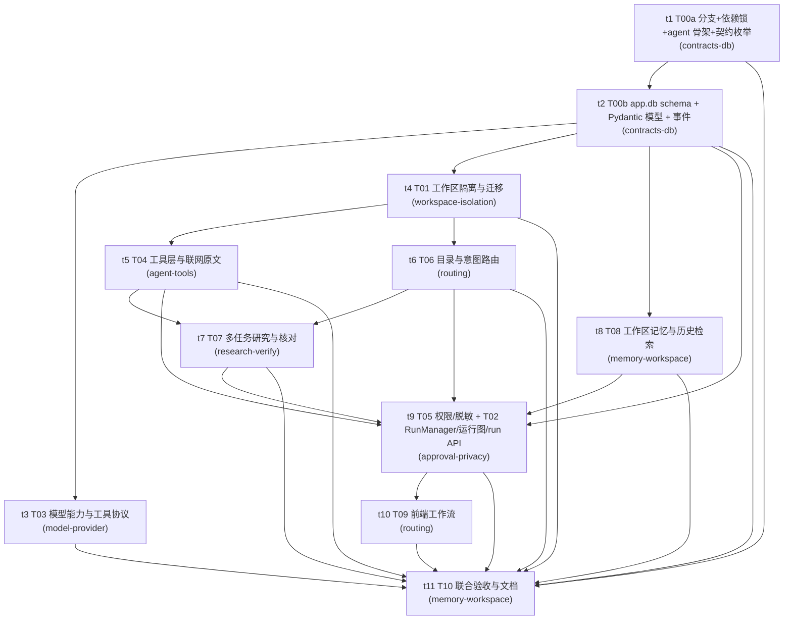

# Everything RAG V1.2.0 架构与文件归属（唯一依据）

| 项目 | 内容 |
|---|---|
| 适用范围 | `feat/V1.2.0` 分支全部开发工作流 |
| 依据 | `docs/PRD/v1.2.0-PRD.md`（下文章节号均指该文档）、`CLAUDE.md`、`docs/tech/00-技术选型决策文档.md` §7 |
| 建立者 | T00a（`contracts-db`） |
| 状态 | 冻结。**改本表需要 captain 批准**；表外的任何越界写文件都视为冲突 |
| 基线 | 分支 `feat/V1.2.0`（自 `main` @ `5efe9a9` 创建）、`backend/requirements.lock` |

本文件的作用只有一个：**让 8 条并行工作流永远不写同一个文件的同一段**。做法是
「一个路径一个拥有者」+「共享契约只增不改」+「共享入口 append-only」。

---

## 1. 模块地图

```
backend/app/
├── agent/                     ← 本版新增：Agent 编排（LangGraph）
│   ├── contracts.py           冻结契约：枚举 / 状态机 / 标识 / Pydantic 模型
│   ├── events.py              SSE 与 run_events 统一事件对象（PRD 13.3）
│   ├── models.py              图内部状态（AgentState / ResearchState）
│   ├── app_store.py           app.db 14 张表（PRD 13.1）
│   ├── runtime.py             RunManager：生命周期 / 调度 / 恢复（PRD 12.2）
│   ├── graph.py               LangGraph 主图与研究子图拓扑（PRD 4.3）
│   ├── routing.py             Intent Agent + 范围检查（PRD 6）
│   ├── planner.py             Planner Agent：子任务与依赖（PRD 6.4）
│   ├── research.py            RAG / General / Web 研究循环（PRD 7）
│   ├── tools.py               ToolRegistry + 10 个工具（PRD 7.1）
│   ├── approval.py            权限 / 批准 interrupt / 人名脱敏（PRD 10）
│   ├── verification.py        Synthesis / Verifier / AnswerArtifact（PRD 8）
│   ├── context.py             模型上下文组装、token 预算与压缩（PRD 9.2–9.3）
│   ├── memory.py              Memory Extractor 节点（PRD 11）
│   └── privacy.py             脱敏实现（PRD 10.4）
├── api/
│   ├── deps.py                WorkspaceContext / RunManager / AppStore 依赖注入
│   └── routes/
│       ├── runs.py            run 创建 / 状态 / SSE / cancel / resume（PRD 13.2）
│       ├── approvals.py       批准与澄清提交端点（PRD 13.2）
│       └── ...                既有路由（会话、知识、设置、导入）
├── core/                      配置 / 会话 / 工作区 / 出网审计
│   ├── workspace_context.py   每工作区不可变上下文（PRD 5.2）
│   ├── workspace_store.py     工作区身份与 storage_key（PRD 5.1）
│   ├── migration.py           V1.1.0 → V1.2.0 迁移（PRD 15）
│   └── outbound.py            唯一出网入口与审计（CLAUDE.md 隐私红线）
├── ingestion/                 导入 / 同步 / 切块 / 图片（PRD 5.3）
├── retrieval/                 dense + BM25 + RRF + 章节补充（按工作区构建）
├── vectorstore/               每工作区 Chroma PersistentClient
├── memory/                    memory.json、提炼器、FTS5 历史检索（PRD 11）
├── generation/                模型客户端、能力适配、tokenizer（PRD 9）
└── search/                    Tavily Search / Extract（PRD 7.3）

frontend/src/                  任务订阅、过程区域、批准与澄清卡片（PRD 14）
benchmark/ scripts/            评测与迁移脚本（PRD 16）
```

---

## 2. 文件归属表（每个路径一个拥有者）

规则：**只有拥有者可以改该文件**。需要改别人的文件时，向拥有者发消息，由拥有者改；
紧急情况下由 captain 重新指派。`（新）` = 本版创建，`（改）` = 本版改造既有文件。

> **任务号 → 拥有者对照（captain 指派，2026-09-19；团队成员上限为 8 人，因此有三处一人多任务）**
>
> | 任务（本文件章节号） | 拥有者 | 团队任务 id |
> |---|---|---|
> | T00a 分支与依赖基线 | contracts-db | t1 |
> | T00b 契约冻结 | contracts-db | t2 |
> | T01 工作区隔离与迁移 | workspace-isolation | t4 |
> | T03 模型能力与工具协议 | model-provider | t3 |
> | T04 工具层与联网原文 | agent-tools | t5 |
> | T06 目录与意图路由 | routing | t6 |
> | T05 权限/暂停恢复/脱敏 **+ T02 RunManager/运行图/run API** | approval-privacy | t9 |
> | T07 多任务研究与核对 | research-verify | t7 |
> | T08 工作区记忆与历史检索 | memory-workspace | t8 |
> | T09 前端工作流 | **routing（第二任务，T06 完成后接手）** | t10 |
> | T10 联合验收与文档 | **memory-workspace（第二任务，T08 完成后接手）** | t11 |
>
> 说明：`contracts-db` **不再**承接 T02；`frontend/**` **不再冻结**（§2.9 已解冻）。
> 本节各表的「工作流」列即上表任务号，**拥有者以上表为准**。

### 2.1 contracts-db —— 契约、依赖基线与业务数据库（T00a / T00b）

| 路径 | 类型 | 内容 |
|---|---|---|
| `backend/pyproject.toml` | 改 | 依赖声明；`langgraph==1.2.11`、`langgraph-checkpoint-sqlite==3.1.1`、`jieba==0.42.1`、`aiosqlite==0.22.1` |
| `backend/requirements.lock` | 新 | `pip freeze` 实际解析锁（Python 3.11.15 / 2026-09-19） |
| `backend/app/agent/contracts.py` | 新 | **分区**：① t1 冻结区 = 枚举 / 状态机 / thread_id / 引用前缀 / 会话默认值；② 文件末「t2 追加区」= Pydantic 模型 + PRD 18.1 数字默认值。**t1 冻结区由 captain 与本工作流共同维护**：captain 已修正 `is_main_thread_id`（拒绝 `*:main` 与非 `run:` 前缀，见 §6 D14） |
| `backend/app/agent/events.py` | 新 | 统一事件对象 + 20 类 payload；类型枚举复用 `contracts.EventType`。**发布器实现归 approval-privacy**（§2.6）：本工作流只定义事件对象与 payload 模型 |
| `backend/app/agent/app_store.py` | 新 | app.db 14 张表、约束、await 访问层、单事务提交。**本工作流只交付 schema 与访问层**；运行期使用归 approval-privacy（§2.6），需要新接口时向本工作流提需求，不得就地改 |
| `backend/app/agent/runtime.py`、`graph.py`、`models.py` | 新 | **拥有者为 approval-privacy**（§2.6），不在本工作流范围 |
| `backend/app/api/routes/runs.py`、`approvals.py` | 新 | **拥有者为 approval-privacy**（§2.6） |
| `backend/app/main.py` | 改 | lifespan 创建与关闭 RunManager；router 注册（**append-only**，见 §4；注册行由 approval-privacy 提供、本工作流落笔） |
| `backend/tests/fakes_agent.py` | 新 | 共享夹具（内存 app.db / tmp 工作区 / 假 Provider / 事件收集器） |
| `backend/tests/test_agent_contracts.py` | 新 | 契约测试：T00a 建立枚举 / 状态机 / `thread_id` 用例（含 §6 D14 的 6 条边界断言）；T00b 在文件末尾追加 app.db 与 Pydantic 模型用例，不改上半部分 |
| `backend/tests/test_agent_app_store.py` | 新 | T00b 的存储与事务用例 |

### 2.2 workspace-isolation —— 工作区隔离与迁移（T01）

| 路径 | 类型 | 内容 |
|---|---|---|
| `backend/app/core/workspace_context.py` | 新 | 不可变 `WorkspaceContext`（覆盖 PRD 5.2 全部清单项） |
| `backend/app/core/workspace_store.py` | 改 | `storage_key`、`status`、`default_permission_mode`、`default_reasoning_level`、`knowledge_revision` |
| `backend/app/core/migration.py` | 新 | PRD 15 十步迁移 + 一致性校验 |
| `backend/app/api/deps.py` | 改 | 注入 `WorkspaceContext`；**其他工作流只追加自己的 provider 函数** |
| `backend/app/ingestion/**` | 改 | 目录导入 / 上传 / 同步 / 删除后提交 `knowledge_revision`，路径取自 `storage_key` |
| `backend/app/vectorstore/**` | 改 | 每工作区 `PersistentClient`；向量句柄缓存键含 `workspace_id` + Provider 摘要 + collection 身份 |
| `backend/app/retrieval/**` | 改 | BM25 / 章节索引只从本区 collection 构建（PRD 5.3）；T04 只调用其接口 |
| `backend/app/models/**` | 改 | 元数据 schema 增加来源工作区与文档版本 |
| `backend/tests/test_workspace_isolation*.py`、`test_migration*.py` | 新 | A06–A08、A26 的隔离与迁移用例 |

### 2.3 model-provider —— 模型能力、工具协议与上下文（T03）

| 路径 | 类型 | 内容 |
|---|---|---|
| `backend/app/generation/base.py` | 改 | Provider 协议：完整响应对象、工具调用、能力声明 |
| `backend/app/generation/providers.py` | 改 | `OpenAICompatChatModel`：四档 `thinking` / `reasoning_effort`、完整协议历史回传、usage 与请求 ID |
| `backend/app/generation/tokenizer.py` | 新 | `deepseek-recipe` tokenizer、版本与文件 SHA-256、本地 token 计数 |
| `backend/app/generation/connection_test.py` | 改 | 能力探测与明确配置错误 |
| `backend/app/agent/context.py` | 新 | 上下文顺序、预算公式、80% 阈值、压缩与 `agent_context_epoch` |
| `backend/tests/test_providers.py`、`test_connection_test.py` | 改 | 四档参数与工具协议回归 |
| `backend/tests/test_agent_context.py` | 新 | 预算与压缩用例（A31） |

### 2.4 agent-tools —— 工具层与联网原文（T04）

| 路径 | 类型 | 内容 |
|---|---|---|
| `backend/app/agent/tools.py` | 新 | `ToolRegistry` + 10 个工具（PRD 7.1）；`workspace_id` 由上下文注入 |
| `backend/app/agent/artifacts.py` | 新 | 网页正文等任务资料的落盘与分批读取（PRD 7.3） |
| `backend/app/search/base.py`、`factory.py`、`tavily.py` | 改 | Search / Extract 结构化来源、`content_complete`、逐项错误、审计入口 |
| `backend/tests/test_search_provider.py`、`test_agent_tools.py` | 改/新 | 来源对象、错误状态、参数校验 |

### 2.5 routing —— 目录与意图识别（T06）

| 路径 | 类型 | 内容 |
|---|---|---|
| `backend/app/agent/routing.py` | 新 | Intent Agent、`RouteDecision` 生成、内部术语范围检查 |
| `backend/app/generation/knowledge_catalog.py` | 改 | 目录构建/查询：标题、层级、主题、术语、别名、来源 ID、`definition_unknown` |
| `backend/app/generation/prompt_policy.py` | 改 | 产品帮助 / 知识概览分类接入路由 |
| `backend/tests/test_agent_routing.py`、`test_prompt_policy.py` | 新/改 | 路由用例（A01–A05）、目录可核验性 |

### 2.6 approval-privacy —— 权限与脱敏（T05）**+ RunManager 与运行图（T02）**

> 本节同时拥有 T02：`runtime.py` / `graph.py` / `models.py` / 事件发布器 / `routes/runs.py`。
> `events.py` 与 `app_store.py` 的**定义**仍归 contracts-db（§2.1），本节只做运行期使用与发布实现。

| 路径 | 类型 | 内容 |
|---|---|---|
| `backend/app/agent/approval.py` | 新 | 三种模式决策、`ApprovalRequest` 事务流转、`interrupt()` 节点、规则版本与参数 hash |
| `backend/app/agent/privacy.py` | 新 | 人名脱敏（实体提取 + 程序校验 + 实际出网载荷检查） |
| `backend/app/agent/runtime.py` | 新 | `RunManager`：线程/checkpoint、父子任务调度、取消与恢复（PRD 12.2） |
| `backend/app/agent/graph.py` | 新 | LangGraph 主图 + 研究子图拓扑、`durability="sync"`、条件跳转与回边（PRD 4.3） |
| `backend/app/agent/models.py` | 新 | 图内部状态与节点 DTO |
| `backend/app/agent/events.py` | 改 | **只追加发布器与 SSE 序列化**；统一事件对象与 payload 模型属 contracts-db，不得改 |
| `backend/app/api/routes/runs.py` | 新 | run 创建 / 状态 / SSE 订阅 / cancel / resume（PRD 13.2） |
| `backend/app/api/routes/approvals.py` | 新 | `POST .../approvals/{id}`、`POST .../inputs/{id}` |
| `backend/app/core/outbound.py` | 改 | 出网审计与脱敏后的实际载荷记录 |
| `backend/tests/test_agent_approval.py`、`test_privacy.py`、`test_run_api.py`、`test_run_state_machine.py`、`test_agent_graph.py`、`test_sse_events.py`、`test_cancel_resume.py` | 新 | A13–A19、A23–A25、A29 |

### 2.7 research-verify —— 多任务研究与核对（T07）

| 路径 | 类型 | 内容 |
|---|---|---|
| `backend/app/agent/planner.py` | 新 | `ResearchTask` 拆分、依赖校验、并发预算、重复任务复用 |
| `backend/app/agent/research.py` | 新 | RAG / General / Web 研究循环、`requirement_coverage` 等每轮更新 |
| `backend/app/agent/verification.py` | 新 | Synthesis、8 项核对、`AnswerArtifact` 发布、引用编号与 `basis_components` |
| `backend/tests/test_agent_planner.py`、`test_agent_research.py`、`test_agent_verification.py` | 新 | A09–A12、A16、A29、A32 |

### 2.8 memory-workspace —— 工作区记忆与历史检索（T08）

| 路径 | 类型 | 内容 |
|---|---|---|
| `backend/app/memory/workspace_memory.py` | 新 | `memory.json` schema、revision / 原子替换、`operation_id` 去重 |
| `backend/app/memory/invalidation.py` | 新 | 人工纠正 / 删除 / 关闭的失效规则与消息视图 |
| `backend/app/memory/store.py`、`extractor.py`、`retriever.py`、`indexer.py`、`index_schema.py`、`models.py` | 改 | 迁移到工作区记忆（旧类别 → 新类别见 PRD 15.2 表） |
| `backend/app/agent/memory.py` | 新 | Memory Extractor 节点与快照构建 |
| `backend/tests/test_memory_*.py`、`test_history_search*.py` | 新/改 | A20–A22、A28、A30 |

### 2.9 routing —— 前端工作流（T09，第二任务）

**已由 captain 指派给 `routing`**（团队任务 id `t10`，依赖 T00b + T02 的 run API 与 SSE 契约）。
本节路径在 T06 完成前仍不得改动；T06 交付后按 PRD 14.1–14.4 落地：

`frontend/src/api/runs.ts`（新）、`frontend/src/api/sse.ts`（改）、`frontend/src/types.ts`（改）、
`frontend/src/components/Chat.tsx`（改）、`ProcessPanel.tsx`（新）、`ApprovalCard.tsx`（新）、
`InputCard.tsx`（新）、`PermissionMenu.tsx`（新）、`ReasoningMenu.tsx`（新）、
`RunStatusBar.tsx`（新）、`CitationPanel.tsx`（改）、`KnowledgeSettings.tsx`（改）、
`frontend/e2e/run-workflow.spec.ts`（新）、`permissions.spec.ts`（新）、`memory.spec.ts`（新）。

> 硬约束：E2E 不得访问真实后端；只改 `frontend/**`，不改 `backend/**`。

### 2.10 memory-workspace —— 联合验收与文档（T10，第二任务）

**已由 captain 指派给 `memory-workspace`**（团队任务 id `t11`，依赖全部实现任务）。
本节与 §2.8 是同一名成员的两个任务，须串行执行。

`benchmark/**`、`scripts/eval_*.py`、`scripts/run.py`、`README.md`、`docs/**`（本文件与
`docs/PRD/**` 除外）、`backend/tests/test_acceptance_v120.py` 与 `test_e2e_*.py` 的验收新增、
`.claude/project-state.md`（**已是合法 UTF-8，只需按 CLAUDE.md §8 更新内容**；见 §6.2）。

> `docs/PRD/v1.2.0-PRD.md` 对全部工作流**只读**：它是验收判据，不得由实现方改写。
> `t11` 是唯一被授权执行 `git commit` 的任务，其余工作流只改工作区。

---

## 3. 共享契约清单（跨工作流唯一来源）

| # | 契约 | 位置 | 说明 |
|---|---|---|---|
| C1 | 枚举与状态机 | `app/agent/contracts.py`（t1 冻结区） | `RunStatus` / `TaskStatus`（PRD 12.3，11 值）、`ApprovalStatus`（10.2）、`InputRequestStatus`、`SourceType` / `EvidenceSourceType`（8.1）、`AnswerBasis`（8.3）、`PermissionMode`（10.1）、`ReasoningLevel`（9.1）、`IntentKind` / `Freshness`（6.2）、`AgentKind`（4.2）、`VerifierVerdict`（8.2）、`EventType`（13.3）。**只增不改**；改取值必须同步 PRD 并由 captain 批准 |
| C2 | 状态迁移 | `RUN_STATUS_TRANSITIONS` / `can_transition_run` / `can_transition_task` | PRD 12.3 迁移图的唯一实现；`cancelled → running` 需 `resumable=true` |
| C3 | 运行身份 | `main_thread_id` / `task_thread_id` / `thread_of_run` | PRD 12.1：`run:<run_id>:main`、`run:<run_id>:task:<task_id>` |
| C4 | 引用编号 | `CITATION_PREFIX` / `citation_prefix` | PRD 8.3：`[S]` 知识、`[W]` 网页、`[M]` 记忆、`[H]` 历史；其余来源不编号 |
| C5 | 事件对象与类型 | `app/agent/events.py` + `contracts.EventType` | `schema_version=2 / run_id / event_seq / execution_id / task_id? / type / created_at / payload`；订阅关闭事件见 `SUBSCRIPTION_CLOSING_EVENTS` |
| C6 | 业务数据库 | `app/agent/app_store.py` | 14 张表（PRD 13.1）；唯一约束 `(run_id, event_seq)`、会话内 `sequence`、`operation_id`、会话内 `client_request_id` |
| C7 | Pydantic 数据模型 | `app/agent/contracts.py`（t2 追加区） | `RouteDecision`（6.2 全 **12** 字段）、`ResearchTask`（6.4 全 **9** 字段）、`Evidence`（8.1 全 **12** 字段）、`AnswerArtifact`、`ApprovalRequest`（10.2）、`InputRequest`、`ModelCapabilities`（9.2 全 **7** 字段）、`ProviderMessage`、`ToolCall`、`OperationRecord`、`AgentError`（12.5）。**计数以 PRD 原文为准**（见 §6 D16；本节曾误写 11/8/11，与 §6.3 第 13 条自相矛盾，captain 已统一更正） |
| C8 | 工作区上下文 | `app/core/workspace_context.py` | PRD 5.2 全部清单项；工具参数不暴露 `workspace_id` |
| C9 | 工具协议 | `app/agent/tools.py` | 工具名、Pydantic 参数类型、是否联网、可用 Agent、返回状态；10 个工具见 PRD 7.1 |
| C10 | 模型协议 | `app/generation/base.py` | 完整响应：`content / reasoning_content / tool_calls / finish_reason / usage / provider_request_id`（PRD 9.2） |
| C11 | HTTP 端点 | `app/api/routes/*.py` | PRD 13.2 全表；`/api/chat` 返回 410 + 客户端版本提示 |
| C12 | SSE 帧 | `app/api/routes/runs.py` | 标准 `id` + JSON `data`；`Last-Event-ID` 补读（PRD 13.3） |
| C13 | memory.json schema | `app/memory/workspace_memory.py` + `contracts.py` 常量 | PRD 11.2 文件级与条目级字段 |
| C14 | 数据目录树 | `app/core/workspace_context.py` | PRD 5.1 的 `data_dir` 与每工作区路径 |
| C15 | 工程默认值 | `contracts.py`（枚举默认值）+ t2 追加区（数字默认值） | PRD 18.1：`ask` / `high` / 并发 3 与 4 / top_k 8 / 记忆 300 字符 / 快照 8000 字符 / 输入 32000 字符 / 80% 阈值 |

---

## 4. 共享入口文件与 append-only 规则

以下文件不可避免被多方触碰，采用「一个拥有者 + 只允许追加」：

| 文件 | 拥有者 | 追加规则 |
|---|---|---|
| `backend/app/main.py` | contracts-db | 其他工作流把自己的 router / lifespan 资源通过拥有者加入；不得改写既有注册行 |
| `backend/app/api/routes/__init__.py` | contracts-db | 同上 |
| `backend/app/api/deps.py` | workspace-isolation | 只追加新的 provider 函数，不改既有函数签名 |
| `backend/app/agent/contracts.py` | contracts-db | 只有 t2 追加区可追加；t1 冻结区只读 |
| `backend/tests/fakes_agent.py` | contracts-db | 允许追加新夹具；修改既有夹具签名需先与拥有者确认。工作流专属夹具放 `tests/fakes_<工作流>.py` |
| `backend/app/__init__.py`、各包 `__init__.py` | 对应工作流 | 只加 docstring / 导出，不写逻辑 |

**提交顺序**：同一文件的两名写者必须串行——先完成者写入，后完成者在拿到
「已写入」通知后再追加。并行冲突时以本表拥有者的版本为准。

---

## 5. 依赖关系图（2026-09-19 与团队任务表对齐）

研究编号 T02/T05/T09/T10 归并后，**运行时编排归 approval-privacy**，因此实际执行图如下
（`t1`…`t11` 为团队任务 id，与 §2 顶部对照表一致）：



模块级依赖（import 方向，禁止反向）：

```
contracts  ← events, models, app_store, tools, approval, context, routing,
             planner, research, verification
app_store  ← runtime, tools, approval, memory
tools      ← research            （研究循环只通过 ToolRegistry 执行动作）
events     ← runtime             （事件先落库后推送）
graph      ← runtime             （runtime 驱动图，图不反向依赖 runtime）
workspace_context ← tools, approval, research, memory, routing, retrieval
```

---

## 6. 契约决策记录（T00a 冻结，不留 TODO）

| # | 决策 | 依据与影响 |
|---|---|---|
| D1 | **SSE 事件类型取 PRD 13.3 表的全部 20 个 `type` 取值**（不是 16）。任务描述中的「16 类」与 PRD 表不符：PRD 13.3 表共 13 行，其中 7 行是 `A / B` 成对事件，展开为 20 个类型 | 以 PRD 原文为准（PRD 是验收判据）。实现与前端订阅都必须按 20 值处理；若 captain 认为应取子集，须先改 PRD |
| D2 | `SourceType`（6 值）与 `EvidenceSourceType`（8 值）分别定义 | PRD 8.1 前半句限定「来源类型为 knowledge/web/memory/history/catalog/product」，末句追加 `general_knowledge` / `proposal`。引用编号只有前 4 类（PRD 8.3），因此 `citation_prefix` 对 catalog/product/general/proposal 返回 `None` |
| D3 | `InputRequestStatus` 取 `pending / answered / superseded` 三值 | PRD 未显式给澄清状态表；5.4 与 12.4 只出现「转为 superseded」与「提交回答」。版本不符按 PRD 13.2 的「问题版本」校验拒绝（语义同 10.2 的 409），不新增 `expired` 状态 |
| D4 | `RunStatus` 与 `TaskStatus` 是**两个独立枚举、同一套 11 个取值** | PRD 12.3 只有一张状态表，run 与 agent_task 共用；两个类型保留类型标注能力。一致性由 T00b 契约测试断言（`run` 与 `task` 取值集合必须相等） |
| D5 | 依赖固定策略：**本版新增依赖全部用 `==`**（`langgraph`、`langgraph-checkpoint-sqlite`、`jieba`、`aiosqlite`）；V1.1.0 既有依赖保留原有下限 | 硬约束要求「真实固定」，但把既有 `>=` 全部改成 `==` 属于基线外改动、会引入回归风险。取舍是把**真实解析结果**固化在 `backend/requirements.lock`（118 行第三方包，全部 `==`）。后续如要求逐条 pin，另开任务 |
| D6 | `requirements.lock` **剔除本项目自身的 editable VCS 行** | `pip freeze` 会输出 `-e git+https://github.com/Pronting/EverythingRAG.git@5efe9a9...#egg=everything_rag_backend`，指向远端仓库与旧提交，既不可复现也不可离线安装；锁文件只锁第三方依赖 |
| D7 | 骨架模块用 `__all__: list[str] = []` + `_PLANNED_EXPORTS` 元组记录计划导出 | 若在 `__all__` 里写尚未定义的名字，ruff `F822`（undefined name in `__all__`）会红；空 `__all__` + 计划常量既通过验收，又给实现方留下接口清单 |
| D8 | 骨架文件不写任何实现（无类、无函数、无导入） | 除 `contracts.py` 外全部模块由后续工作流认领；预先写占位实现会与认领者冲突 |
| D9 | `app/agent/__init__.py` 只导出 `contracts` | 其余模块在实现前不可导入；包入口保持最小，避免任一模块半成品导致整包导入失败 |
| D10 | `websockets` 由 `17.0.1` 降到 `16.1.1` | `langgraph` 传递依赖的解析结果；已在锁文件头部记录。`uvicorn` / `fastapi` 导入与 `/api/status` 冒烟均通过 |
| D11 | enum 类型默认值放 `contracts.py`（`DEFAULT_PERMISSION_MODE=ask`、`DEFAULT_REASONING_LEVEL=high`）；PRD 18.1 的数字默认值放 t2 追加区 | 默认值只有一份定义，避免 T00b 与其它工作流各自定义后漂移 |
| D12 | `tests/fakes_agent.py` 只依赖标准库 + `aiosqlite` + `contracts`；建表走探测式接线 | T00a 阶段 `app_store` 尚未实现，夹具必须能独立导入；`install_agent_schema()` 在 T00b 落地后自动生效（探测 `ensure_schema` / `init_schema` / `create_schema` / `initialize`） |
| D13 | T09 前端工作流**已指派给 `routing`**（团队任务 `t10`，T06 完成后接手）；`frontend/**` 由「冻结」改为「T06 交付后可改」 | 团队**成员上限 8 人**（第 9 名成员被平台拒绝），无法为前端另设成员；`routing` 的 T06 与 T09 无文件交集，串行执行不冲突。captain 指派，2026-09-19 |
| D14 | `is_main_thread_id` 由 captain 修正：校验 `run:` 前缀 + `thread_of_run` 可解析（`run_id` 非空）+ `endswith(":main")` + `_TASK_MARKER not in thread_id` | 原实现 `is_main_thread_id("garbage:main")` 返回 **True**（应为 False），且 `not thread_id.endswith(_TASK_MARKER)` 是**永远为真的死条件**——子图 thread 形如 `run:<run_id>:task:<task_id>`，末尾是 task_id，从不以 `:task:` 结尾。当时全仓库无调用点，改动代价最低；T02 会将其用于 checkpoint 路由。已在 `test_agent_contracts.py` 固化 6 条边界用例（32 passed） |
| D15 | 任务号 → 拥有者对照以 §2 顶部表为准：`contracts-db` **不再**承接 T02；T02（运行时编排）归 `approval-privacy`；T10（联合验收）归 `memory-workspace` | 同上成员上限约束。§2.1/§2.6/§2.9/§2.10 与 §5 已同步；captain 指派，2026-09-19 |
| D16 | **字段数量以 PRD 原文为准，任务/清单里的计数按实际更正**：`RouteDecision` **12** 字段（PRD 6.2 表 12 行，任务写 11）、`ResearchTask` **9**（PRD 6.4 写 9 项，任务写 8）、`Evidence` **12**（PRD 8.1 列 12 项，任务写 11）、`memory.json` 条目级 **11** 字段（PRD 11.2 列 11 项，§6.3 第 18 条写 12） | 与 D1 同类问题。实现一律按 PRD 全字段交付（**超集**，不缺字段）；本表更正计数，避免后续按错误数字自查或断言。`ModelCapabilities` 7 字段三处一致，无争议 |
| D17 | `ApprovalRequest` 在 PRD 10.2 的 11 个字段之外新增 `superseded_reason`，并保留 `scope` / `created_at` / `resolved_at` | PRD 5.4 与 11.4 要求批准失效时说明原因（会话移动 / 记忆失效），仅凭 `status=superseded` 无法表达；`decision` 保持「用户决定」语义，不被系统失效复用。`scope` 承载 10.2「允许本轮同类操作」的 run + 工具类别 + 问题范围 + 规则版本 |
| D18 | **迁移后 `app.db.workspaces` 是工作区记录的唯一权威**；`workspaces.json` 迁移通过（PRD 15.2 步骤 10 提交 `storage_schema_version`）后降级为只读存档 | PRD 13.1 首段「迁移后它是工作区与会话的权威数据源」。**交接期运行规则**：运行路径只读 `app.db`；`workspaces.json` 只被迁移任务读一次（导入来源），运行路径任何时刻都不读它；启动先跑幂等迁移（PRD 15.2 步骤 2–3），迁移完成前不对外提供工作区 API |
| D19 | 工作区记录**单向适配**：`core/workspace_store.py`（t4）降级为 `AppStore` 之上的适配器；`app_store` 不反向依赖 `core/` | 读=委托 AppStore；写=只调用 `create_workspace` / `update_workspace` / `bump_knowledge_revision`（其它模块不得绕过 AppStore 直接写 `workspaces` 表）。t9 的 RunManager 读 `default_permission_mode` / `default_reasoning_level` / `knowledge_revision` 同样走 AppStore |
| D20 | PRD 5.2 的「服务实例」**不进 Pydantic 契约**：`contracts.WorkspaceContext` 只承载可序列化数据（身份 / 目录 / 知识版本 / 默认设置，10 字段）；服务句柄由实现层 `app/core/workspace_context.py`（t4）承担，成员名由 `contracts.WorkspaceServiceHub` Protocol 冻结为 `view` + `app_store` | 让 Pydantic 模型持有 IO 对象会破坏「不可变数据」与「不含 IO」两条约定。`app_store` 实例的生命周期由 API lifespan 单实例持有（t9 的 RunManager 与工具执行器复用同一个），上下文只引用不拥有 |
| D21 | `runs.input_message_id` / `messages.run_id` / `agent_tasks.parent_task_id` 使用 `DEFERRABLE INITIALLY DEFERRED` 外键 | 立即外键让 PRD 13.2「保存用户消息并创建任务」与 13.1 的答案单事务提交都无法实现（实测 SQLite 3.53.1：两种插入顺序均 `FOREIGN KEY constraint failed`）。延迟模式下互指可在同一事务内建立，**悬空引用仍在 COMMIT 时报错**（完整性未丢）；`transaction()` 在 COMMIT 失败时同样回滚，不留半开事务。清单见 `app_store._DEFERRED_FOREIGN_KEYS` |
| D22 | 读取路径的 **JSON 列必须反序列化**后再交给 Pydantic；登记表 `app_store.JSON_COLUMNS` + 往返测试逐列覆盖 | T00b 曾漏掉 `migration_jobs.validation`（把 `'{"files": 12}'` 直接交给 `dict` 字段），由往返测试抓出。新增 JSON 列时必须同步登记，`test_json_columns_round_trip_through_every_reader` 与 `test_json_column_registry_matches_real_schema` 锁死 |
| D23 | 事件类型字符串统一经 `events._normalize_event_type` 收敛，未知类型抛 `EventProtocolError`（保留 `__cause__`） | PRD 12.5 末段 / 13.3 末段要求「未知版本或负载校验失败抛明确异常」；裸 `ValueError` 会被调用方当成普通 bug，t9 的 SSE 端点需要该类型区分协议错误与服务端故障。异常内容不得回显到界面 |
| D24 | `pyproject.toml` 增加 `[tool.ruff.lint.per-file-ignores]`：`tests/*.py` 放宽 `F811` | pytest 只自动发现 conftest.py 的夹具，因此共享夹具必须显式导入测试模块，函数参数与导入同名会被 pyflakes 误报为重定义。仅放宽这一条，其余规则照常（`app/agent` 不受影响） |

### 6.1 captain 对 T00a 交付物的复核记录（2026-09-19）

| 复核项 | 结论 | 证据 |
|---|---|---|
| `feat/V1.2.0` 分支存在 | 通过 | `git branch --show-current` = `feat/V1.2.0` |
| 依赖真实安装且版本固定 | 通过 | `import langgraph / langgraph.checkpoint.sqlite.aio / jieba` 退出码 0；`pyproject.toml` 全部 `==` |
| 枚举与 PRD 逐条对齐 | 通过 | `RunStatus`/`TaskStatus` 各 11 值（PRD 12.3）；`EventType` 20 值（PRD 13.3 的 7 对 + 6 单 = 20）；`AnswerBasis` 9 值（PRD 8.3）；`ReasoningLevel` 4 档（PRD 9.1）；`PermissionMode` 3 值（PRD 10.1） |
| 契约测试 | 通过 | `pytest tests/test_agent_contracts.py` → **32 passed** |
| 契约边界缺陷 | **已修** | 见 D14 |

### 6.2 真实语料与凭证侦察（captain，2026-09-19）

用于判断 T06（≥120 题路由评测）与 T10（≥40 题答案质量评测）的可行性：

| 资源 | 实测 | 对评测的影响 |
|---|---|---|
| `benchmark/cases.json` | 存在，19460 B，**87 条真实中文用例**（captain 实测脚本核对：semantic 22 / identifier 13 / fact_lookup 12 / multi_hop 10 / definition 9 / negative 9 / numeric 7 / negative_adversarial 3 / colloquial 2；字段 `id,cat,diff,gold,query,evidence`，`gold` 指向 `.tmp_probe/sample_chunks.json` 的真实块） | T06 的 120 题**必须优先复用这 87 条真实问题**；缺口才允许构造，且必须在数据文件与报告中显式标注哪些是构造样例（PRD 16.1）。**captain 初版写「~92 条」，经 `routing` 复核并由 captain 重测确认为 87，已更正** |
| `data/`（仓库根目录） | **不是真实数据目录**，只是开发/评测用的玩具集：20 篇 MD、`chroma.sqlite3` **188 KB**、`state.db` 20 KB | 可用于离线检索回归，**不可**用来代表真实语料的规模或结构 |
| `~/.everything-rag/`（`settings.data_dir` 默认值，见 `app/core/config.py:26`） | **真实数据目录**：`chroma.sqlite3` **252,858,368 B ≈ 241 MB**、`image_state.db` **23,158,784 B ≈ 22 MB**、`conversations.json` **873,667 B**、`state.db` 401,408 B、`config.json` 2,604 B、`workspaces.json` 737 B、`avatars/`、`documents/`、`models/`、`staging/` 以及 **16 个 UUID 名称子目录**、4 份 `vision_batch_report*.json`、`.chroma-write.lock` | 这是 t11 的 **A26 真实迁移**与 A06/A07（两工作区同名文档）的真实素材。captain 上一轮把仓库 `data/` 当成真实数据，**属误判，已更正** |
| Provider 凭证 | **齐备**：`backend/.env` 设 `EVERYTHING_RAG_CHAT_{BASE_URL,MODEL,API_KEY}` 与 `EVERYTHING_RAG_EMBED_{BASE_URL,MODEL,API_KEY}`（captain 只核对变量名与非空长度，**未读取也未打印任何密钥值**）；`~/.everything-rag/config.json` 有 `chat` / `embed` / `vision` / `search` / `answer_preferences` / `avatars` / `theme`，`schema_version=2` | captain 上一轮据「`data/config.json` 不存在」判断 live 用例跑不了，**属误判**：真实配置在 `~/.everything-rag/config.json` 与 `backend/.env`。A01/A18/A19 **技术上可执行**，但会产生真实外呼与费用，**须用户明确同意后才跑** |

> 上表最后两行由 captain 于本轮更正（原结论「真实语料仅 20 篇 / Provider 未配置」来自只看仓库 `data/` 的误判）；更正依据：`app/core/config.py` 的 `data_dir` 默认值 + `~/.everything-rag/` 与 `backend/.env` 的实测。

**t11 迁移的硬约束（据此更正）**

1. A26 迁移的**真实对象是 `~/.everything-rag/`（约 241 MB 向量库）**，不是仓库 `data/`。迁移前必须由用户显式确认，并做完整备份（PRD 15.2 第 1 步的「一致的本地备份」）。
2. 迁移实现必须按 **真实规模**验证：241 MB Chroma + 22 MB 图片库 + 873 KB 会话。用小玩具集跑通不能替代。
3. `config.json` 已存在 `schema_version=2` 且含 `knowledge_only` 字段——正是 PRD 15.2 末段要求「保存于迁移记录、设置页移除该开关」的字段，迁移需真实处理。
4. live 用例（A01/A18/A19/A26）跑与不跑**由用户决定**；不跑时报告写「未执行 + 原因 + 需用户执行」，跑时须记录真实凭证环境与费用。
| `.claude/project-state.md` | **已是合法 UTF-8**：23268 B，`decode("utf-8")` strict 成功（12654 字符），`decode("gbk")` 在第 13 字节抛 illegal multibyte sequence；文件头字节为 `23 20 E9A1B9 E79BAE E78AB6 E68081 20`（`# 项目状态 `），正文含 `✅` U+2705（GBK 无法编码） | **更正 captain 上一轮的误判**：此前把 Windows 控制台的 GBK 呈现当成文件损坏。t11 **只更新内容**（CLAUDE.md §8 的「当前阶段 / 下一步 / 验收 checklist」），**严禁任何编码转换**——把好文件按 GBK 转码会真正写坏它。该文件是「上轮误判、本轮实测更正」的案例：控制台乱码 ≠ 文件编码错误 |

> 上表 `.claude/project-state.md` 一行由 captain 于本轮实测更正（原写「GBK 乱码，须用 UTF-8 重写」，属错误结论）；更正依据来自 `memory-workspace` 的独立复核 + captain 的字节级复测。

### 6.2b 真实环境实测补充（captain 复核 + `memory-workspace` 侦察，2026-09-19）

三条经 captain 独立复核确认的事实，**都会影响 t11 的验收与 live 费用测算**：

| # | 事实 | 证据 | 影响 |
|---|---|---|---|
| F1 | **真实数据总量 3100.6 MB**（captain 只报了 `chroma.sqlite3` 的 241 MB，不完整） | `~/.everything-rag/` 递归合计 3,100.6 MB；**15 个 UUID 子目录** + `avatars/ documents/ models/ staging/`；另有 `state.pre-image-v7.db` 401,408 B 与 **`.chroma-write.lock` 1 B（疑似遗留锁）** | A26 迁移的备份与耗时评估按 3.1 GB 计，不是 241 MB。t4/t8 的写入锁现场需留意该遗留锁 |
| F2 | **生效凭证来自 `~/.everything-rag/config.json`，不是 `backend/.env`** | `settings_store.py:3` 优先级 `config.json > env/.env > 默认值`；运行路径 `create_chat_model_from_config(get_settings_store().load().chat)`（`conversations.py:376`、`chat.py`、`deps.py:68`、`main.py:89`）。实测两套值不同：生效 chat = `https://api.deepseek.com` / **`deepseek-flash`**；`.env` 的 `https://opencode.ai/zen/go/v1` / `deepseek-v4-flash` 只是缺省回退，且两把 key 不同 | live 费用必须按 `api.deepseek.com` 计价；按 `.env` 会算错模型与价格 |
| F3 | **`config.json` 四把 API key 明文未掩码** | captain 实测：chat/embed/vision/search 的 `api_key` 均为非掩码字符串（长度 35/51/51/58，前缀分别为 `sk-d`/`sk-g`/`sk-g`/`tvly`）；来源 `settings_store.py:219/229/238/247` 的 `get_secret_value()` 直写 | 与 CLAUDE.md §11「API key 不落 config 明文（环境变量 / 内存掩码）」**冲突**。记为 t11 的 finding；是否修复须用户决定，captain 不一并扩围 |

**live 前置探针（**已被 t3 实测更正，captain 原判断有误**）**：captain 曾据「官方常见 `deepseek-chat` / `deepseek-reasoner`」判断 `deepseek-flash` 非官方标准 id —— **该判断已过时**。`model-provider`（t3）以官方文档实测确认：**`deepseek-flash` 已是 DeepSeek 官方标准 model id**（能力位与上下文上限均取自官方页面，见 `app/generation/capabilities.py` 的 `CAPABILITY_SOURCES`），旧名 `deepseek-v4-flash` 已退役但服务端仍接受并已做别名映射。
⇒ 因此**模型 id 探针不再是付费前的必做项**（但作为「端点与凭证连通性」的廉价冒烟仍有价值，成本一次几 token）。
⇒ 仍然保留的风险判断：live 运行会真实外呼与真实计费，**是否执行由用户决定**（见 `docs/tech/v1.2.0-live-eval-plan.md`）。

**启动路径**：`env_file=".env"` 相对 CWD 解析，只有 `backend/.env` 存在；`scripts/run.py:216` 会 `os.chdir(BACKEND_DIR)`，所以正常启动无碍，但 live/eval 脚本必须按 CLAUDE.md §6 在 `backend/` 下执行。

### 6.2c 真实 Chroma 布局与迁移决策（captain 决策，2026-09-19）

`workspace-isolation` 的只读侦察（`mode=ro` 打开 `chroma.sqlite3`）纠正了一个**结构性误判**，并由 captain 采信：

| 事实 | 证据 | 后果 |
|---|---|---|
| **UUID 目录是 Chroma HNSW 分段目录，不是工作区目录** | 抽查 `04bf6625-…/` = `data_level0.bin` 2,977,908 B + `index_metadata.pickle` + `link_lists.bin` + `header.bin` + `length.bin` | 现状 `deps.get_vector_store()` 用 `create_vector_store(persist_dir=settings.data_dir)`，**Chroma persist 根就是 `~/.everything-rag/` 本身**。PRD 5.1 的 `workspaces/<storage_key>/chroma/` 是**真实布局变更**，没有「挪目录」捷径 |
| **1 个区已有 4 个 collection 身份，全部 dim=4096** | `chunks__cloud-Qwen-Qwen3-Embedding-8B__v1` + 同指纹 `…-endpoint-dcfb966d818d__v5/v6/v7` | PRD 15.2 第 6 步「保留全部历史 collection 身份」不是修辞：每区必须原样保留这 4 个身份，**不得收敛成单 collection** |
| **16,802 条 embedding / 8 个 segment / 164,768 行 metadata** | chroma.sqlite3 只读查询 | 原始向量载荷 ≈ 16,802×4096×4 B ≈ **275 MB**（大于 sqlite 文件 241 MB，实体为紧凑编码）⇒ 第 6 步批次按真实量级定，**不能用 188 KB 玩具库试出的批次** |
| **15 个分段目录 vs 8 个 segment ⇒ 约 7 个孤儿分段** | 目录数 vs sqlite 枚举数 | **禁止按目录个数推记录数**；整目录拷贝会把孤儿一并搬走并使 15.3 校验数字错。必须**以公共 API / sqlite 枚举为准** |
| **`models/` = 2.29 GB，占数据目录 70%，且不在 PRD 5.1 目标表内** | 10 个文件 2,289,720,514 B；`config.py:54` 注明「本地 fastembed/bge-m3 已移除」，真实 collection 全是云端 `cloud-Qwen-…` 指纹 | 已移除组件的 ONNX 残留，无功能价值。C 盘可用 9.9 GB，全量备份 3.25 GB + 目标 chroma ≈275 MB 塞得下，但把 2.29 GB 死权重一起快照等于 70% 备份开销买零价值 |

**决策 D16 —— 备份与搬运范围（T01 与 A26 共同适用）**

1. **备份**：对 `~/.everything-rag/` 做一致性快照，**排除 `models/`**，并在迁移记录中显式写明「排除项 + 理由（已移除组件的 ONNX 残留，非 PRD 5.1 目标路径）」。建议仍纳入快照：`chroma.sqlite3` 与全部分段目录、`state.db`、`state.pre-image-v7.db`、`image_state.db`、`conversations.json`、`workspaces.json`、`config.json`、`documents/`、`avatars/`、`staging/`、`vision_batch_report*.json`、`.chroma-write.lock`。
2. **搬运**：只覆盖 PRD 5.1 目标表内路径 + 文档/图片/向量/会话必需项。
3. **表外路径**（`models/`、`vision_batch_report*.json`、`state.pre-image-v7.db`、`.chroma-write.lock`）：**原地保留，不删除**。新增工作区目录结构只承载 5.1 表内容。
4. **枚举口径**：collection 与记录数一律经公共 API / `chroma.sqlite3` 枚举，**不得按目录数或文件名推断**；15.3 的「collection 数量及记录数量一致」按枚举结果核对。
5. **遗留锁**：`.chroma-write.lock`（1 B）若是上一进程遗留，T01 必须先判定再决定是否清理；**不得在未判定时删除**（可能是活锁）。
6. **备份不足即中止**：磁盘余量 9.9 GB，排除 `models/` 后备份约 0.96 GB；若实测余量不足以容纳备份 + 目标 chroma，**中止迁移**而不是降级为「不备份」。

> 以上均由 captain 拍板。`workspace-isolation` 已确认按此实现（D16 逐条核对一致）；**但截至本行 T01 尚未实现，『保留 / 排除』清单尚未产出** —— t11 在 A26 中必须先要求产出该清单并核对，不得因本文件存在本条而跳过。
>
> （订正说明：本行原以过去时写「已按此实现并在 t11 迁移报告中列出清单」，属**将来事实写入完成时**的时态错误，由 `workspace-isolation` 指出后更正。教训：协调文档里的时态就是事实状态，写错会让下游跳过核对。）


### 6.3 t2 交付验收清单（captain 预置，2026-09-19）

t2 冻结后 t3/t4/t5/t6/t8 五条流同时开工，**契约错误会同时污染五条流**，因此 captain 按下列清单逐条核对后才放行。
清单来自 PRD 原文，不是主观偏好；`[必须]` = 不符合即拒绝放行。

**app.db（PRD 13.1）**

1. `[必须]` 14 张表齐备，命名与 PRD 表名逐字一致：`workspaces`、`conversations`、`messages`、`runs`、`agent_tasks`、`provider_messages`、`operations`、`approvals`、`input_requests`、`run_events`、`answer_artifacts`、`background_jobs`、`history_fts`、`migration_jobs`。
2. `[必须]` 四个唯一约束真实生效且被测试断言：`(run_id, event_seq)`、会话内 `sequence`、`operation_id`、会话内 `client_request_id`。
3. `[必须]` `PRAGMA foreign_keys=ON` 与 WAL 已启用，并由测试断言（不是只在文档里写）。
4. `[必须]` 建表幂等：连续两次初始化不报错、不丢数据。
5. `[必须]` **答案事务原子性**（PRD 13.1 末段）：助手消息 + `answer_artifacts` + `answer.meta`/`answer.delta*`/`run.completed` 事件 + 记忆提炼任务在同一事务提交；注入异常后**无半成品事件**。事件编号按 `answer.meta → answer.delta* → run.completed` 顺序分配，最后一个事件带明确的 `completed` 或 `completed_with_gaps`。
6. `[必须]` 事件补读：`after=seq` 返回严格大于该编号的事件，且顺序单调。
7. `[必须]` 批准/澄清状态流转：`pending → approved|denied|superseded`；**重复相同决定幂等返回现有结果；冲突决定抛 409 语义错误**（PRD 10.2）。
8. `[应当]` `workspaces` 含 `id` / 唯一 `storage_key` / `name` / `status` / `default_permission_mode` / `default_reasoning_level` / `knowledge_revision`。
9. `[应当]` `conversations` 含 `context_epoch` 与快照字段（`memory_revision`、`memory_invalidation_revision`、`memory_snapshot_text`、`memory_snapshot_hash`、`memory_snapshot_at`）。
10. `[应当]` `runs` 含 `origin_run_id`、`stop_reason`、`resumable`、`context_epoch`、答案 ID。
11. `[应当]` `agent_tasks` 含 `thread_id`、`agent_context_epoch`、`parent_task_id`、`depends_on`。
12. `[提示]` `history_fts` 按 PRD 11.5 = FTS5 虚拟表（`unicode61`）+ 原始消息单独保存在 `messages`；分词内容与原文分离存储。

**共享 Pydantic 模型（`contracts.py` t2 追加区）**

13. `[必须]` 字段与 PRD 原文逐条对齐（**captain 已按 PRD 原文更正本条的计数**）：`RouteDecision` **12** 字段（PRD 6.2 表，含 `question`）、`ResearchTask` **9** 字段（PRD 6.4 句中列举，含 `task_id`）、`Evidence` **12** 字段（PRD 8.1 句「至少包含」，含 `task_id`）、`ModelCapabilities` **7** 字段（PRD 9.2）。字段名集合一致即通过。
    > captain 自纠：本条初版写「11 / 8 / 11」，是把 PRD 表格与句中列举数错了（漏计 `question` / `task_id`）。t2 的实现（12 / 9 / 12）**与 PRD 原文一致，是正确的**；错的是本清单。
14. `[必须]` 齐全：`WorkspaceContext` 视图、`AnswerArtifact`、`ApprovalRequest`、`InputRequest`、`ProviderMessage`、`ToolCall`、`OperationRecord`、`AgentError`。
15. `[必须]` `ApprovalRequest` 覆盖 PRD 10.2 全部语义：`approval_id`、`run_id`、`task_id`、`interrupt_id`、`operation_id`、`args_hash`、`context_epoch`、规则版本、显示内容、状态、用户决定。**允许把「显示内容 / 状态 / 用户决定」拆成嵌套模型**（t2 实测实现为 `display` / `scope` / `decision` + `created_at` / `resolved_at`，符合 PRD 10.2 表格的按钮语义与 409 校验需要，判为通过）。
16. `[必须]` **t1 冻结区只读**：枚举取值、状态迁移表、`thread_id` 规则、`[S][W][M][H]` 引用前缀未被修改或删除（`test_agent_contracts.py` 的 32 条必须仍全绿）。
17. `[应当]` PRD 18.1 数字默认值集中在 t2 追加区（并发 3 / 模型请求 4 / `context_top_k=8` / 记忆 300 字符 / 快照 8000 字符 / 输入 32000 字符 / 80% 阈值），不散落到各工作流。
18. `[应当]` `memory.json` schema 常量含 PRD 11.2 文件级 **9** 字段与条目级 **11** 字段（`id`/`kind`/`text`/`source_conversation_id`/`source_message_ids`/`created_at`/`updated_at`/`user_pinned`/`status`/`superseded_by`/`operation_id`）。
    > captain 第二次自纠：本条初版写条目级「12」，实为 **11**（`contracts-db` 复核 PRD 11.2 原文指出）。连同第 13 条的 12/9/12：**本节计数错误均由 captain 造成，实现侧按 PRD 原文交付，实现是对的**。

**SSE 事件（`events.py`）**

19. `[必须]` 统一事件对象字段：`schema_version=2`、`run_id`、`event_seq`、`execution_id`、`task_id?`、`type`、`created_at`、`payload`。
20. `[必须]` 20 类 `type` 的 payload 模型齐全（PRD 13.3，见 D1），且类型枚举复用 `contracts.EventType` 而**不另建第二份类型表**。
21. `[必须]` 未知版本或 payload 校验失败**抛明确异常**，不得静默降级或返回空对象（PRD 12.5 末段）。

**放行条件**：1–7、13–16、19–21 全部满足；8–12、17–18 若缺，必须在 t2 回报中列出缺口与计划，由 captain 判定是否阻塞下游。

---

### 6.4 交接期契约裁定（`contracts-db` 答复 captain，2026-09-19）

t4/t5/t6/t8/t9 全部按本节执行，**不要再各自决定**。

| # | 问题 | 裁定 |
|---|---|---|
| A1 | 工作区记录权威源 | **`app.db.workspaces` 是唯一权威**（PRD 13.1 首段）。`workspaces.json` 在迁移通过后**停用写入**，降级为只读存档（保留作迁移来源与人工排查）。判定点为 PRD 15.2 步骤 10：提交 `storage_schema_version` 后应用统一使用目标数据 |
| A2 | 交接期读哪个（一句话规则） | **运行路径只读 `app.db`；`workspaces.json` 只被迁移任务读一次（作为导入来源），运行路径任何时刻都不读它。** 应用启动先跑 T01 的幂等迁移（PRD 15.2 步骤 2–3：导入 `workspaces.json`/`conversations.json`、为每区生成 `storage_key` 与默认 `ask`/`high`）；迁移完成前**不对外提供工作区 API**（中间态不暴露） |
| A3 | 是否需要适配层 | 需要，且**单向**：`core/workspace_store.py`（t4）降级为 `AppStore` 之上的**适配器** —— 读=委托 AppStore 查询；写=只调 `create_workspace`/`update_workspace`/`bump_knowledge_revision`；`workspaces.json` 仅作迁移来源读取。**`app_store.py` 不反向依赖 `core/`**。任何模块不得绕过 AppStore 直接写 `workspaces` 表 |
| A4 | 「服务实例」放哪里 | **不进 Pydantic 契约**（避免模型持有 IO 对象、破坏可序列化与冻结语义）。改由实现层 `app/core/workspace_context.py`（t4）持有，并以 `contracts.WorkspaceServiceHub` Protocol 冻结两个成员名：`view: WorkspaceContext`（可序列化数据视图，10 字段）与 `app_store: AppStore`（**生命周期由 API lifespan 创建的单实例持有**，t9 的 RunManager 复用同一实例；上下文只引用不拥有） |

> captain 已实测 `WorkspaceServiceHub` 为 `@runtime_checkable Protocol`，成员确为 `view` + `app_store`。PRD 5.2 的「服务实例」由该 Protocol 承担，`WorkspaceContext` 只承担「身份 / 目录 / 知识版本 / 默认设置」。
> 命名由本契约冻结；t4 如需改名，先向 `contracts-db` 提需求。

**t2 放行前的一次实测 blocker（captain 发现，已交回 owner 修）**：`runs.input_message_id → messages.id` 与 `messages.run_id → runs.id` 构成环形外键且为**立即生效**，实测两种插入顺序在同一事务内**都被拒**，使 PRD 13.2「保存用户消息并创建任务」无法在单事务内实现。captain 已验证修法：两处改 `DEFERRABLE INITIALLY DEFERRED`（SQLite 3.53.1 实测 `[immediate] FAILED` / `[deferred] COMMIT OK`，且悬空引用仍会在 COMMIT 被拒，完整性不丢）。**放行条件：该修复 + 一条「同事务互指成功、悬空引用被拒」的测试。**

---

### 6.5 captain 独立探针结果（2026-09-19）

captain 不受成员自查约束，对已完成任务做独立复跑。**探针脚本在 `.tmp_probe/v120_prd/`，全部只用 tmp 目录，不触碰 `~/.everything-rag/`。**

| 探针 | 覆盖 | 结果 |
|---|---|---|
| `checklist_t2.py` | §6.3 主干 12 条：环形外键同事务互指、`client_request_id` 幂等、批准幂等/409/过期 hash、事件编号单调与 `after_seq` 补读、未知事件类型抛 `EventProtocolError`、JSON 列往返、`commit_answer` 原子性与事件顺序 | **12/12 passed** |
| `checklist_isolation.py` | PRD 5.3 跨区隔离（A06 核心）：两区 `root_dir` / `storage_key` 互异、PRD 5.1 全部路径字段齐备、两区**同名 collection** 数据互不可见、chroma 目录物理分离 | **7/7 passed** |

**环境陷阱（记住它，别重复踩）**：在 Windows + PowerShell 下捕获长输出时，`Start-Process -RedirectStandardOutput`、`Select-Object -First N`、以及把输出管道给 `Out-Null` **会造成"假挂起"**——子进程早已退出（或很快退出），但父进程一直等管道，表现为 150–180 秒超时且**一个字符都看不到**。
captain 因此浪费了 4 轮，把两个**我自己脚本里的** `TypeError` / `AttributeError` 误读成"应用死锁"。
⇒ 取长输出的正确姿势：
```powershell
$job = Start-Job -ScriptBlock { param($wd) Set-Location $wd; & ".\backend\.venv\Scripts\python.exe" -u "<script>" *>&1 } -ArgumentList (Get-Location).Path
if (Wait-Job $job -Timeout 120) { Receive-Job $job } else { "TIMEOUT" }; Remove-Job $job -Force
```
⇒ 更好的姿势：**探针自己把结果写进 `.log` 文件**（`chk()` 同步落盘），这样即使进程卡住也能看到卡在哪一步。captain 的两个探针都已按此改造。

---

### 6.6 过渡期权威源裁定（t4 二选一，2026-09-19）

captain 要求 t4 在「(a) 启动期幂等迁移」与「(b) 显式过渡期双源」之间落定一个。**t4 选 (b)**，并据此**修正 §6.4 的 A2 在迁移前那半句**（A1/A3/A4 不变）。

| # | 决策 | 内容 |
|---|---|---|
| D25 | **过渡期显式双源**：`storage_schema_version` 未提交（<2）时，`workspaces.json` 是**活数据源**、`app.db` 是待迁目标；提交后（≥2）`app.db` 是**唯一权威**、`workspaces.json` 停写为只读存档 | 判定唯一依据 `data_dir/storage.json`（:data:`WORKSPACE_LAYOUT_VERSION`），**不因某次写入而翻转**。A2 的「运行路径只读 `app.db`」应读作「**迁移完成后**只读 `app.db`」；迁移前运行路径读 JSON 是**有意的过渡态**，不是实现走样 |

**为什么选 (b) 而不是 (a)**

1. (a) 要在 API lifespan 里对用户**真实 3.1 GB 数据**自动执行迁移：失败即数据事故，且 `main.py` 归 `contracts-db`（§4 append-only），t4 不该越界落笔。
2. A26 本来就要求「用户显式确认 + 完整备份」后才执行真实迁移；把它变成启动期自动动作会与既有验收前提冲突。
3. 现状：用户真实数据里 15 个工作区/会话都在 `conversations.json` + `workspaces.json`，`app.db` 尚不存在。若按 (a) 字面实现且迁移未触发，用户升级后会看到「0 工作区」——(b) 不会出现这个退化。

**各模块在迁移前后读哪个（t8/t9/t11 照此执行）**

| 时机 | 工作区身份与默认设置 | 知识/检索 | 会话 |
|---|---|---|---|
| 迁移前（version<2） | `workspaces.json`（经 `WorkspaceContextFactory`） | `data_dir` 根布局（`LayoutMode.LEGACY`） | `conversations.json` |
| 迁移后（version≥2） | `app.db.workspaces`（迁移步骤 3 单向镜像到 JSON 存档） | `workspaces/<storage_key>/`（`LayoutMode.WORKSPACE`） | `app.db` |

**唯一读取入口（t9/t8 必须走它，不要各自拼）**：`app/core/workspace_context.py` 的 `WorkspaceContextFactory.resolve(workspace_id)` → `WorkspaceContext.view`，它同时给出 `workspace_id` / `storage_key` / `status` / `knowledge_revision` / `default_permission_mode` / `default_reasoning_level` / `memory_enabled` 与全部目录。迁移步骤 3 会把 `app.db` 的记录**单向**写入 JSON 存档（`WorkspaceStore.replace_all`，方向恒为 app.db → 存档），因此同一个入口在迁移前后返回一致字段，t9 不需要分支判断。
- `knowledge_revision` 递增的**唯一调用点**：`app/api/deps.py:knowledge_revision_bumped()`（内部 `WorkspaceStore.bump_knowledge_revision`），导入/同步/删除提交成功后调用。

**已知缺口（明确记录，不掩盖）**

1. **迁移后的写路径仍落 JSON**：`POST /api/workspaces` 等接口目前经 `WorkspaceStore` 写 `workspaces.json`，尚未改为「只调 `AppStore.create_workspace` / `update_workspace`」（A3）。根因是这些路由是**同步**的，而 `AppStore` 是 aiosqlite 异步访问层。**计划**：随 t9 改造 run/工作区路由时一并转为 `await` 写 app.db，之后 JSON 才真正只读；在完成前，迁移后新建的工作区以 JSON 为准。
2. **(a) 仍需落地**：发布前应以**显式用户动作**（设置页「迁移我的数据」入口 + 用户确认）触发 `V120Migration.run()`，并在此之前保持迁移前读 JSON。t11 的 A26 验收按此执行。

---

### 6.7 历史检索分词契约（t4 修正 + contracts-db 复核，2026-09-19）

t8 报「导入侧用 `cut()`、查询侧用 `cut_for_search()`」，t4 修正后双方对齐。contracts-db 独立复现（jieba 0.42.1 默认词典）后记录如下。

| # | 决策 | 内容 |
|---|---|---|
| D26 | **jieba 分词配置常量的唯一定义位置 = `app/core/workspace_context.py`**（t4）：`JIEBA_TOKENIZER_MODE = "cut_for_search"`、`JIEBA_DICT_VERSION`、`JIEBA_GENERATOR_VERSION = f"jieba-0.42.1-{mode}-{dict_version}"` | 迁移（t4）与历史索引/查询（t8）**必须 import 复用**，不得各写一份；模式或词典版本变化即换文本索引缓存键（PRD 11.5「`cache_file` 包含词典版本」）。**不上契约层**的理由：`contracts.py` 不应依赖 jieba 运行时/词典，而 jieba 工厂 `jieba_tokenizer()` 本就在该模块，内聚优先；若日后确需跨工作流共享，再上升到 `contracts.py` 并在 §6 补记 |

**更正一条早期转述的样例（重要，否则会写出永真断言）**

早期在团队内转发过「`cut("固定快照")` → `['固定快照']`」，**该样例不成立**。contracts-db 独立实测：

| 文本 | `cut` | `cut_for_search` | 是否分叉 |
|---|---|---|---|
| `固定快照` | `['固定','快照']` | `['固定','快照']` | 相同 |
| `多模态向量检索` | 4 词 | 同左 | 相同 |
| `固定快照的机制` | 4 词 | 同左 | 相同 |
| `知识库管理系统` | `['知识库','管理系统']`（2 词） | 6 词（多出 `知识`/`管理`/`系统`/`管理系`） | **分叉** |
| `中华人民共和国` | `['中华人民共和国']`（1 词） | 6 词 | **分叉** |

**影响面表述**：两模式差异只出现在**合成词 / 术语**上，因此后果是「合成词查询可能查不中」（FTS5 按 AND 组合子词），而**不是**「整体查不中」。测试要用上表第 4/5 行这类**决定性样例**（断言 tokens 同时含 `知识` 与 `管理系`），不要用第 1 行。

> 同源观测已复核：t4 报的 `tests/test_history_tools.py` 两条失败在复核时已恢复（10 passed），属 t8 迭代中的瞬态，无需另行处理。

---

### 6.8 接口补充、接线归属与顺序确定性（contracts-db 落笔，2026-09-19）

| # | 决策 | 内容 |
|---|---|---|
| D27 | `AppStore` 新增**纯增量**公开读取接口 `list_migration_jobs(*, status=None, migration_version=None)` | t4 的迁移用例（幂等 / 断点续跑 / 中止）与 t11 的 A26 验收需要枚举迁移记录，此前只能用私有 `_fetch_all` 绕过。**这是唯一公开枚举入口**，业务代码与测试都不得走私有路径。既有接口与语义零改动（t5/t6/t8 不受影响） |
| D28 | `app.db` 单例的**创建与注册必须同块落地，归 t9**（D20/A4）；`main.py` 的 lifespan 由 t9 提供完整块，contracts-db 只按 §4 append-only 落笔 | `register_app_store()` / `get_app_store()` 已在 `app/api/deps.py`，但**当时没有任何代码创建 `AppStore` 实例**。t4 请求的「`register_app_store(app_store)` + 关闭复位」两行不能单独插入（`app_store` 变量不存在即 `NameError`）。**落地记录（contracts-db 已于本文件同日落笔）**：顺序为 `AppStore.open(app_db_path())` → `register_app_store(store)` → `try: resume_pending_image_tasks(); yield` → `finally:` `register_app_store(None)` → `await store.close()`；单例创建**先于** `resume_pending_image_tasks()`（后者按区续跑要经 `get_workspace_context_factory()` 取只引用单例的上下文）；关闭失败只记类型，不掩盖主异常 |
| D29 | D19 的**收口条件**：迁移完成后工作区写路径转为 `await` 写 `app.db`（`AppStore.create_workspace` / `update_workspace`），在此之前 JSON 仍为准 | 与 §6.6「已知缺口 1」同源，此处只固化收口条件与负责人：**owner = t9**，在其改造 run/工作区路由时一并完成（同步路由转 `await`）。完成前不得宣称 D19 已完全落地，t11 的 A3 验收按此判 |
| D30 | `core/conversation_store.py` 的侧边栏/归档排序**兜底键改为止序倒排**（`-sort_seq`、`(archived_at, sort_seq)`） | 修复全量套件下的顺序 flake：`_sidebar_sort_key` 原本用 `+sort_seq` 升序兜底，时间戳打平时会退化成「创建顺序（最早的在前）」，与「组内越新越靠前」相反；Windows 时钟粒度约 15.6ms，连续创建的会话极易打平（单跑因冷启动不易打平，故只在高负载全量运行中复现）。属**既有**缺陷（该文件本次未被其他改动触碰），非 V1.2.0 引入；只用冻结时钟即可 100% 复现，回归测试见 `test_recency_order_is_stable_when_timestamps_tie` 与 `test_archived_order_is_stable_when_timestamps_tie` |
| D31 | 启动期 `app.db` 打不开 = **fail-fast**，且失败必须**可诊断但不泄路径** | captain 裁示：迁移后 `app.db` 是唯一权威源，不做「降级启动」（半可用状态会把故障推到 run API 上）。诊断口径 = 日志一行 + `RuntimeError`，只含「步骤 + 异常类名 + `sqlite_errorname`」（如 `SQLITE_CANTOPEN` / `SQLITE_NOTADB` / `SQLITE_READONLY`），**不打印 `str(exc)`、不带数据目录路径正文**（PRD 12.5）。实测三种现实失败模式的 message 本身不含路径，故保留 `from exc` 调用栈。日志沿用仓内既有风格（module-level `logger`，不自建 logging 配置） |
| D32 | `WebPageEvidence`（10 字段）与 `WebReadRange`（4 字段）从 `app/agent/tools.py` **升格为共享契约**，定义在 `contracts.py` t2 追加区；`tools.py` 保留同名**别名再导出**（由 t5 落笔），既有 `from app.agent.tools import WebPageEvidence` 调用方零改动 | PRD 7.3 的网页证据是跨模块数据：T07 的 Web Agent 产出、Synthesis / Verifier 读、前端引用卡片展示、t11 的 A01/A11 断言；留在工具层会让下游 import 工具层内部结构。升格为**纯搬迁**（字段名 / 默认值（含 `Field(default_factory=WebReadRange)`）/ `ge=0` 校验 / `model_dump()` 形状逐字不变），契约测试断言字段清单 + 往返 dump 一致 + 与 tools 并存期兼容。**同构重复清单（仅列出，未擅自改他人工件）**：① `app/agent/research.py::WebPageReading`（11 字段）是 `WebPageEvidence` 的本地投影 —— 把 `read_range` 摊平成 `offset`/`total` 并丢掉 `length`/`complete`，其 docstring 自认「工具层 `WebPageEvidence` 的本地投影」；建议 T07 改为直接使用契约层类型（**属 T07 文件，待 captain 派活**）。② `app/search/base.py::ExtractedPage`（frozen dataclass，6 个同名字段）是 Tavily Extract 的 **provider 层原始返回**，刻意保持零契约依赖，转换在 `tools.py` 完成 —— **建议维持分离**，不合并 |
| D33 | **D32 的收口（closing）：网页证据统一已完成，且实现方式比「别名」更彻底** —— `tools.py:60-61` **直接从 `app.agent.contracts` 导入** `WebPageEvidence` / `WebReadRange`，并在 `__all__`（`tools.py:105-106`）**再导出**；`tools.py` 内**零本地类定义**。D32 中「保留同名别名再导出（由 t5 落笔）」的措辞由本行取代（D32 作为 t15 时点的历史记录保留不改）。**永久守卫 = t19（T_guard）**：`tests/test_agent_contracts.py` 新增 2 条断言 —— ① `test_tools_web_evidence_is_the_contract_class_not_a_local_copy`（身份 `tools.X is contracts.X` + `__module__ == "app.agent.contracts"`；用 `pathlib` 读 `app/agent/tools.py` 源码文本断言 `^\s*class\s+(WebPageEvidence\|WebReadRange)\b` **零命中**，不依赖导入副作用；两个名字仍在 `tools.__all__`；默认 dump 与同一 payload 的 `model_validate` 结果与契约层逐字一致）；② `test_web_evidence_guard_is_not_vacuous`（守卫非永真：合成源码片段在**变异后必须命中**、同名副本类必须与契约层**判为不同对象**），并以「注入 `class WebPageEvidence` / `class WebReadRange` 的变异副本源码」实测 regex 命中 `['WebReadRange','WebPageEvidence']`（真实 `tools.py` 命中 `[]`）。字段奇偶性（10 / 4 字段清单、空对象全默认、嵌套 `read_range` 默认、`ge=0` 拒绝 `offset=-1`、`extra="forbid"` 拒绝多余字段、往返一致）复用 t15 已落地的 3 条断言，不重复。**同构重复项的收敛状态（t19 复验，勿再当待办）**：① `app/agent/research.py::WebPageReading` —— **已收敛**：`research.py:548` 现为 `WebPageReading = WebPageEvidence` 的**薄再导出**（`research.py:102-103` 同时在 `__all__`），不再维护第二份字段定义，`read_range` 保留 `offset`/`length`/`total`/`complete` 四字段、不再摊平；实测 `research.WebPageReading is contracts.WebPageEvidence` → True、`__module__ = "app.agent.contracts"`、`research.py` 内 `class WebPageReading` 本地定义数 **0**；身份守卫由 T06 自己的 `tests/test_research_loop.py::test_web_page_reading_reuses_shared_contract`（:891）承担，T06 四文件（planner / research_loop / verification / answer_artifact）**166 passed**。② `app/search/base.py::ExtractedPage`（frozen dataclass，6 个同名字段）—— **刻意维持分离**（provider 层原始返回，零契约依赖，转换在 `tools.py` 完成）：**这是设计而非欠债，不是待收敛项** | D32 的「统一已完成」需要**可执行证据**，否则未来有人在 `tools.py` 重新引入本地同名类（或改字段）会静默使统一失效；本项目已真实发生过一次同构漂移（`research.py::WebPageReading` 曾是 `WebPageEvidence` 的本地投影，现已收敛为再导出，见上格），故值得三行守卫。守卫必须**非永真**：若只写 `tools.X is contracts.X` 而误把两侧都指向契约层，出问题时不会报警，故补 `test_web_evidence_guard_is_not_vacuous` 用合成源码 + 同名副本类证明检查有效。守卫只读源码文本、只用 tmp 工作区，不触发导入副作用 |
| D34 | **T09 的图驱动与 state 形状**：`graph.py` 提供**两条驱动、同一批节点、同一张边表** —— LangGraph 路径（生产：每工作区 `AsyncSqliteSaver` 检查点 + `interrupt()` 暂停）与离线驱动 `run_pipeline`（无检查点场景，如单测）共用节点函数与 `MAIN_GRAPH_EDGES`；`AgentState`/`ResearchState` 用 `TypedDict` 且只放可序列化值，服务句柄经 `GraphServices` 在编译期闭包注入。暂停只允许发生在 `approval` / `clarify` 两个节点；任一子任务失败时研究节点返回带 `error` 的 state，主图直接收敛为 `failed`（**绝不把父图永久留在 `waiting_children`**），同层兄弟任务已产出的有效结果保留 | 双实现是漂移的温床（「图里走了这条边、测试里走了另一条」），因此两条驱动共享边表与节点；state 放 Pydantic 对象或句柄会让检查点恢复依赖运行期对象图；失败必须收敛，否则用户看到的是永远转圈的过程区域。回边次数上限 `REVISION_MAX_ROUNDS=2` 用尽后，发布节点把不可发布的核对结论**降级为 `insufficient` 并附一条说明**（PRD 8.3 `completed_with_gaps`），而不是把整次运行判死 |
| D35 | **T09 的批准语义与脱敏口径**：① 「允许本轮同类操作」严格限定 `run_id + 工具类别 + 问题范围 + 规则版本` 四项全等（`approval.scope_matches`）；② 批准卡片与**实际出网参数**一律用脱敏后的值（`NameRedactor` 稳定称谓；URL 能保持有效地址就保持，否则退化为脱敏搜索目标并记录原因），而审批记录绑定的 `args_hash` 是**原始参数**的 hash；③ 权限门每次执行前**重读会话当前权限模式**（运行期改权限在下一次工具执行前生效）；④ 同构重复：`app/agent/approval.py` 是权限/批准/脱敏的唯一定义处，`gate` 只包一层 `ToolRegistry` | 前三项都是 PRD 10.1 / 10.2 / 10.4 的硬要求：范围放宽会让 A 问题上的「允许」被 B 问题复用；卡片展示未脱敏参数等于把姓名写进界面；用启动时的权限快照会让「改成完全访问」在本次运行里不生效。硬编码的姓名识别不做（PRD 10.4 只要求「非公开姓名」，名单由部署方提供） |
| D36 | **T09 的服务装配缝与授权归属**：`RunManager` 不 import `app.api.*`；工具上下文句柄（retriever / embedder / search provider / image reader / catalog / memory）由构造参数 `tool_services(context)` 注入，`app/api/run_services.py` 是唯一的「线束」。`GraphServices.research_graph` 在每次调用时按当前 run 现编译（图闭包绑定真实 run），检查点仍按工作区缓存。批准产生的授权范围同时登记在 `RunManager._grants[run_id]`，并由 `_with_grants` 并回 state | 「运行层不依赖 API 层」是分层底线（架构 §5 依赖方向）；图若按工作区缓存编译产物，节点闭包会绑定到**第一个** run 的 emit/publish，第二个 run 的事件会写错 run。授权必须落在运行层：恢复后的工具执行由权限门直接判定，不再经过批准节点，只存在 state 里会丢失（单测实测到 `approval_grants == []`） |
| D37 | **D29 收口（closing，captain 2026-09-19 裁定「批准 (A)，范围收窄」）**：① `app.db` schema **v1→v2**：`workspaces` 追加 `pinned INTEGER NOT NULL DEFAULT 0` + `order_index REAL`，`ensure_schema` 按 `PRAGMA table_info` 列缺失判定执行**带默认值**的 `ALTER TABLE ... ADD COLUMN` 并写 `user_version=2`（幂等，老库升级后既有行行为不变 —— `pinned=0`/`order_index=NULL` 等价于「未置顶、无手工位次」）；② `AppStore.create_workspace` / `update_workspace` 各加**带默认值**的 `pinned`/`order_index`（`None` = 不改），`WorkspaceRecord` 追加两个默认字段，新增 `reorder_workspaces(ordered_ids)`（与 `WorkspaceStore.reorder` 逐字同语义：只写 `order_index`、**不动 `updated_at`**）；③ `conversations.py` 的 **5/5** 工作区写端点迁移后 `await` 写 app.db（`POST`/`PUT {id}`/`DELETE` 走 `create_workspace`/`update_workspace`/`update_workspace(status=archived)`，`pin`/`order` 走新增列），迁移前保持 JSON 语义，写完一律经 `WorkspaceStore.adopt_record`（`workspace_from_record` 为 app.db→存档的**唯一**转换定义）单向镜像；④ 排序规则**唯一化**为 `core/workspace_store.workspace_order_key`（存档行与 `WorkspaceRecord` 共用一份，`_workspace_sort_key` 转发）；⑤ `WorkspaceContextView` **刻意不补**这两个字段（侧边栏 UI 状态，视图只服务身份/默认值，PRD 5.2）；⑥ 存档降级为**可再生**物化视图：`WorkspaceContextFactory(..., app_db_reader=...)` 在解析前按需用 app.db 权威行刷新存档（逐字段比较，一致则不写盘；存档被删/损坏/过期都能自愈），`deps.read_app_db_workspaces()` 提供只读 stdlib `sqlite3` 读（复用 `_list_workspace_ids` 的口径）；⑦ `deps.knowledge_revision_bumped()` 改为 **async + 落 app.db + 镜像存档**（PRD 5.3.4 缓存键 / 8.2 资料状态检查，滞后会让索引缓存不失效、证据失效检查失灵），调用方 `routes/knowledge.py` 已是 async；⑧ 「JSON 停写」的正确读法固化：**JSON 不再作为权威被写入**，文件仍由 app.db 单向镜像刷新（§6.6 第 513 行的既定设计）⑨ **版本号辨析（t27 验收勿混淆）**：`app.agent.contracts.APP_DB_SCHEMA_VERSION`（=2，管 `app.db` 的 `PRAGMA user_version`，由 `app_store.ensure_schema()` / `upgrade_schema()` 维护）与 `core/workspace_store.WORKSPACE_LAYOUT_VERSION` / `storage.json` 的 `storage_schema_version`（=2，管工作区布局与 D25 过渡期双源判定，由 `workspace_context.committed_storage_version()` 判读）是**两个独立版本号**，当前巧合同为 2，**不可互相推导、不可互相覆盖**（改一个不要顺手改另一个） | 留 2/5 写端点在 JSON 存档上等于把权威劈成两半，正是 D19 要防的漂移（`WebPageEvidence` 已真实吃过一次同构漂移）；`ALTER TABLE ... ADD COLUMN`（带默认值）是向后兼容操作，不需要重写数据。新增列全部**带默认值**且 `pinned`/`order_index` 只被工作区端点读写 → t21/t5/t6/t8 零影响。`app_db_reader` 用**接缝注入**而不是让 core 拼 `data_dir/app.db`：core 不重复路径规则，且默认 `None` 时行为与改造前逐字一致（迁移、后台任务与既有测试不受影响）。**残余（同源、未做，待派活）**：`app.db.workspaces` 仍无 `updated_at` 之外的 UI 元数据扩展点；「文件字节永不变化」若被要求，需把镜像改为纯内存 + 启动期水合（`main.py` lifespan） |

---

## 7. 越界与冲突处理


1. 需要改别人的文件：发消息给拥有者，附「路径 + 需要的改动 + 原因」。
2. 发现契约不足（缺枚举 / 缺字段）：不要就地加在别处，向 `contracts-db` 提需求；
   由 `contracts-db` 决定进 t1 冻结区还是 t2 追加区。
3. 两个工作流都需要的新依赖：由 `contracts-db` 更新 `pyproject.toml` 与
   `requirements.lock`（依赖基线是 owner 单一职责），并在本文件 §6 增记决策。
4. 本文件的任何修改都要 captain 批准，并在 §6 追加一条决策记录。
