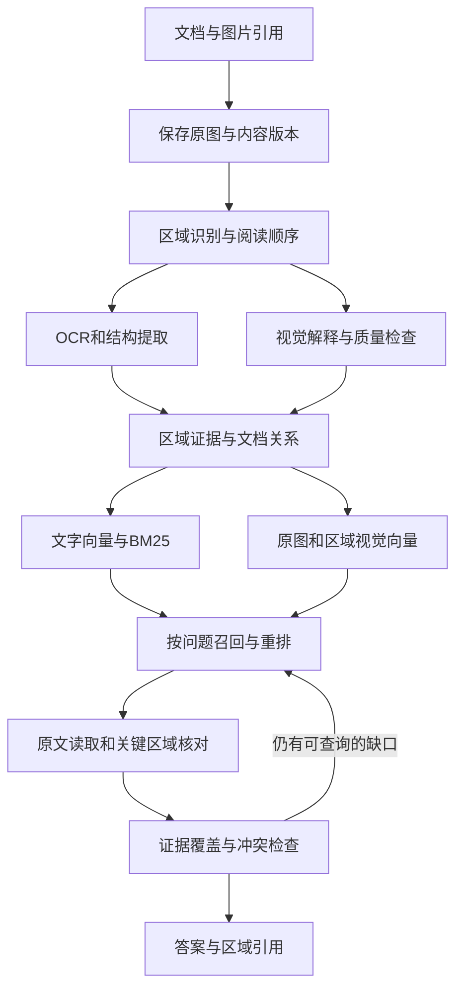

# V1.2.0 检索、图片与回答质量扩展研究

研究日期：2026-09-19。状态：技术研究与需求建议。

本次检查了工作目录中的入库、分块、混合检索、图片核对和新增 Agent 模块，并对本机默认数据目录进行了只读统计。文中的场景推演明确标记为假设；没有运行新的视觉模型评测，没有向外部模型发送私人文档。代码处于持续开发状态，文件中的能力与实际聊天入口的接通状态分别记录。

关联文档：[V1.2.0 PRD](C:/Users/22331/Desktop/everything-rag/docs/PRD/v1.2.0-PRD.md)、[检索相关性 PRD](C:/Users/22331/Desktop/everything-rag/docs/PRD/RAG-relevance-PRD.md)。本文提供扩展建议，尚未修改这两份 PRD 的验收范围。

## 1. 当前代码已经具备的能力

| 环节 | 已确认能力 | 当前边界与扩展位置 |
|---|---|---|
| Markdown 解析 | 使用 markdown-it-py，识别标题、正文、表格、代码和图片引用 | 可以继续保留原始结构，增加图片在章节中的准确位置与前后说明关系 |
| 分块 | 依据标题组织内容，区分表格、代码和图片，处理短内容与长内容 | 已经有结构意识；新需求应集中在证据关系、行列身份和原文定位 |
| 文本检索 | dense、BM25、RRF、查询规范化、标题与章节补充 | 当前规则会影响最终入选；相关性 PRD 已经规划模型重排与 `EvidenceView` |
| 图片入库 | 下载、预处理、描述缓存、原图缓存、图片引用与章节信息 | 图片主要通过识别后的文字参与检索 |
| 图片表示 | `index_text` 用于向量；`evidence_text` 保留详细内容 | 摘要适合查找主题；尚无独立视觉向量和可引用的区域对象 |
| 图片关键词查找 | BM25 使用完整图片事实文字，包含标题与章节 | 摘要没有包含的数字仍可能通过 BM25 找到；识别时遗漏的内容无法通过这条路径恢复 |
| 问题相关核图 | 使用用户问题重新读取原图 | 原 `ChatService` 依赖关键词触发，最多核对两张不同图片，输入仍为整图 |
| Agent 图片工具 | 新增 `verify_image(image_id, question)`，使用当前工作区范围定位图片 | 参数尚无区域坐标，返回主要为核对文字；工具存在不代表全部聊天入口已经接通 |
| 答案检查 | 新增引用检查、数字单位检查及可选 `ModelVerifier` 接口 | 程序检查能发现部分问题，行列归属和完整语义仍需要明确验收 |

代码依据：[markdown_parser.py](C:/Users/22331/Desktop/everything-rag/backend/app/ingestion/markdown_parser.py)、[chunker.py](C:/Users/22331/Desktop/everything-rag/backend/app/ingestion/chunker.py)、[hybrid_retriever.py](C:/Users/22331/Desktop/everything-rag/backend/app/retrieval/hybrid_retriever.py:975)、[image_document.py](C:/Users/22331/Desktop/everything-rag/backend/app/ingestion/image_document.py:33)、[chat_service.py](C:/Users/22331/Desktop/everything-rag/backend/app/generation/chat_service.py:123)、[tools.py](C:/Users/22331/Desktop/everything-rag/backend/app/agent/tools.py:403)、[verification.py](C:/Users/22331/Desktop/everything-rag/backend/app/agent/verification.py:1003)。

研究时 `main.py` 注册的入口包括 chat、knowledge、conversation、memory 等，尚未看到 runs、approvals 路由注册。因此，本文将新增 Agent 文件视为开发中的模块，完整用户流程需要单独验收。依据：[main.py](C:/Users/22331/Desktop/everything-rag/backend/app/main.py:98)。

## 2. 本地数据检查发现了什么

### 2.1 图片缓存

| 只读统计项 | 数量 |
|---|---:|
| 缓存中的不同图片描述 | 1,631 |
| 缓存中的原图 | 68 |
| 同时具有缓存原图的描述 | 68 |
| 包含“检索摘要”和“原始证据”两个新格式标记的描述 | 66 |
| 描述字符长度中位数 | 1,000 |
| 描述最大字符长度 | 2,808 |
| 图片任务 done / failed | 1,692 / 12 |

统计覆盖默认数据目录的历史缓存。描述格式计数仅检查标记，不评判识别准确性。没有原图缓存也不能证明来源图片不可获取。1,000 字的中位数值得检查历史描述完整性，但这个数值本身不能证明每份描述均被截断。

当前文档识图入口允许最多 12,000 字符、6,000 输出 token；问题核图允许最多 4,000 字符、2,000 输出 token，并在截断时添加说明。不能把历史缓存的长度直接当作当前模型的输出限制。依据：[vision.py](C:/Users/22331/Desktop/everything-rag/backend/app/generation/vision.py:138)。

### 2.2 各个 collection 的图片记录

以下编号按照数据库 collection ID 排序，仅用于匿名统计，未根据运行配置选择当前 collection。同一内容可能出现在多个 collection，不能把记录相加当作独立文档总数。

| collection 编号 | 总记录 | 图片记录 | 不同图片 hash | 其中具有原图缓存 | 图片表示版本 |
|---|---:|---:|---:|---:|---|
| 1 | 4,719 | 1,692 | 1,631 | 68 | 全部为 1 |
| 2 | 4,269 | 1,620 | 1,559 | 2 | 未记录 |
| 3 | 3,198 | 1,624 | 1,564 | 2 | 未记录 |
| 4 | 4,616 | 635 | 618 | 1 | 未记录 |

四个 collection 均为 4,096 维。这里最值得处理的是**表示版本与识别版本的区别**：`build_image_document()` 可以使用旧描述生成新表示，`process_image_task()` 随后写入 `image_representation_version=1`。所以，1,692 条新版表示记录与 66 份新格式描述可以同时存在。

需要分别记录 `extraction_version`、`representation_version`、`embedding_fingerprint`。管理页面也应分别显示“重新识别图片”“重新生成检索表示”“重新生成向量”的状态，不能用一个“索引已更新”状态覆盖全部过程。

### 2.3 图片尺寸

只读取 68 张缓存原图的尺寸与文件长度，没有进行视觉内容检查。合计 12,971,936 字节；其中两张长宽比达到 4。按照当前文档识图的 2,560 最长边与 400 万像素限制，68 张图片均无需缩小。

假设输入为 1,200 × 12,000 的长图，现有预处理会将其变为约 256 × 2,560，原先 20 像素高的文字只剩约 4.27 像素。这个几何计算说明长图需要区域读取；它不代表本次缓存样本发生了这种问题，也没有给出 OCR 错误率。

复现脚本位于被 Git 忽略的本地分析目录：[缓存统计](C:/Users/22331/Desktop/everything-rag/.tmp_probe/image_quality_inventory.py)、[collection 与尺寸统计](C:/Users/22331/Desktop/everything-rag/.tmp_probe/v120_quality_profile.py)。两个 SQLite 连接均采用只读方式。

## 3. 六个问题经过系统时会发生什么

这些案例用于依据代码推演流程。端到端行为与实际资料的识别准确性需要通过真实评测确认。

### 3.1 “风控服务为什么关注 P99，某个优化为什么能够改善它？”

当前系统能够通过术语、标题和正文找到定义及方案说明。图片中的指标名称与识别文字也能参加检索。问题没有包含当前核图正则中的“图表、数据、数值”等词语时，原聊天路径不会仅因为回答依赖曲线图就自动核图。

需要的证据可能包括：P99 的定义、服务目标、优化前后测试条件、指标变化，以及解释原因的正文。只找到一张变化曲线不能证明因果关系。

建议流程：建立上述五项证据需求，分别寻找资料；读取图中的系列、时间与单位；寻找正文中明确说明原因的部分。最终区分“文档给出的原因”“图中直接可见的变化”“基于材料作出的推断”。

验收：P99、P99.9、P95 不混用；测试条件不同的数值不能直接构成优化结论；没有原因说明时明确保留缺口。

### 3.2 “这份月度表格中，第二个业务在三月份的成功率是多少？”

当前图片描述 prompt 已经要求保留行名、列名、时间和单位。但模型返回的是文字，程序没有独立的单元格身份。即使“业务名称”“三月”“98%”都出现在描述中，也不能证明这三个内容属于同一个单元格。

建议流程：识别表格区域、表头层级、行名与脚注；建立单元格对象；根据问题选择目标区域进行原图核对。将答案对应到 `table_id + row_key + column_key + region_id`。

验收：交换两个业务的数值后，系统必须检测到归属不一致；空白、零值、未统计、不可读分别表达。

### 3.3 “登录流程中，短信校验失败以后进入哪个分支？”

当前描述可以记录节点和箭头，但它仍然是一次整图识别的文字结果。某个箭头方向或条件漏读后，文字向量无法补充这部分信息。

建议流程：查找登录流程图，读取失败节点周围区域，并保留整图中的连接关系。将箭头记录为 `from_node / to_node / condition`，对涉及答案的路径逐条核对。

验收：图中不可辨认的箭头不能根据常见登录流程补写；图和文字说明相互冲突时列出两处依据。

### 3.4 “找一下那个右侧有两个缓存层的架构图，我忘记标题了。”

当前 dense 和 BM25 依赖图片描述。如果描述没有保留“两层缓存”和空间关系，图片可能无法成为候选。

建议流程：用户问题同时进入图片文字检索和视觉检索；原图或区域的视觉向量直接参与候选生成；视觉重排检查图中的结构。命中后恢复所属文档、章节和前后说明。

验收：评测集包含描述文字遗漏空间关系、原图仍清楚呈现关系的真实案例，并检查新增视觉通道是否带来独立召回。

### 3.5 “这个方案后来改成什么了？”

当前 `process_image_task()` 命中 `src` 缓存时直接复用描述，没有在这条路径重新下载图片核验内容。核图时也会优先使用已经缓存的原图。如果同一 URL 的内容改变，单靠 URL 不能决定资料版本。

建议流程：图片内容版本、文档修订版本和方案状态分别保存；同步任务检查来源是否变化；回答同时核对当前有效版本与被替代版本。

验收：在受控真实来源中替换图片内容并重新同步，新查询能读取新版本，历史答案仍可追溯当时使用的图片。

代码依据：[pipeline.py](C:/Users/22331/Desktop/everything-rag/backend/app/ingestion/pipeline.py:507)、[image_state_store.py](C:/Users/22331/Desktop/everything-rag/backend/app/ingestion/image_state_store.py)、[image_reader.py](C:/Users/22331/Desktop/everything-rag/backend/app/generation/image_reader.py)。

### 3.6 “结合两份方案和三张实验图，判断哪种方案适合当前服务。”

当前检索能够返回多个来源，原聊天入口最多重新核对两张图片。第三张必要图片可能只保留历史识别文字。新增 Agent 的工具可以成为按需读取更多证据的入口。

建议流程：问题分解为目标、约束、方案机制、实验条件、结果、适用性六类需求；每类保存独立证据与缺口。研究过程中读取所有会影响结论的图片，保留互补证据，检查相反证据，计算可直接比较的数据。

验收：三张图分别支持不同必要条件时，系统能够读取三张图；重复搜索没有新证据时说明尚未解决的问题；能够提供部分有依据的回答。

## 4. 网上方案中可以采用的技术

### 4.1 文档结构识别

PaddleOCR 的 PP-StructureV3 提供布局、表格、公式、图表处理与阅读顺序恢复，可输出结构化结果和 Markdown，也支持服务化接入。它适合承担“图中有哪些区域、区域是什么类型、文字怎样排列”的工作。[官方介绍](https://www.paddleocr.ai/main/en/version3.x/algorithm/PP-StructureV3/PP-StructureV3.html)

项目建议：通过 `DocumentImageParser` 适配器接入结构识别，输出区域、文字与表格结构；视觉模型负责解释流程关系、核对目标区域和处理提问。OCR 输出与视觉解释分别保留。两者一致可以提高可用性，仍需检查关键字段。这里没有运行本项目语料的 OCR 对比，因此不能声明某个模型已经取得最高准确率。

### 4.2 原图参与检索

Qwen3-VL-Embedding 支持文字、图片及混合输入；开源 2B 与 8B 模型默认输出分别为 2,048 与 4,096 维。ColPali 采用多向量表示与 late interaction，适合研究页面中局部视觉信息的匹配。[Qwen 模型说明](https://huggingface.co/Qwen/Qwen3-VL-Embedding-2B/raw/main/README.md)、[ColPali 论文摘要](https://arxiv.org/abs/2407.01449)

项目建议采用**现有文字通道加独立视觉通道**。建议接入候选为云端 `qwen3-vl-embedding`，使用原图、区域和相应章节说明生成检索表示。视觉通道的实际增益必须由本项目评测确定。ColPali 作为多向量检索的研究参照，涉及的表示和评分协议应独立管理。

### 4.3 可直接接入的云端接口

阿里云文档列出了 `qwen3-vl-embedding`：默认 2,560 维，支持图片 Base64 Data URI，`enable_fusion=true` 可生成图文融合向量。云端名称、维度与开源模型的配置应分别记录。[Multimodal embedding API](https://www.alibabacloud.com/help/en/model-studio/multimodal-embedding-api-reference)

`qwen3-vl-rerank` 支持文字和图片候选，图片可使用 Base64。文档中的请求、响应结构与 `qwen3-rerank` 有区别，并说明分数属于当前请求的相对相关性，不能跨请求直接比较。[Rerank API](https://help.aliyun.com/en/model-studio/text-rerank-api)

具体接入设计：

- 新增视觉 embedding 配置，与文字 embedding 配置分别保存。
- 视觉查询与图片使用同一个模型、版本、维度和指令配置。维度相同也不代表两个模型的向量可以混用。
- 新建工作区内的视觉 collection，保留当前文字 collection。
- 每份证据使用稳定 ID 关联文字、原图、区域、来源与版本。
- 私人图片通过受控 Provider 请求发送，使用已有权限与人名处理流程；无需把图片发布成公开 URL。
- 配置连接测试同时检查返回维度、图片输入、结果数量、结果 ID 与错误响应。
- 官方 embedding 页面关于单次图片数量存在不同表述，适配器采用每个待索引区域独立请求的确定行为，并用真实连接测试验证所用服务配置。
- 本次只核查公开接口文档，没有使用用户凭据验证账号权限和服务响应。

### 4.4 检索之后继续使用视觉证据

VisRAG 研究将文档图像用于检索及视觉问答；M3DocRAG 进一步研究跨页面、跨文档的多模态证据组合。这些研究支持在回答阶段保留图像证据和跨图关系，公开评测中的收益不能直接作为本项目收益。[VisRAG 论文摘要](https://arxiv.org/abs/2410.10594)、[M3DocRAG 论文摘要](https://arxiv.org/abs/2411.04952)

项目建议：根据已验证的 Provider 能力，将关键原图和区域提供给回答模型，或由视觉工具返回带来源定位的结构化证据。原图仍然保留在证据集合中，文字提取结果附带提取来源和局限。

### 4.5 为分块补充真实背景

Contextual Retrieval 为每个分块增加与其相关的文档背景，并让背景参与 embedding 和 BM25。它能帮助处理分块中主体、时间和术语不明确的情况。[Anthropic 官方说明](https://www.anthropic.com/engineering/contextual-retrieval)

项目已经为文本加入文件标题和章节。扩展部分可以进一步记录文档中明确给出的服务名称、方案阶段、测试条件和术语解释。新增说明保存为独立 `retrieval_context`，引用它使用的原文范围；原始正文保持独立。生成模型在写事实时仍读取对应原文，背景生成错误不能成为新的知识事实。

## 5. 图片能力的完整设计

### 5.1 数据对象

| 对象 | 主要字段 | 用途 |
|---|---|---|
| `ImageAsset` | `workspace_id`, `asset_id`, `raw_sha256`, `width`, `height`, `mime_type`, `original_ref` | 保存不可变原图身份 |
| `ImageOccurrence` | `occurrence_id`, `asset_id`, `doc_id`, `document_revision`, `heading_id`, `position`, `caption_ref` | 表示图片在某份文档中的出现位置 |
| `ImageRegion` | `region_id`, `asset_id`, `region_type`, `bbox`, `coordinate_version`, `parent_region_id`, `reading_order` | 定位表格、图表、流程和文字区域 |
| `ExtractionArtifact` | `artifact_id`, `region_id`, `provider`, `model_revision`, `prompt_hash`, `preprocess_version`, `schema_version`, `content`, `quality_flags` | 保留识别过程与结果 |
| `NumericFact` | `subject`, `metric`, `value`, `unit`, `period`, `conditions`, `cell_ref`, `evidence_id` | 保证数字属于正确主体与条件 |
| `EvidenceLink` | `source_id`, `target_id`, `relation_type`, `origin`, `evidence_ref` | 连接图片、正文、表格脚注与资料版本 |
| `EvidenceView` 扩展 | `asset_id`, `region_ids`, `artifact_id`, `payload_hash`, `evidence_kind` | 让评分、核对、生成和引用使用同一份内容 |

同一张图片在两份文档中出现时，原图可以在工作区内复用，出现位置与章节语境分别保留。其他工作区不能通过 hash 查询得到这张图片。

`bbox` 采用经过 EXIF 方向处理后的统一坐标，保存对应像素尺寸及变换信息。前端高亮、区域裁剪、OCR 坐标必须使用相同坐标版本。超出图片范围或无效坐标立即返回错误。

### 5.2 入库流程

整图保留整体结构，区域保留清楚可读的局部内容。长表格区域应保留表头、单位和必要脚注；横跨多个区域的流程箭头应保留父区域或连接信息。裁剪结果不能失去解释其含义所需的上下文。

区域读取按内容结构决定。对超出服务输入限制的区域继续划分，并保留父子关系。通过未覆盖区域、OCR 空白、字段缺失和实际裁剪范围判断是否需要继续识别，不能只依赖模型自报“已完整识别”。

### 5.3 不同图片采用不同证据结构

| 类型 | 必须保留 | 回答限制 |
|---|---|---|
| 表格 | 表头层级、行名、列名、单元格、单位、脚注、合并单元格关系 | 无法确定行列归属的数值不能作为明确事实 |
| 趋势图 | 横轴、纵轴、系列、图例、单位、时间范围、明确标注的点值 | 没有明确读数依据时只描述可见趋势 |
| 流程图 | 节点、方向、条件、分支、跨区域连接 | 箭头不可读时保留未确认状态 |
| 架构图 | 组件、分组、连接、方向、图例及正文说明 | 图形布局不能自动证明调用顺序或业务因果 |
| 文档截图 | 标题、阅读顺序、正文、代码与表格范围 | 截图没有显示的后续内容不可补写 |

识别文字可以进入检索；只有经过相应核对并满足答案所需条件的内容，才能作为确定结论的依据。模型给出的解释、OCR 文字和原图定位分别保存。

### 5.4 缓存与资料更新

当前 hash 基于经过预处理的 JPEG。新设计使用原始文件字节的 `raw_sha256` 标识来源内容，另存规范化图片与区域表示的 hash。这样可以分别判断原文件变化和预处理配置变化。

提取缓存键由原图 hash、区域、模型版本、prompt、预处理版本和输出 schema 共同决定。文字表示和 embedding 使用各自的版本字段。

来源检查结合文档变更、来源更新时间、ETag、Last-Modified 与定期内容 hash 核验。服务未提供可靠更新信息时，需要实际获取内容后判断。某个阶段更新只使其后续产物失效，不删除历史引用所需的原始证据。

新产物全部校验通过后更新当前有效 revision。处理失败时明确显示任务失败和当前资料状态；不能把旧识别结果标记为新版本识别成功。一次研究使用固定的资料 revision，跨版本研究显式记录多个版本。

### 5.5 召回与重排

1. 每个子问题保留原始问题、主体、时间、条件和所需证据类型。
2. 并行查询文字向量、BM25、图片视觉向量；所有通道使用当前工作区范围。
3. 按资产、出现位置、区域与版本消除重复，保留各通道排名。
4. 利用排名融合生成候选集合；不同 embedding 分数不直接相加。
5. 文字候选使用已规划的文字重排；涉及视觉证据时，混合候选进入多模态重排。
6. 检查候选是否支持至少一个必要子问题。覆盖缺口、冲突和原文关系可以触发新的查询。

视觉候选不能被一个只看旧图片描述的前置筛选全部排除，否则视觉通道补充召回的价值会消失。图片区域与它所属文档的背景分别参与判断，最终生成读取对应原图与正文。

跨请求重排分数不直接比较。需要多批请求时保留批内排名，按子问题组织候选，并在容量允许的共同请求中比较最终候选。重排结果决定候选阅读顺序；证据是否足够回答，需要独立检查。模型返回 0.9 不等于答案有 90% 正确率。

相关性 PRD 已经要求固定候选构造、独立校准，并检查加入干扰项后的分数决定是否稳定。视觉通道接入后，候选类型与评分协议都发生变化，需要建立独立的多模态校准档案；不能直接复用文字重排阈值。

### 5.6 按问题读取与核对

建议扩展工具：

| 工具 | 输入 | 输出 |
|---|---|---|
| `inspect_image` | `image_id`, `question`, `region_ids` 或合法 `bbox` | 区域事实、原图定位、可读性、未确认字段 |
| `read_table` | `table_id`, `rows`, `columns` | 表头、目标单元格、单位、脚注及来源 |
| `follow_evidence` | `evidence_id`, `relation_type` | 对应正文、相邻区域、被引用文档或版本关系 |
| `calculate_facts` | 已核对事实 ID、运算类型 | 计算值、单位、公式、输入事实及条件检查 |

工具结果存入同一证据库。回答模型通过 Provider 已验证的图片能力直接读取关键区域，或使用视觉工具输出。任何路径都保存模型实际读取的图片版本和区域。

核图触发依据包括：答案依赖图片、关键数值未确认、结构关系未确认、识别产物不完整、多个来源冲突。用户没有写出“图片”也能够触发。

并发数量可以配置；整个问题需要读取多少图片由证据需求决定。研究结束条件包括必要证据已满足、现有可用来源已充分查询且缺口无法补充、等待用户澄清、用户停止、服务错误。每轮记录新增证据与已消除的缺口，重复执行同一操作没有新结果时调整研究动作。

### 5.7 引用和用户界面

答案引用能够打开原文准确位置或原图对应区域。图片引用显示所属文档、章节、资料版本和核对状态；计算结果展示公式与输入来源。

过程状态可以显示“正在读取表头”“正在核对 P99 的单位”“发现两份方案使用不同测试条件”。这些文字来自实际工具事件和证据状态，避免用模型生成的连续思考文字替代执行记录。

知识库管理增加原图可用性、区域识别、证据完整性、索引版本、待更新任务等状态。用户可以针对具体区域纠正识别结果；修订保存独立版本，更新关联检索表示，并加入质量评测。

## 6. 其他值得纳入 V1.2.0 的质量能力

### 6.1 工作区术语与指代解析

为内部服务名称、缩写、旧称和项目特有术语保存 `term / aliases / definition / evidence_refs / scope`。定义从文档明确内容中提取，可由用户确认；同名术语保留各自适用范围。

“那个登录方案”“当时优化的指标”可以结合会话历史定位到候选对象。查询改写保留原问题，并记录引入术语的来源。多个对象都符合时，请求用户选择；记忆中曾经出现过的内容只帮助寻找资料，事实仍须读取知识库。

收益场景：减少内部术语被当作通用问题处理，也让模糊回忆能够恢复到具体文档。

### 6.2 可继续阅读的文档关系

保留 `section_of`、`caption_of`、`references`、`explains`、`supersedes` 等有来源依据的关系。原始链接、章节结构和图注关系可以确定记录；模型推断的关系带有独立状态，需要核验。

Agent 找到一张图后，可以继续读取解释这张图的正文；找到“详细过程见另一份方案”后，可以读取被引用文档。通过 SQLite 关系表与现有文档读取工具即可表达这些关系。

收益场景：原因说明、限制条件、实验方法往往不在最容易被召回的那一块内容中。

### 6.3 资料阶段、时间和适用范围

增加 `draft / proposed / adopted / deprecated / unknown`、生效时间、被替代版本、适用服务与环境。来源没有声明状态时记录 `unknown`，不能单凭更新时间推断方案已经采用。

用户问“我们现在怎样处理”，系统核查当前有效资料；用户问“当时为什么这样设计”，系统读取相应历史版本。两份材料内容不同，先检查适用条件是否不同，再判定是否存在事实冲突。

收益场景：减少将设计讨论、废弃方案、不同环境配置组合成一个确定答案。

### 6.4 数值事实与确定性计算

把指标数值和主体、单位、时间、分母、实验条件一起传递。百分比与百分点分别处理；多份材料的统计口径不同则不能直接运算。

对于已核对的数据，使用 Decimal 等明确的计算逻辑执行差值、比例和单位换算，保留公式。用户问 P99 时，已有汇总 P99 数值不能用于随意计算新的整体 P99。

收益场景：回答“改善了多少”“哪种方案更稳定”时，减少数字虽然出现过、实际归属或运算却不成立的问题。

### 6.5 子问题覆盖表与相反证据查询

每个必要子问题保存 `required_evidence / found_evidence / conflicts / gaps / status`。某个结论已经形成时，进一步查询明确的限制、例外、失败条件和后续修订。

相反证据查询围绕明确结论进行。例如“缓存方案降低了延迟”需要检查一致性要求、更新频率、失效条件和异常流量场景。普通定义问题无需自动扩展成完整方案研究。

收益场景：检索结果不会只集中在容易找到的主题，也能够说明方案的适用条件。

### 6.6 澄清问题根据答案影响触发

主体不明确、比较条件不同、用户要求与资料范围不一致，且不同选择会改变结论时，发起澄清。能够从工作区、当前会话和原文确定的内容直接读取。

对暂时无法澄清的部分，输出已有依据的回答并明确适用条件。澄清状态保存到研究流程，可在用户回答后继续已有任务。

### 6.7 纠正结果进入质量评测

用户反馈可以具体到“文档不相关”“引用没有支持这句话”“这个单元格识别错误”“使用了旧版方案”“没有回答某个条件”。保留问题、使用过的证据版本、实际工具记录和修订内容。

修订用于更新确定的识别事实、查询策略样例与评测案例。单次反馈不应无条件变成所有问题共同使用的事实；跨用户、跨工作区复用需要独立授权与范围控制。

### 6.8 入库完成度与回答范围检查

导入完成后显示文档、图片引用、成功识别、失败识别、原图不可用和索引待更新数量。回答涉及的资料如果仍有未处理图片，证据状态应反映这个缺口。

用户询问“知识库有哪些内容”时使用文档目录和处理状态；询问具体内容时使用正文与图片证据。两类请求都能够说明当前已纳入回答范围的资料版本。

## 7. 与现有 PRD 的衔接

| 既有设计 | 本文补充要求 |
|---|---|
| 路由与子问题规划 | 增加术语依据、指代来源和所需证据类型；复用既有流程 |
| 工作区记忆快照 | 记忆帮助选择查询对象，知识证据单独读取；不让记忆中的旧回答替代原文 |
| dense、BM25、RRF 与重排 | 增加独立视觉候选和多模态评分，保留现有相关性评测 |
| `EvidenceView` 的文本一致性 | 扩展为文字、图片区域、提取产物与版本的一致性 |
| 最终来源最多 8 个 | 建议明确为单次检索返回上限；复杂研究的完整证据集合另行保存并按结论组织引用 |
| 最多核对两张图片、更新后重排一次 | 建议改为单批并发策略；研究流程可按新的证据缺口发起后续核图 |
| 答案核对 | 增加行列归属、数值条件、区域引用、方案状态和冲突判断 |
| 中间过程展示 | 复用工具事件，显示正在核对的证据对象与尚未解决的问题 |

“来源最多 8 个”和“两张图片”的修改会改变相关性 PRD 的产品范围，需要在正式采用本研究时同步需求、接口和验收；当前文档没有直接修改这些要求。

建议新增模块职责：`DocumentImageParser` 管理区域结构，`VisualEmbeddingProvider` 管理视觉向量，`MultimodalReranker` 管理图文排序，`EvidenceRepository` 保存事实与原始定位。现有入库 pipeline、工作区检索与 Agent tools 调用这些接口。Provider 错误、维度不一致、版本缺失、无效证据引用均返回明确错误。

## 8. 如何验证质量确有提高

### 8.1 真实数据集

建议从当前有效工作区选择至少 50 张图片及其所属文档，建立 120 个真实问题。包含普通图片主题、表格精确读数、图中关系、图文组合、跨图比较、版本冲突和无法回答案例。样本不足的类别使用具备明确来源的真实公开材料补充，并单独统计域外结果。

每题记录：问题、工作区、资料版本、允许的等价答案、必要证据集合、原文范围、原图区域、不能推断的内容。数值题记录主体、单位、时间和条件。标注由人工核对，模型可以辅助整理，不能自动充当唯一标准。

开发集与保留测试集按文档及同图家族划分。相同图片、同一方案改写版本不能分别进入两组造成信息泄漏。问题来自真实资料；场景推演和几何计算不充当模型准确率测试结果。

### 8.2 分层指标

| 层级 | 指标 | 需要揭示的问题 |
|---|---|---|
| 识别 | 字符错误、表格行列归属、目标单元格准确率、箭头与条件准确率 | 图片内容是否被正确读取 |
| 候选召回 | Recall@K、必要证据集合覆盖率、视觉通道新增命中 | 正确证据是否进入候选 |
| 重排 | nDCG、无关证据比例、重排后必要证据保留率 | 筛选有没有删除重要资料 |
| 生成 | 事实正确率、必要子问题完成率、数值完整匹配 | 找到的证据是否被正确使用 |
| 引用 | 结论支持率、区域定位正确率、引用覆盖率 | 引用内容是否支持对应结论 |
| 无答案 | 不当确定回答率、正确说明缺口比例 | 资料不足时是否仍编写确定结论 |
| 过程 | 新增证据、重复工具调用、人工纠正次数、耗时 | 循环是否持续取得信息 |

OmniDocBench 将文档解析按多类内容和属性分别评估，说明识别评测需要区分文字、结构与阅读关系。本文的数值归属和答案引用指标是针对本项目提出的验收设计。[论文摘要](https://arxiv.org/abs/2412.07626)

### 8.3 对照实验

在同一份资料快照、相同问题和相同回答模型上比较：

| 实验 | 配置 | 观察目标 |
|---|---|---|
| A | 当前图片描述与混合检索 | 建立本次真实基准 |
| B | A 加完整原图缓存与提取版本管理 | 检查来源可用性与更新正确性 |
| C | B 加区域识别和结构化提取 | 测量表格、长图与流程读取改善 |
| D | B 加视觉向量候选 | 单独测量视觉通道补充召回 |
| E | C 加视觉向量与多模态重排 | 检查组合效果和筛选损失 |
| F | E 加图文关系、按需核图和数值核验 | 测量最终答案及引用质量 |

另设诊断条件：给回答模块提供人工核准的正确证据集合，再运行同样问题。若仍回答错误，继续改进阅读与生成；若能够回答，重点检查召回、识别和筛选。这是用于分离原因的真实证据对照，不计入正常系统成绩。

每个配置保存模型、prompt、索引和提取版本；分别报告各类别变化与配对差异。生成存在波动时用重复运行报告结果范围。已有相关性 PRD 中的 72 正例、10 负例及其历史指标可以作为补充回归集，本研究没有重新运行这些指标。

### 8.4 建议验收条件

- 固定测试集中，跨工作区读取、引用与实际版本不一致、无效区域引用均为零。
- 已知表格关键数值题必须包含正确的主体、行列、单位和时间；读不清时返回未确认。
- 引用支持率与必要证据集合覆盖率同时提高，不能通过减少回答内容制造单项指标提高。
- 纯文字旧评测的必要证据保留率不得降低；图片相关问题按类别报告改善情况。
- 资料更新测试覆盖相同 URL 内容变化、识别模型变化、prompt 变化和人工纠正。
- 使用真实 Provider 完成图片向量、图文重排、原图核对的连接与端到端验收，记录服务实际限制。

## 9. 建议纳入版本的需求顺序

这里的顺序表示依赖关系和评审优先级，各项均包含完整的错误处理、版本管理、用户状态及验收。

| 优先级 | 需求 | 依赖与完成标准 |
|---|---|---|
| P0 | 图片来源、识别与索引版本分开管理 | 原图可追溯；更新后引用和缓存一致 |
| P0 | 区域识别、结构化提取与区域引用 | 表格和关系题能够定位原图依据 |
| P0 | 证据覆盖、数值归属及缺口检查 | 回答对应完整证据条件，资料不足可表达 |
| P0 | 真实图片和图文问题评测集 | 能区分召回、识别、筛选与生成问题 |
| P1 | 视觉向量与多模态重排 | 为文字描述遗漏的图片信息提供有效召回 |
| P1 | 术语、指代与文档关系读取 | 模糊回忆与跨文档问题能持续查证 |
| P1 | 方案状态和时间范围 | 当前方案与历史方案分别使用 |
| P1 | 图片识别纠正与问题回放 | 修订能够更新索引并加入回归验证 |

本次已经完成代码阅读、只读数据统计、图片尺寸计算和官方资料核查。模型选择的最终准确率、区域识别效果、云端账号可用性以及完整 Agent 流程仍属于上述真实验收项目，本文未给出尚未执行的测试成绩。
